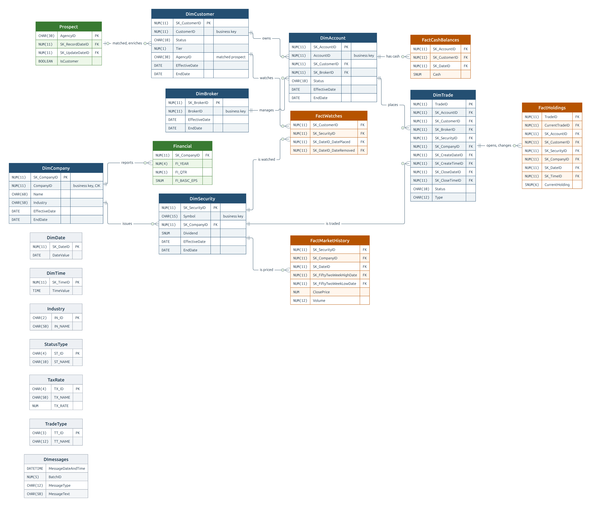

# Data and AI Platform for TPC-DI Financial Data

**Contents**

[Overview](#overview) | [Repository Structure](#repository-structure) | [Business Domain and Data](#business-domain-and-data) | [Layer 1: Data Platform](#layer-1-data-platform) | [Layer 2: Machine Learning Platform](#layer-2-machine-learning-platform) | [Layer 3: Agent Platform](#layer-3-agent-platform) | [Infrastructure and Operations](#infrastructure-and-operations) | [Getting Started](#getting-started)

## Overview

This project is a data and AI system for a retail brokerage, based on the TPC-DI domain. It generates related financial records, processes them through batch and streaming pipelines, and uses the resulting data for analytics, machine learning, and agent applications.

- **Layer 1 (Data Platform)**: Turns raw batch files and streaming cash events into validated lakehouse and warehouse tables, using SeaweedFS, Hive Metastore, Trino, PostgreSQL (proposed), Spark, dbt, Kafka, Flink, Airflow, Soda, and DataHub.
- **Layer 2 (Machine Learning Platform)**: Forecasts future net account cash movement and applies a tier-based minimum-cash policy, using Feast, Kubeflow Pipelines, MLflow, and KServe, plus document chunking and embedding retrieval.
- **Layer 3 (Agent Platform)**: Connects language models to project data, retrieved documents, and model predictions through gateways, MCP tools, and agent coordination.

## Repository Structure

```text
coursework/
├── generator/        # Source-data generator, tests, reference fixtures
├── pipelines/        # Data-processing jobs
├── dbt/              # dbt configuration and warehouse transformations
├── orchestration/    # Airflow configuration and DAGs
├── governance/       # DataHub ingestion and metadata configuration
├── infra/            # Docker Compose files, container builds, service configuration
├── tests/            # Pipeline tests
├── docs/             # Data specification, design, infrastructure, status, research
└── misc/             # Tools, temporary work, archives, reference data
```

The [documentation guide](docs/Documentation-Guide.md) maps each document to its purpose.

## Business Domain and Data

The project uses the TPC-DI retail brokerage as its business domain and raw source data. The [data specification](docs/Data-Specification.md) holds the full detail.

### Business Domains & Origin Systems

| Business Domain | Origin System | Business Context |
| --- | --- | --- |
| **Customers & Accounts** | CMS (history) & OLTP (daily) | Customer profiles, demographics, and brokerage accounts managed by brokers. |
| **Brokers** | Internal HR DB | Employee records. Brokers are specifically employees with job code `314`. |
| **Trading & Holdings** | OLTP Trading DB | Trade lifecycles (submission to completion or cancellation) and resulting security holdings. |
| **Cash** | OLTP Trading DB | Money moving into and out of accounts, such as deposits, withdrawals, and cash from trades. |
| **Market** | OLTP Trading DB | Daily price and volume observations for each security. |
| **Watch Lists** | OLTP Trading DB | Securities that customers watch, added and removed over time. |
| **Prospects** | External Marketing Provider | Potential customers with demographic data (some overlap with existing customers). |
| **Companies & Securities** | Financial Newswire (FINWIRE) | Companies, the securities they issue, and quarterly financial reports. |
| **Reference Data** | Static Reference Files | Calendar, time of day, industries, statuses, tax rates, and trade types. |

### Physical Source Files & Ingestion Rules

The project ingests all 18 TPC-DI business and reference source files, plus `BatchDate.txt`. Metadata used only for formal benchmark audit validation is excluded.

**Change Data Capture (CDC) Rules**: Daily OLTP files are CDC extracts. Each row starts with a `CDC_FLAG` (`I` for insert, `U` for update) and a `CDC_DSN` (sequence number). Insert-only files always carry `I`; historical files omit both fields.

| Origin | Source File(s) | Format | Grain | Batch 1 | Batch 2+ | CDC Rules |
| --- | --- | --- | --- | :---: | :---: | --- |
| CMS | `CustomerMgmt.xml` | XML | One action on a customer and its accounts | Yes | No | N/A (Action-ordered) |
| OLTP | `Customer.txt` | Pipe-delimited | One changed customer | No | Yes | `I`, `U` |
| OLTP | `Account.txt` | Pipe-delimited | One changed account | No | Yes | `I`, `U` |
| OLTP Trading DB | `Trade.txt` | Pipe-delimited | One trade (state or change) | Yes | Yes | `I`, `U` |
| OLTP Trading DB | `TradeHistory.txt` | Pipe-delimited | One trade status change | Yes | No | N/A (Historical only) |
| OLTP Trading DB | `CashTransaction.txt` | Pipe-delimited | One cash movement | Yes | Yes | `I` only |
| OLTP Trading DB | `HoldingHistory.txt` | Pipe-delimited | One holding change per trade | Yes | Yes | `I` only |
| OLTP Trading DB | `WatchHistory.txt` | Pipe-delimited | One watch placement or cancellation | Yes | Yes | `I` only |
| OLTP Trading DB | `DailyMarket.txt` | Pipe-delimited | One security per day | Yes | Yes | `I` only |
| Internal HR DB | `HR.csv` | Comma-delimited | One employee | Yes | No | N/A (Full extract) |
| External Marketing | `Prospect.csv` | Comma-delimited | One prospect | Yes | Yes | N/A (Full snapshot) |
| Financial Newswire | `FINWIREyyyyQq` | Fixed-width | One company, security, or financial report | Yes | No | N/A (One file per quarter) |
| Static Reference | `Date.txt`, `Time.txt`, `Industry.txt`, `StatusType.txt`, `TaxRate.txt`, `TradeType.txt` | Pipe-delimited | One row per code, day, or second | Yes | No | N/A (Static) |
| Load Metadata | `BatchDate.txt` | Text | The batch extraction date | Yes | Yes | N/A |

### Load Cycle & Processing Strategy

TPC-DI defines one historical load followed by two daily batches. This project keeps the pattern and extends the daily batches to support ML feature engineering:

| Batch | Starting State | Data Volume & Duration | Work |
| --- | --- | --- | --- |
| **Batch 1 (Historical)** | Empty warehouse | All history before the first daily batch (length open). | Load reference data and full extracts, build SCD2 history, and calculate opening cash balances and holdings. |
| **Batch 2+ (Daily)** | Previous batch complete | One day per batch, up to one year. | Apply the day's CDC changes (`I`, `U`), new activity, and full `Prospect.csv` snapshot. |

Each day is its own batch with a unique `BatchID` and `BatchDate.txt`. SCD2 versions, cash balances, and prospect updates are dated by batch. Batch 1 requires at least one year of prices and four quarters of earnings to calculate 52-week highs and lows and P/E ratios. Daily batches contain no HR, FINWIRE, or reference files; therefore, brokers, companies, and securities do not change after Batch 1.

*Note: While batch sources follow this pattern, this project processes subsequent `CashTransaction` records as a continuous Kafka and Flink stream.*

## Layer 1: Data Platform

The data platform turns source data into validated tables for analytics and machine learning, with scheduled quality checks and catalog lineage.

### Data Zones and Silver Layer

| # | Zone | Purpose | Grain | Storage |
| --- | --- | --- | --- | --- |
| 1 | **Staging** | Immutable landing zone for raw batch files. The cash stream enters through Kafka instead. | One file | SeaweedFS (object storage) |
| 2 | **Bronze** | Source records and received events as delivered, including duplicates and parse failures. Preserves provenance. | One source record or one delivery | SeaweedFS (lakehouse tables) |
| 3 | **Silver** | Cleaned, typed, deduplicated, and conformed records. Ready for joins. | One validated business record | SeaweedFS (lakehouse tables) |
| 4 | **Gold** | The warehouse, cash stream outputs, and ML tables. | Per business entity or metric | PostgreSQL (proposed) |

Hive Metastore records lakehouse table schemas and file locations. Spark processes the tables, and Trino provides SQL access for inspection and queries. Table format: open.

The TPC-DI specification does not define a silver layer. The Silver layer is the project's own model, with the following traits:
- **Preserve Change Order**: Keep `CDC_FLAG`, `CDC_DSN`, `BatchID`, and batch date. SCD2 versioning depends on them.
- **Handle XML Nuance**: For `CustomerMgmt.xml`, preserve the distinction between omitted and empty elements until Gold versions are built.
- **Deduplicate Correctly**: Remove repeated deliveries of the same event, but keep legitimate repeated business changes (such as two updates to one trade).
- **Separate Temporal Data**: Keep event dates strictly separate from batch dates and system arrival dates.

### Data Lineage: Source-to-Gold Mapping

| Source Records | Transformation Logic | Gold Output |
| --- | --- | --- |
| `CustomerMgmt.xml` + `Customer.txt` | Apply XML actions, then CDC rows. Add tax rates and prospect data; keep daily SCD2 versions. | `DimCustomer` |
| `CustomerMgmt.xml` + `Account.txt` | Same pattern. Resolve customer and broker keys; add a version when the customer changes. | `DimAccount` |
| `HR.csv` | Keep employees with job code 314. | `DimBroker` |
| FINWIRE (`CMP`, `SEC`) | Parse fixed-width records in posting order; build histories; link securities to companies by CIK or name. | `DimCompany`, `DimSecurity` |
| FINWIRE (`FIN`) | Load quarterly results; find the company by CIK or name at posting time. | `Financial` |
| `Trade.txt` + `TradeHistory.txt` | Insert each trade, then update its status. Keys are set at creation and kept at close. | `DimTrade` |
| `CashTransaction.txt` | Sum each account's daily movements and add them to the previous balance. *(Subsequent movements go through Kafka and Flink.)* | `FactCashBalances` |
| `HoldingHistory.txt` + `DimTrade` | Copy `HH_AFTER_QTY`; take keys, date, time, and price from the changing trade. | `FactHoldings` |
| `DailyMarket.txt` + `DimSecurity` + `Financial` | Copy prices and volume; calculate 52-week high and low, P/E, and yield. | `FactMarketHistory` |
| `WatchHistory.txt` | Insert a watch on `ACTV`; set its removal date on `CNCL`. | `FactWatches` |
| `Prospect.csv` + `DimCustomer` | Insert or update prospects, calculate tags, and match active customers. | `Prospect` |

### Gold Warehouse

The Gold layer implements the TPC-DI warehouse model. Dimensions describe business entities; facts record activity.

**SCD2 Dimension Rules**:
- **Keys**: A natural key (`CustomerID`) identifies the entity across time. A surrogate key (`SK_CustomerID`) identifies one specific version.
- **Versioning**: On a change, the current version gets `IsCurrent = 0` and `EndDate` = the new version's `EffectiveDate`. A new row is inserted with a new `SK`, `IsCurrent = 1`, and `EndDate = 9999-12-31`.
- **Collapse**: Multiple changes to one entity on the same day collapse into a single daily version.
- **Fact Joining**: Facts store the `SK` of the dimension version valid on the event's date.
- **Propagation**: A new customer version gives the customer's accounts new versions. A new company version does the same for its securities.

| Table | Type | Contents | Grain | Built From | Batch 1 | Batch 2+ |
| --- | --- | --- | --- | --- | --- | --- |
| `DimCustomer` | SCD2 Dimension | Identity, contacts, tier, tax rates, prospect data | One customer version | `CustomerMgmt.xml`, `Customer.txt`, `Prospect.csv` | Versions from XML actions | New versions from CDC |
| `DimAccount` | SCD2 Dimension | Owner, broker, tax status, status | One account version | `CustomerMgmt.xml`, `Account.txt` | Versions from XML actions | New versions from CDC and customer changes |
| `DimBroker` | SCD2 Dimension | Name, manager, branch, office, phone | One broker | `HR.csv` | One version per broker | No change |
| `DimCompany` | SCD2 Dimension | Name, industry, credit rating, CEO, address | One company version | FINWIRE `CMP` | Versions from postings | No change |
| `DimSecurity` | SCD2 Dimension | Symbol, exchange, shares, dividend, issuing company | One security version | FINWIRE `SEC` | Versions from postings | No change |
| `DimTrade` | Mutable Dimension | Type, status, quantity, prices, fees, account, security | One trade | `Trade.txt`, `TradeHistory.txt` | One row per trade | Insert new trades; update status on close |
| `FactCashBalances` | Fact | End-of-day account cash | One account per day with transactions | `CashTransaction.txt` | Daily balances | From the cash stream |
| `FactHoldings` | Fact | Quantity held after a trade | One holding change | `HoldingHistory.txt` | One row per change | One row per change |
| `FactMarketHistory` | Fact | Prices, volume, 52-week high and low, P/E, yield | One security per day | `DailyMarket.txt` | One row per day | One row per day |
| `FactWatches` | Fact | Period a customer watches a security | One watch | `WatchHistory.txt` | Watches from actions | Insert placements; set removal dates |
| `Prospect` | Current State | Agency record, marketing tags, `IsCustomer` | One prospect | `Prospect.csv` | One row per prospect | Insert new; update changed |
| `Financial` | Current State | Quarterly results | One company per quarter | FINWIRE `FIN` | One row per report | No change |
| `DimDate`, `DimTime` | Reference | Calendar and clock attributes | One day; one second | `Date.txt`, `Time.txt` | Loaded once | No change |
| `Industry`, `StatusType`, `TaxRate`, `TradeType` | Reference | Code lookups | One code | Matching `.txt` files | Loaded once | No change |
| `DImessages` | Load Log | Status messages and data alerts | One message | The load process | Each batch | Each batch |

#### Gold Layer Entity Relationships

The ERD shows all 19 tables, their key fields, and the main entity relationships. The `Prospect` relationship is a match by name and address, not a key.



*Header colors: blue for dimensions, orange for facts, green for current-state tables, gray for reference tables and the load log.*

### Data Generation

The generator produces related source records using the TPC-DI specification and existing dataset as references. Predictive account behavior is designed together with the cash forecast task, while keeping accounts, trades, cash, and holdings consistent (behavior model open).

- **Scale**: Supports small development runs and at least 100 GB of offline data.
- **Relationships**: Preserves referential integrity and consistent entity histories.
- **Load Patterns**: Produces historical data and daily changes.
- **Offline Problems**: Injects skew, schema evolution, and an additional problem such as duplicates.
- **Streaming Problems**: Injects late arrivals and an additional problem such as duplicate events.
- **Inspection**: Measures output volume, cardinality, skew, schema variants, duplicate rates, and event delays.

Implementation references include the [Databricks TPC-DI generator](https://github.com/shannon-barrow/databricks-tpc-di/tree/main/src/tools/tpcdi_gen).

### Batch Processing

Spark handles batch source parsing and integration. dbt is planned for SQL modeling. Division of work between Spark, dbt, PostgreSQL, and Trino: open.

- **Source Parsing**: Reads the different file formats and accounts for records that cannot be parsed.
- **Cleaning and Integration**: Applies types, handles duplicates and daily changes, and validates relationships.
- **Historical Modeling**: Applies SCD2 rules to the history-tracking dimensions.
- **Warehouse Modeling**: Builds related dimensions and facts with defined grains.
- **Feature Computation**: Retains historical feature values with event and availability timestamps.
- **Baseline Comparison**: Spark task metrics, file layouts, and query plans before and after each optimization.

### Streaming Processing

After Batch 1, each new cash transaction is published to Kafka as one event with a stable event ID, and Flink processes it continuously.

| Cash Event Field | Type | Meaning |
| --- | --- | --- |
| Event ID | Project-defined (format open) | Identifies the cash movement. A repeated delivery keeps the same ID. |
| `CT_CA_ID` | `NUM(11)` | Account ID |
| `CT_DTS` | `DATETIME` | Event time |
| `CT_AMT` | `SNUM(10,2)` | Signed amount (+ adds cash, - removes cash) |
| `CT_NAME` | `CHAR(100)` | Description |
| Delivery time | Kafka timestamp | When the event arrived; used to measure lateness |

| Output | Zone | Grain | Contents |
| --- | --- | --- | --- |
| Received events | Bronze | One delivery | Each event as delivered, including duplicates |
| Cash events | Silver | One cash movement | Validated events with duplicates removed |
| `FactCashBalances` | Gold | One account per day | TPC-DI daily balance: previous balance plus the day's net movement |
| Running balance | Gold | One account | Current cash after each event |
| Window aggregates | Gold | One account per window | Inflow, outflow, net movement, and count. Window sizes are open. |

- **Start**: Flink initializes state from the final Batch 1 Gold balances and never reprocesses historical transactions.
- **Duplicates**: Repeated deliveries share an Event ID and are counted once.
- **Late events**: A late event changes its day's balance and every later balance. Lateness limits and correction rules: open.

### Orchestration and Governance

Airflow coordinates three pipelines. Each includes processing and validation stages.

| Pipeline | Scope |
| :--- | :--- |
| **DP1** | Parses source files into bronze tables and validates ingestion. |
| **DP2** | Transforms bronze into silver and gold, with validation of the resulting tables. |
| **DP3** | Computes and validates offline feature tables. |

Airflow connections and variables provide shared configuration. DataHub records the tables each pipeline reads and writes, together with validation results.

## Layer 2: Machine Learning Platform

The ML platform connects feature computation, training, and serving in a reproducible workflow.

### Prediction Task

The model predicts total future net cash movement for each account over a chosen horizon. The policy adds that forecast to recorded cash and flags a projected balance below the minimum configured for the account owner's customer tier.

```text
projected_cash = current_cash + forecast_net_movement
alert = projected_cash < configured_minimum[customer_tier]
```

| Data | Grain | Contents | Open |
| --- | --- | --- | --- |
| **Offline features** | One account per feature time | Feature history for training and backfills | Feature list and windows |
| **Online features** | One account | Latest feature values for scoring | Storage details |
| **Label** | One account per prediction time | Sum of unique `CT_AMT` values after the prediction time, up to the forecast cutoff | Forecast horizon |
| **Tier minimums** | One tier (1, 2, 3) | Minimum cash per tier. TPC-DI supplies the tier; the project supplies the amount. | Amounts |
| **Forecast and alert** | One account per as-of time | Account ID, as-of time, forecast cutoff, current cash, forecast movement, projected cash, tier, minimum, shortfall, model version, policy version | Storage schema |

Candidate features include previous daily balance, earlier daily inflow and outflow totals, recent movement counts and amounts from Flink, and optional trade-type totals. Horizon, scoring cadence, features, model, and metrics: open. Obligations and payment coverage: future work.

### Features and Training

- **Offline Features**: Timestamped feature history for training and backfills.
- **Online Features**: Latest eligible feature values for inference. Batch and streaming jobs can produce features for either use.
- **Point-in-Time Rule**: Training uses only values available before the prediction time, including for late records and corrections.
- **Feature Retrieval**: Uses Feast to assemble training examples.
- **Training Pipeline**: Uses Kubeflow Pipelines for data loading, splitting, training, and evaluation.
- **Run Tracking**: Uses MLflow to record model artifacts, parameters, metrics, and data versions.
- **Evaluation**: A simple baseline against the selected model on held-out periods and generator seeds.

### Serving and Retrieval

- **Feature Materialization**: Updates the online feature store from offline tables and streaming jobs.
- **Model Serving**: Uses KServe to expose the trained model to applications and agents.
- **Alert Path (proposed)**: Flink features go to a separate scorer, which calls the model, applies the minimum-cash policy, and keeps alerts for an API.
- **Text Pipeline**: Ingests documents, creates chunks and embeddings, and records lineage and validation.

## Layer 3: Agent Platform

The agent platform provides access to project data, documents, and predictions through defined tools. User task, expected output, and tool permissions: open.

### Agent Components

- **Model Server**: Hosts the LLM and exposes its inference API.
- **Data and ML Tools**: Provides controlled access to structured data, retrieved documents, and model predictions.
- **Coordinator**: Routes work between agents.
- **Gateway**: Applies routing and access policies to model, tool, and agent requests.
- **Registry**: Publishes available agents and their interfaces.
- **Prompt Management**: Versions prompts used by deployed agents.

Framework, language model, tool contracts, and coordination rules: open.

## Infrastructure and Operations

### Local Deployment

Docker packages services and jobs. Docker Compose groups local services by function.

- **Core Services**: Runs PostgreSQL, SeaweedFS, Hive Metastore, and Trino.
- **Batch Compute**: Runs Spark and the service used to connect dbt to Spark.
- **Streaming**: Runs Kafka and Flink.
- **Orchestration**: Runs Airflow.
- **Governance**: Runs DataHub and its supporting services.

Profiles control which groups start together. Container builds are reviewed for image size and required dependencies.

### Deployment and Service Operation

- **Infrastructure as Code**: Uses Terraform and Ansible for infrastructure provisioning and service configuration.
- **CI/CD**: Tests, builds, and deploys pipelines, streaming jobs, tools, and agents.
- **Routing and Security**: Configures gateways, authentication, HTTPS, rate limits, and centralized secrets.
- **Observability**: Collects service metrics, logs, traces, and model and agent telemetry.
- **Testing**: Checks data correctness, rerun behavior, APIs, and performance under load.

The coursework also requires two demonstrated novel ideas; the [project design](docs/Project-Design.md#1-coursework-requirements) records the requirements.

## Getting Started

Run project commands from the repository directory in Ubuntu WSL. These commands operate the existing platform and batch pipeline. Read [Project Status](docs/Status.md) for its limits and [Infrastructure](docs/IaC.md) for service setup.

1. Start the core services.

   ```bash
   make up-core
   ```

2. Initialize storage and databases.

   ```bash
   make bootstrap
   ```

3. Check core service integration.

   ```bash
   make verify
   ```

4. Start Spark.

   ```bash
   make up-compute
   ```

5. Generate the small input dataset. This command replaces `misc/sample_run`.

   ```bash
   make generate
   ```

6. Run the existing batch pipeline. Its default overwrite mode removes earlier silver data; see [the command's scope and limits](docs/IaC.md#1-how-to-run-it).

   ```bash
   make dp1
   ```
