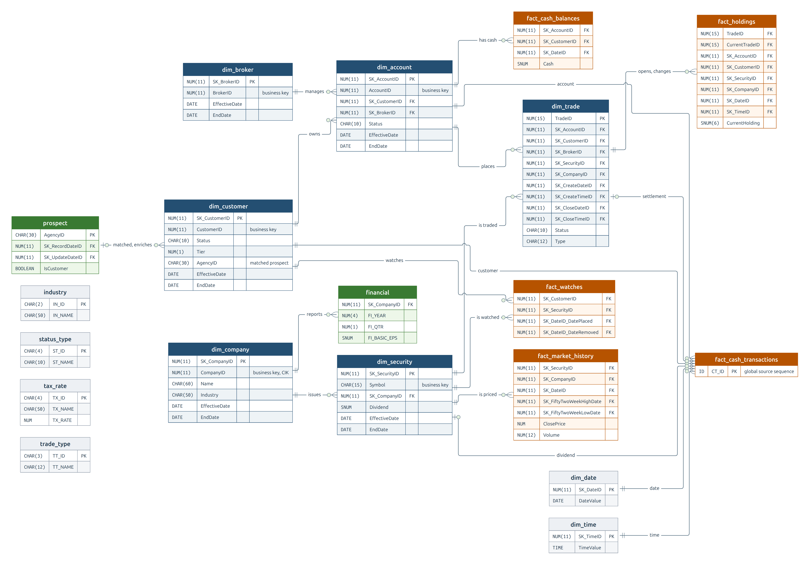

# Project Data Specification

This document defines the data for our project. The project uses the TPC-DI retail brokerage as its business domain and raw source data, moves the data through medallion zones, streams cash transactions, and forecasts account cash with machine learning.

For all details about the TPC-DI benchmark, refer to the [TPC-DI v1.1.0 Specification PDF](TPC-DI/TPC-DI_v1.1.0.pdf). Our design is also informed by [Shannon Barrow's Databricks TPC-DI implementation](https://github.com/shannon-barrow/databricks-tpc-di) and the [associated Medium article](https://medium.com/dbsql-sme-engineering/benchmarking-etl-with-the-tpc-di-part-1-b581d46c44f1).

---

## 1. Business Domains & Origin Systems
The system models the data landscape of a retail brokerage. This table maps each business domain to its logical origin system and business context.

*Note: Section 3 lists the physical files that these systems produce.*

| Business Domain | Origin System | Business Context |
| --- | --- | --- |
| **Customers & Accounts** | CMS (history) & OLTP (daily) | Customer profiles, demographics, and brokerage accounts managed by brokers. |
| **Brokers** | Internal HR DB | Employee records. Brokers are specifically employees with job code `314`. |
| **Trading & Holdings** | OLTP Trading DB | Trade lifecycles (submission to completion or cancellation) and resulting security holdings. |
| **Cash** | OLTP Trading DB | Money moving into and out of accounts, such as deposits, withdrawals, and cash from trades. |
| **Market** | OLTP Trading DB | Daily price and volume observations for each security. |
| **Watch Lists** | OLTP Trading DB | Securities that customers watch, added and removed over time. |
| **Prospects** | External Marketing Provider | Potential customers with demographic data (some overlap with existing customers). |
| **Companies & Securities** | Financial Newswire (FINWIRE) | Companies, the securities they issue, and quarterly financial reports. |
| **Reference Data** | Static Reference Files | Calendar, time of day, industries, statuses, tax rates, and trade types. |

## 2. Load Cycle & Processing Strategy
TPC-DI defines one historical load followed by two daily batches. This project keeps the historical load, extends the daily batches up to one year, delivers FINWIRE quarterly inside the daily batches, and sends cash movements after the historical load as a continuous stream.

### 2.1 Processing Phases

| Phase | Path | Starting State | Coverage | Work |
| --- | --- | --- | --- | --- |
| **Historical load (Batch 1)** | Files in `historical/` | Empty warehouse | `start_date` through `end_date` (length open) | Load reference data and full extracts, build SCD2 history, and calculate opening cash balances and holdings. |
| **Daily batches (Batch 2+)** | Files in `incremental/YYYYMMDD/` | Previous date complete | One `data_date` per batch, from the day after `end_date`, up to one year | Apply the day's CDC changes (`I`, `U`), new activity, the full `Prospect.csv` snapshot, and FINWIRE on release dates. |
| **Cash stream** | Events on Kafka | Final historical cash balances | Cash movements after `end_date`, continuously | Update running balances, window aggregates, and daily balances as events arrive ([Section 2.4](#24-batch-to-stream-handoff)). |

Batch 1 requires at least one year of prices and four quarters of earnings to calculate 52-week highs and lows and P/E ratios.

### 2.2 Source Cadence
Each source follows one cadence after the historical load:
- **Daily, in each daily batch**: `Customer.txt`, `Account.txt`, `Trade.txt`, `HoldingHistory.txt`, `WatchHistory.txt`, `DailyMarket.txt`, and the full `Prospect.csv` snapshot.
- **Quarterly, in the daily batch of the release date**: `FINWIREyyyyQq`. Q1 results release April 30, Q2 results July 31, Q3 results October 31, and Q4 results January 31 of the following year. The release date's batch applies company and security postings before that day's trades and prices. All postings in a quarter's file, including company and security changes, release together on the release date. Release time of day, extra delivery delay, and how often companies and securities change remain open.
- **Continuous, through the cash stream**: `CashTransaction` movements.
- **Once, in the historical load**: `CustomerMgmt.xml`, `TradeHistory.txt`, `HR.csv`, and the six reference files. Later customer, account, and trade changes arrive through `Customer.txt`, `Account.txt`, and `Trade.txt`. HR and reference data stay static for the run; `DimBroker` keeps its history columns with one version per broker. Ongoing HR and reference updates are deferred.

*Note: The fixed FINWIRE release schedule simulates an earnings feed, not statutory filing deadlines. Earnings announcements can precede formal filings ([SEC guidance](https://www.investor.gov/sites/default/files/readan8k.pdf)).*

### 2.3 Calendar & Dates
- **Day**: Each day runs from midnight UTC up to, but not including, the next midnight. Source timestamps without a time zone are UTC.
- **Daily batch calendar**: Every calendar date has a daily batch, including weekends and holidays. A source with no changes on a date still delivers its file, with zero records.
- **`data_date`**: The business date that a daily extract represents, encoded in its folder and file name. Extraction and arrival dates do not change it.
- **Historical range**: Two run parameters of the historical load, inclusive `start_date` and `end_date`. The provider sends no range, and the load does not check record dates against it. The end date dates the historical `Prospect.csv` snapshot. FINWIRE and reference files can begin before `start_date`.
- **Cash event date**: The UTC date of `CT_DTS`. The delivery time is a separate value that measures lateness.
- **`BatchID`**: Identifies a load, not a folder. Its assignment is deferred with catch-up and rerun rules.

### 2.4 Batch-to-Stream Handoff
- **Split**: Cash movements dated on or before `end_date` load in the historical load. Later movements arrive only as stream events; daily batches carry no cash files.
- **Start state**: The stream starts from the final historical balances, keyed by natural `AccountID`, and never reprocesses historical movements ([handoff constraints](Project-Design.md#32-history-scd2--batch-to-stream-consistency)).
- **Daily balances**: After the historical load, `FactCashBalances` rows come from the stream, dated by cash event date.
- **Duplicates**: Repeated deliveries of one cash movement share an Event ID and count once.
- **Late events**: A late event changes its day's balance and every later balance. The lateness limit and correction rule remain open.
- **Open, account keys for early events**: A cash event can refer to an account whose daily batch has not loaded yet, because the stream does not wait for daily files. How stream outputs resolve account dimension keys remains open.
- **Open, simulated clock**: How the delivery step paces daily files and cash events on one simulated calendar remains open.

## 3. Physical Source Files & Ingestion Rules
The project uses all 18 TPC-DI business and reference source families. It does not generate or ingest `BatchDate.txt`; the historical range is a run parameter of the historical load (Section 2.3). Metadata used only for formal benchmark audit validation is also excluded.

The tables and schema headings use the standard source names. The naming rules below define the project file names.

**Change Data Capture (CDC) Rules**: Daily OLTP files are CDC extracts. Each row starts with a `CDC_FLAG` (`I` for insert, `U` for update) and a `CDC_DSN` (sequence number). Insert-only files always carry `I`; historical files omit both fields.

| Origin | Source File(s) | Format | Grain | Batch 1 | Batch 2+ | CDC Rules |
| --- | --- | --- | --- | :---: | :---: | --- |
| CMS | `CustomerMgmt.xml` | XML | One action on a customer and its accounts | Yes | No | N/A (Action-ordered) |
| OLTP | `Customer.txt` | Pipe-delimited | One changed customer | No | Yes | `I`, `U` |
| OLTP | `Account.txt` | Pipe-delimited | One changed account | No | Yes | `I`, `U` |
| OLTP Trading DB | `Trade.txt` | Pipe-delimited | One trade (state or change) | Yes | Yes | `I`, `U` |
| OLTP Trading DB | `TradeHistory.txt` | Pipe-delimited | One trade status change | Yes | No | N/A (Historical only) |
| OLTP Trading DB | `CashTransaction.txt` | Pipe-delimited | One cash movement | Yes | Stream | N/A (events after Batch 1) |
| OLTP Trading DB | `HoldingHistory.txt` | Pipe-delimited | One holding change per trade | Yes | Yes | `I` only |
| OLTP Trading DB | `WatchHistory.txt` | Pipe-delimited | One watch placement or cancellation | Yes | Yes | `I` only |
| OLTP Trading DB | `DailyMarket.txt` | Pipe-delimited | One security per day | Yes | Yes | `I` only |
| Internal HR DB | `HR.csv` | Comma-delimited | One employee | Yes | No | N/A (Full extract) |
| External Marketing | `Prospect.csv` | Comma-delimited | One prospect | Yes | Yes | N/A (Full snapshot) |
| Financial Newswire | `FINWIREyyyyQq` | Fixed-width | One company, security, or financial report | Yes | Release dates | N/A (One file per posting quarter) |
| Static Reference | `Date.txt`, `Time.txt`, `Industry.txt`, `StatusType.txt`, `TaxRate.txt`, `TradeType.txt` | Pipe-delimited | One row per code, day, or second | Yes | No | N/A (Static) |

**Source Naming and Delivery**:
- **Historical files**: Use `historical/` with standard names such as `CustomerMgmt.xml`, `Trade.txt`, and `Prospect.csv`. Add no date suffix. Keep the existing year and quarter in `FINWIREyyyyQq`.
- **Daily files**: Use `incremental/YYYYMMDD/<Source>_YYYYMMDD.<extension>`, for example `incremental/20170708/Customer_20170708.txt` and `incremental/20170708/Prospect_20170708.csv`. The folder and file name carry the same `data_date`, written as plain `YYYYMMDD`. Delivery delays and retries do not change it.
- **Quarterly files**: Name `FINWIREyyyyQq` by the year and quarter of `PTS`, not the financial reporting period. For example, Q1 2026 results published April 30 belong in `FINWIRE2026Q2`; their `Year` and `Quarter` fields remain `2026` and `1`. Keep the existing name format without a daily date suffix. Publish only records released by that delivery, never future postings. Each file arrives in the daily folder of its release date, for example `incremental/20260430/FINWIRE2026Q2`. That date's batch applies it before that day's trades and prices.
- **Generation and delivery**: Generate source data locally first. A separate delivery step sends batch files to Staging and cash events after Batch 1 to Kafka. Delivery timing remains open.
- **Delivery completeness**: The pipeline keeps a predefined list of expected files for each delivery: the historical set, the daily set for every date, and `FINWIREyyyyQq` on release dates. The provider sends no control or manifest file. A delivery is complete when every expected file is present. A file with zero records means no activity; a missing file means the delivery is incomplete. Late-file handling remains open.
- **Catch-up and reruns**: Multiple-date loads, out-of-order arrival, repeated and corrected deliveries, and `BatchID` assignment are deferred to pipeline design.
- **S3 placement**: The paths above are relative to the `staging` bucket ([bucket rationale](Project-Design.md#25-object-storage-layout-rationale)). S3 groups object keys by prefix, not by directories or tags. The platform holds one dataset at a time, so keys have no dataset level.
- **Generator summary**: Keep one reference summary on local disk beside the generated dataset; it is never uploaded. It records generation settings, output counts, and the data characteristics and problems we choose to simulate. Ingestion does not read it ([generator rules](Project-Design.md#33-generator)).

## 4. Data Zones (Medallion Architecture)
Data moves through four distinct zones:

| # | Zone | Purpose | Grain | Storage |
| --- | --- | --- | --- | --- |
| 1 | **Staging** | Immutable raw batch files as delivered. The cash stream enters through Kafka instead. | One file | SeaweedFS `staging` bucket |
| 2 | **Bronze** | Source records and received events as delivered, including duplicates and parse failures. Preserves provenance. | One source record or one delivery | SeaweedFS `lakehouse` bucket, `bronze/` tables |
| 3 | **Silver** | Cleaned, typed, deduplicated, and conformed records. Ready for joins. | One validated business record | SeaweedFS `lakehouse` bucket, `silver/` tables |
| 4 | **Gold** | The warehouse (Section 6), cash stream outputs, and ML tables (Section 7). | Per business entity or metric | PostgreSQL (proposed) |

The lakehouse table format remains open.

### Retention and History
The versioning baseline uses existing mechanisms ([rationale](Project-Design.md#26-data-versioning-rationale)):
- **Raw retention**: Staging keeps every delivered file unchanged for the active dataset. Replaying it rebuilds Bronze, Silver, and Gold.
- **Provenance and rejects**: Bronze preserves provenance and parse failures. Data alerts go to `DImessages`.
- **Business history**: SCD2 dimensions record what was true on each date (Section 6).
- **Deferred**: Corrected deliveries, table snapshots, and dead-letter handling.

### Silver Layer Design
The TPC-DI specification does not define a silver layer. The Silver layer is the project's own model, with the following traits:
- **Preserve Change Order**: Keep `CDC_FLAG`, `CDC_DSN`, `BatchID`, and `data_date`. SCD2 versioning depends on them.
- **Handle XML Nuance**: For `CustomerMgmt.xml`, preserve the distinction between omitted and empty elements until Gold versions are built.
- **Deduplicate Correctly**: Remove repeated deliveries of the same event, but keep legitimate repeated business changes (such as two updates to one trade).
- **Separate Temporal Data**: Keep event dates strictly separate from `data_date` and system arrival dates.

## 5. Data Lineage: Source-to-Gold Mapping
*High-level transformation lineage. PDF clauses 4.5 (historical) and 4.6 (daily) provide field-level rules.*

| Source Records | Transformation Logic | Gold Output |
| --- | --- | --- |
| `CustomerMgmt.xml` + `Customer.txt` | Apply XML actions, then CDC rows. Add tax rates and prospect data; keep daily SCD2 versions. | `DimCustomer` |
| `CustomerMgmt.xml` + `Account.txt` | Same pattern. Resolve customer and broker keys; add a version when the customer changes. | `DimAccount` |
| `HR.csv` | Keep employees with job code 314. | `DimBroker` |
| FINWIRE (`CMP`, `SEC`) | Parse fixed-width records in posting order; build histories; link securities to companies by CIK or name. | `DimCompany`, `DimSecurity` |
| FINWIRE (`FIN`) | Copy the report year and quarter from the record; resolve the company at `PTS`; retain publication and availability metadata. | `Financial` |
| `Trade.txt` + `TradeHistory.txt` | Insert each trade, then update its status. Keys are set at creation and kept at close. | `DimTrade` |
| `CashTransaction.txt` | Sum each account's daily movements and add them to the previous balance. *(Subsequent movements go through Kafka and Flink.)* | `FactCashBalances` |
| `HoldingHistory.txt` + `DimTrade` | Copy `HH_AFTER_QTY`; take keys, date, time, and price from the changing trade. | `FactHoldings` |
| `DailyMarket.txt` + `DimSecurity` + `Financial` | Copy prices and volume; calculate 52-week high and low, P/E, and yield. | `FactMarketHistory` |
| `WatchHistory.txt` | Insert a watch on `ACTV`; set its removal date on `CNCL`. | `FactWatches` |
| `Prospect.csv` + `DimCustomer` | Insert or update prospects, calculate tags, and match active customers. | `Prospect` |

## 6. Gold Warehouse
The Gold layer uses the TPC-DI warehouse model with ongoing FINWIRE releases. Dimensions describe business entities; facts record activity. Financial publication and availability fields remain open.

**SCD2 Dimension Rules**:
- **Keys**: A natural key (`CustomerID`) identifies the entity across time. A surrogate key (`SK_CustomerID`) identifies one specific version.
- **Versioning**: On a change, the current version gets `IsCurrent = 0` and `EndDate` = the new version's `EffectiveDate`. A new row is inserted with a new `SK`, `IsCurrent = 1`, and `EndDate = 9999-12-31`.
- **Collapse**: Multiple changes to one entity on the same day collapse into a single daily version.
- **Fact Joining**: Facts store the `SK` of the dimension version valid on the event's date.

| Table | Type | Contents | Grain | Built From | Batch 1 | Batch 2+ |
| --- | --- | --- | --- | --- | --- | --- |
| `DimCustomer` | SCD2 Dimension | Identity, contacts, tier, tax rates, prospect data | One customer version | `CustomerMgmt.xml`, `Customer.txt`, `Prospect.csv` | Versions from XML actions | New versions from CDC |
| `DimAccount` | SCD2 Dimension | Owner, broker, tax status, status | One account version | `CustomerMgmt.xml`, `Account.txt` | Versions from XML actions | New versions from CDC and customer changes |
| `DimBroker` | SCD2 Dimension | Name, manager, branch, office, phone | One broker | `HR.csv` | One version per broker | No change |
| `DimCompany` | SCD2 Dimension | Name, industry, credit rating, CEO, address | One company version | FINWIRE `CMP` | Versions from postings | New versions from quarterly FINWIRE |
| `DimSecurity` | SCD2 Dimension | Symbol, exchange, shares, dividend, issuing company | One security version | FINWIRE `SEC` | Versions from postings | New versions from quarterly FINWIRE |
| `DimTrade` | Mutable Dimension | Type, status, quantity, prices, fees, account, security | One trade | `Trade.txt`, `TradeHistory.txt` | One row per trade | Insert new trades; update status on close |
| `FactCashBalances` | Fact | End-of-day account cash | One account per day with transactions | `CashTransaction.txt` | Daily balances | From the cash stream |
| `FactHoldings` | Fact | Quantity held after a trade | One holding change | `HoldingHistory.txt` | One row per change | One row per change |
| `FactMarketHistory` | Fact | Prices, volume, 52-week high and low, P/E, yield | One security per day | `DailyMarket.txt` | One row per day | One row per day |
| `FactWatches` | Fact | Period a customer watches a security | One watch | `WatchHistory.txt` | Watches from actions | Insert placements; set removal dates |
| `Prospect` | Current State | Agency record, marketing tags, `IsCustomer` | One prospect | `Prospect.csv` | One row per prospect | Insert new; update changed |
| `Financial` | Current State | Quarterly results | One company per quarter | FINWIRE `FIN` | One row per report | New quarterly reports |
| `DimDate`, `DimTime` | Reference | Calendar and clock attributes | One day; one second | `Date.txt`, `Time.txt` | Loaded once | No change |
| `Industry`, `StatusType`, `TaxRate`, `TradeType` | Reference | Code lookups | One code | Matching `.txt` files | Loaded once | No change |
| `DImessages` | Load Log | Status messages and data alerts | One message | The load process | Each batch | Each batch |

### Gold Layer Entity Relationships
The ERD shows all 19 tables, their key fields, and the main entity relationships. Financial publication and availability fields remain open and are not shown. The `Prospect` relationship is a match by name and address, not a key.



*Header colors: blue for dimensions, orange for facts, green for current-state tables, gray for reference tables and the load log.*

## 7. Cash Streaming & ML
After Batch 1, cash transactions arrive as a stream, and the cash data feeds the ML forecast.

### 7.1 Cash Streaming (Kafka and Flink)
Cash movements after the historical load arrive as Kafka events and follow the cycle rules in [Section 2.4](#24-batch-to-stream-handoff). This section defines the event fields and the outputs.

| Cash Event Field | Type | Meaning |
| --- | --- | --- |
| Event ID | Project-defined (format open) | Identifies the cash movement. A repeated delivery keeps the same ID. |
| `CT_CA_ID` | `NUM(11)` | Account ID |
| `CT_DTS` | `DATETIME` | Event time |
| `CT_AMT` | `SNUM(10,2)` | Signed amount (+ adds cash, - removes cash) |
| `CT_NAME` | `CHAR(100)` | Description |
| Delivery time | Kafka timestamp | When the event arrived; used to measure lateness |

| Output | Zone | Grain | Contents |
| --- | --- | --- | --- |
| Received events | Bronze | One delivery | Each event as delivered, including duplicates |
| Cash events | Silver | One cash movement | Validated events with duplicates removed |
| `FactCashBalances` | Gold | One account per day | TPC-DI daily balance: previous balance plus the day's net movement |
| Running balance | Gold | One account | Current cash after each event |
| Window aggregates | Gold | One account per window | Inflow, outflow, net movement, and count. Window sizes are open. |

### 7.2 ML Forecasting & Alerts
The model forecasts each account's future net cash movement. A policy adds the forecast to current cash and flags accounts that fall below a minimum set by customer tier:

```text
projected_cash = current_cash + forecast_net_movement
alert = projected_cash < configured_minimum[customer_tier]
```

| Data | Grain | Contents | Open |
| --- | --- | --- | --- |
| **Offline features** | One account per feature time | Feature history for training and backfills | Feature list and windows |
| **Online features** | One account | Latest feature values for scoring | Storage details |
| **Label** | One account per prediction time | Sum of unique `CT_AMT` values after the prediction time, up to the forecast cutoff | Forecast horizon |
| **Tier minimums** | One tier (1, 2, 3) | Minimum cash per tier. TPC-DI supplies the tier; the project supplies the amount. | Amounts |
| **Forecast and alert** | One account per as-of time | Account ID, as-of time, forecast cutoff, current cash, forecast movement, projected cash, tier, minimum, shortfall, model version, policy version | Storage schema |

Candidate features include previous daily balance, earlier daily inflow and outflow totals, recent movement counts and amounts from Flink, and optional trade-type totals. Every feature value has an event time and an availability time; training uses only values available before the prediction time. A prediction whose forecast window has not ended has no label yet; it is not a zero movement.

## 8. Core Integration Rules

### Temporal Rules
- **Record Dates vs. `data_date`**: Historical rows use their own dates. Daily customer and account changes use `data_date`. Streamed cash events use the UTC date of `CT_DTS`.
- **Trade Times**: `PNDG` sets the creation time (`SBMT` for market orders `TMB` and `TMS`). `CMPT` or `CNCL` sets the close time.
- **SCD2 Collapse**: Several changes to one entity on one day become one version. The latest value wins, by timestamp and then file order.
- **Propagation**: A new customer version gives the customer's accounts new versions. A new company version does the same for its securities.
- **Financial periods**: Populate `Financial.FI_YEAR`, `FI_QTR`, and `FI_QTR_START_DATE` from the `FIN` record, never from the file name. Resolve `SK_CompanyID` against the company version valid at `PTS` ([PDF clause 4.5.14](TPC-DI/TPC-DI_v1.1.0.pdf)). Company and security versions use their own posting dates, not the financial quarter's start or end.
- **Financial availability**: Preserve source publication time and platform availability separately. P/E calculations and ML features must not use a report before the relevant as-of time permits it. A report released April 30 cannot supply earnings to an April 15 as-of calculation. Follow natural company identity across SCD2 versions when combining quarterly earnings; reports need not share one `SK_CompanyID`. The physical fields, replay clock, and missing-earnings policy remain open.
- **Source dependencies**: Make new company and security identities available before normal trade and market activity refers to them. Delayed deliveries and changes effective before arrival need an explicit correction rule; do not substitute current dimension values.

### Historical Actions (XML)
In `CustomerMgmt.xml`, updates are partial and contextual:
- An **omitted** property retains its existing value.
- An **explicitly empty** element (for example `<C_M_NAME/>`) sets the value to `NULL`.
- `INACT` and `CLOSEACCT` add a version with `Status = 'INACTIVE'`. Nothing is deleted, and the new version is current (`IsCurrent = 1`).

### Trade Lifecycle Updates
`DimTrade` is updated in place. Historical status events come from `TradeHistory.txt`. Daily updates use `Trade.txt`. Surrogate keys (`SK_CustomerID`, `SK_AccountID`, `SK_BrokerID`, `SK_CompanyID`, `SK_SecurityID`) and `BatchID` are set when the trade is first created; later close updates retain them.

## 9. Physical Structures & Schema Reference
Exact parsing rules, physical constraints, and field schemas for bronze ingestion and silver and gold transformations. Full schemas are collapsed below.

### 9.1 General Parsing Rules
- **Delimited Files**: `.txt` uses pipe (`|`), `.csv` uses comma (`,`). No header rows. An empty field represents `NULL` where allowed.
- **CDC (Change Data Capture)**: Daily OLTP files start with `CDC_FLAG` (`I` insert, `U` update) and `CDC_DSN` (sequence number). Historical files omit both fields.
- **Date and Time Formats**: Default is `YYYY-MM-DD` and `YYYY-MM-DD HH:MM:SS`. FINWIRE uses `YYYYMMDD` and `YYYYMMDD-HHMMSS`. `CustomerMgmt.xml` uses `YYYY-MM-DDTHH:MM:SS`. Interpret source timestamps without a time zone as UTC; keep their source text formats.
- **FINWIRE Records**: Characters 1 to 15 are `PTS`; characters 16 to 18 are the record type (`CMP`, `SEC`, `FIN`). Record lengths: `CMP` 543, `SEC` 170 or 220, `FIN` 196 or 246 characters.
- **XML Null vs. Omitted**: In `CustomerMgmt.xml`, an omitted property retains its previous value. An explicitly empty element, such as `<C_M_NAME/>`, sets the value to `NULL`.

### 9.2 Source File Schemas

Fields in file order, with the types, restrictions, and descriptions of PDF clause 2.2. Daily files start with `CDC_FLAG` and `CDC_DSN`; historical files omit them.

<details>
<summary>Data Types</summary>

| Type | Definition | Used In | Meaning |
| --- | --- | --- | --- |
| `BOOLEAN` | `0` or `1` | Both | False or true |
| `CHAR(n)` | Up to n single-byte characters | Both | Text |
| `DATE` | `YYYY-MM-DD` | Both | Date |
| `DATETIME` | `YYYY-MM-DD HH:MM:SS` | Both | Timestamp; no time zone |
| `TIME` | Time of day to 1 ms | Warehouse | Time |
| `NUM(m[,n])` | Unsigned, m digits, n after the point | Both | Exact number |
| `SNUM(m[,n])` | Signed, m digits, n after the point | Both | Exact signed number |
| `IDENT_T` | NUM(11) | Both | Identifier from the OLTP system |
| `SK_T` | NUM(11) | Warehouse | Surrogate key of a dimension row |
| `TRADE_T` | NUM(15) | Both | Trade identifier |
| `CDC_FLAG_T` | CHAR(1) | Source | `I`, `U`, or `D`; each file narrows the set |
| `CDC_DSN_T` | NUM(12) | Source | Change sequence number within a file |
| `S_QTY_T` | NUM(6) | Source | Share quantity of one trade |
| `S_COUNT_T` | NUM(12) | Both | Aggregate share count |
| `S_PRICE_T` | SNUM(8,2) | Both | Share price |
| `VALUE_T` | SNUM(10,2) | Both | Single transaction or security value |
| `BALANCE_T` | SNUM(12,2) | Both | Aggregate account or transaction value |
| `FIN_AGG_T` | SNUM(15,2) | Warehouse | Aggregate financial value |

</details>

<details>
<summary>Customer & Account Sources (CustomerMgmt, Customer, Account)</summary>

#### CustomerMgmt.xml

XML, historical load only. Actions in time order; namespace `http://www.tpc.org/tpc-di`. An update carries only the identifiers and the changed properties.

```xml
<TPCDI:Action ActionType="CLOSEACCT" ActionTS="2007-07-16T00:29:01">
  <Customer C_ID="6">
    <Account CA_ID="6" />
  </Customer>
</TPCDI:Action>
```

| Action Type | Meaning |
| --- | --- |
| `NEW` | New customer with one or more new accounts |
| `ADDACCT` | One or more new accounts for an existing customer |
| `UPDCUST` | Changes to an existing customer |
| `UPDACCT` | Changes to one or more existing accounts |
| `CLOSEACCT` | Closes one or more accounts |
| `INACT` | Makes a customer and its active accounts inactive |

| Field | Element | Type | Restrictions | Description |
| --- | --- | --- | --- | --- |
| `ActionType` | Action | `CHAR(9)` | ’NEW’, ‘ADDACCT’, ‘UPDCUST’, ‘UPDACCT’, ‘CLOSEACCT’, ‘INACT’ | Action type; see the table above. |
| `ActionTS` | Action | `CHAR` | Not empty | Date and time of the action as YYYY-MM-DDTHH:MM:SS. Note the ‘T’ is a literal value. |
| `C_ID` | Customer | `IDENT_T` | Not empty, Required | Customer identifier |
| `C_TAX_ID` | Customer | `CHAR(20)` | Not empty, Required on ‘NEW’ | Customer’s tax identifier |
| `C_GNDR` | Customer | `CHAR(1)` | Not empty | Gender of the customer |
| `C_TIER` | Customer | `NUM(1)` | Not empty | Customer tier |
| `C_DOB` | Customer | `DATE` | Not empty, Required on ‘NEW’ | Customer’s date of birth as YYYY-MM-DD |
| `C_L_NAME` | Name | `CHAR(25)` | Not empty, Required on ‘NEW’ | Customer's last name. |
| `C_F_NAME` | Name | `CHAR(20)` | Not empty, Required on ‘NEW’ | Customer's first name. |
| `C_M_NAME` | Name | `CHAR(1)` |  | Customer's middle initial |
| `C_ADLINE1` | Address | `CHAR(80)` | Not empty, Required on ‘NEW’ | Address Line 1 |
| `C_ADLINE2` | Address | `CHAR(80)` |  | Address Line 2 |
| `C_ZIPCODE` | Address | `CHAR(12)` | Not empty, Required on ‘NEW’ | Zip or postal code |
| `C_CITY` | Address | `CHAR(25)` | Not empty, Required on ‘NEW’ | City |
| `C_STATE_PROV` | Address | `CHAR(20)` | Not empty, Required on ‘NEW’ | State or province |
| `C_CTRY` | Address | `CHAR(24)` |  | Country |
| `C_PRIM_EMAIL` | ContactInfo | `CHAR(50)` |  | Customer's primary e-mail address |
| `C_ALT_EMAIL` | ContactInfo | `CHAR(50)` |  | Customer's alternate e-mail address |
| `C_PHONE_1` | ContactInfo | `PhoneNumber*` |  | Customer’s primary phone number |
| `C_PHONE_2` | ContactInfo | `PhoneNumber*` |  | Customer’s secondary phone number |
| `C_PHONE_3` | ContactInfo | `PhoneNumber*` |  | Customer’s third phone number |
| `C_LCL_TX_ID` | TaxInfo | `CHAR(4)` |  | Customer's local tax rate |
| `C_NAT_TX_ID` | TaxInfo | `CHAR(4)` |  | Customer's national tax rate |
| `CA_ID` | Account | `IDENT_T` | Not empty, Required | Customer account identifier |
| `CA_TAX_ST` | Account | `NUM(1)` | Not empty, Required on ‘NEW’ | Tax status of this account |
| `CA_B_ID` | Account | `IDENT_T` | Not empty, Required on ‘NEW’ | Identifier of the managing broker |
| `CA_NAME` | Account | `CHAR(50)` |  | Name of customer account |

*Phone numbers*: `C_PHONE_1` to `C_PHONE_3` use the `PhoneNumber` type, with these child elements:

| Field | Type | Description |
| --- | --- | --- |
| `C_CTRY_CODE` | `CHAR(3)` | Country code |
| `C_AREA_CODE` | `CHAR(3)` | Area code |
| `C_LOCAL` | `CHAR(10)` | Local number |
| `C_EXT` | `CHAR(5)` | Extension |

#### Customer.txt

Pipe-delimited, daily batches only, ordered by `CDC_DSN`.

```text
I|6440|4728|031-80-9744|ACTV|Kempffer|Tandie|||3|1933-04-19|16132 Corsicana Road||85775|Overland Park|DC|United States of America|||880-2336|||266|978-6267||||||Tandie.Kempffer@gawab.com|Tandie.Kempffer@mail2world.com|DE2|MN1
```

| Field | Type | Restrictions | Description |
| --- | --- | --- | --- |
| `CDC_FLAG` | `CDC_FLAG_T` | ‘I’ or ‘U’ | Denotes insert or update |
| `CDC_DSN` | `CDC_DSN_T` | Not NULL | Database Sequence Number |
| `C_ID` | `IDENT_T` | Not NULL | Customer identifier |
| `C_TAX_ID` | `CHAR(20)` | Not NULL | Customer’s tax identifier |
| `C_ST_ID` | `CHAR(4)` | ‘ACTV’ or ‘INAC’ | Customer status type identifier |
| `C_L_NAME` | `CHAR(25)` | Not NULL | Primary Customer's last name. |
| `C_F_NAME` | `CHAR(20)` | Not NULL | Primary Customer's first name. |
| `C_M_NAME` | `CHAR(1)` |  | Primary Customer's middle initial |
| `C_GNDR` | `CHAR(1)` |  | Gender of the primary customer |
| `C_TIER` | `NUM(1)` |  | Customer tier |
| `C_DOB` | `DATE` | Not NULL | Customer’s date of birth, as YYYY-MM-DD. |
| `C_ADLINE1` | `CHAR(80)` | Not NULL | Address Line 1 |
| `C_ADLINE2` | `CHAR(80)` |  | Address Line 2 |
| `C_ZIPCODE` | `CHAR(12)` | Not NULL | Zip or postal code |
| `C_CITY` | `CHAR(25)` | Not NULL | City |
| `C_STATE_PROV` | `CHAR(20)` | Not NULL | State or province |
| `C_CTRY` | `CHAR(24)` |  | Country |
| `C_CTRY_1` | `CHAR(3)` |  | Country code for Customer's phone 1. |
| `C_AREA_1` | `CHAR(3)` |  | Area code for customer’s phone 1. |
| `C_LOCAL_1` | `CHAR(10)` |  | Local number for customer’s phone 1. |
| `C_EXT_1` | `CHAR(5)` |  | Extension number for Customer’s phone 1. |
| `C_CTRY_2` | `CHAR(3)` |  | Country code for Customer's phone 2. |
| `C_AREA_2` | `CHAR(3)` |  | Area code for Customer’s phone 2. |
| `C_LOCAL_2` | `CHAR(10)` |  | Local number for Customer’s phone 2. |
| `C_EXT_2` | `CHAR(5)` |  | Extension number for Customer’s phone 2. |
| `C_CTRY_3` | `CHAR(3)` |  | Country code for Customer's phone 3. |
| `C_AREA_3` | `CHAR(3)` |  | Area code for Customer’s phone 3. |
| `C_LOCAL_3` | `CHAR(10)` |  | Local number for Customer’s phone 3. |
| `C_EXT_3` | `CHAR(5)` |  | Extension number for Customer’s phone 3. |
| `C_EMAIL_1` | `CHAR(50)` |  | Customer's e-mail address 1. |
| `C_EMAIL_2` | `CHAR(50)` |  | Customer's e-mail address 2. |
| `C_LCL_TX_ID` | `CHAR(4)` | Not NULL | Customer's local tax rate |
| `C_NAT_TX_ID` | `CHAR(4)` | Not NULL | Customer's national tax rate |

#### Account.txt

Pipe-delimited, daily batches only, ordered by `CDC_DSN`.

```text
I|12860|9008|11473|4728||1|ACTV
```

| Field | Type | Restrictions | Description |
| --- | --- | --- | --- |
| `CDC_FLAG` | `CDC_FLAG_T` | ‘I’ or ‘U’ | Denotes insert or update |
| `CDC_DSN` | `CDC_DSN_T` | Not NULL | Database Sequence Number |
| `CA_ID` | `IDENT_T` | Not NULL | Customer account identifier |
| `CA_B_ID` | `IDENT_T` | Not NULL | Identifier of the managing broker |
| `CA_C_ID` | `IDENT_T` | Not NULL | Owning customer identifier |
| `CA_NAME` | `CHAR(50)` |  | Name of customer account |
| `CA_TAX_ST` | `NUM(1)` | 0, 1 or 2 | Tax status of this account |
| `CA_ST_ID` | `CHAR(4)` | ‘ACTV’ or ‘INAC’ | Customer status type identifier |

</details>

<details>
<summary>Trading & Activity Sources (Trade, TradeHistory, CashTransaction, HoldingHistory, WatchHistory)</summary>

#### Trade.txt

Pipe-delimited. Batch 1 is ordered by `T_ID`; daily batches by `CDC_DSN`.

*Batch 1:*

```text
0|2012-07-07 00:02:34|CMPT|TMB|0|AAAAAAAAAAAACQP|2939|9.57|0|3160|10.02|58.95|27.31|1611.19
```

*Daily batch:*

```text
U|1488405|372101|2017-07-08 00:57:49|SBMT|TLS|0|AAAAAAAAAAAABFV|5225|4.06|428|990||||
```

| Field | Type | Restrictions | Description |
| --- | --- | --- | --- |
| `CDC_FLAG` | `CDC_FLAG_T` | ‘I’, ‘U’ | Denotes insert, update |
| `CDC_DSN` | `CDC_DSN_T` | Not NULL | Database Sequence Number |
| `T_ID` | `TRADE_T` | Not Null | Trade identifier. |
| `T_DTS` | `DATETIME` | Not Null | Date and time of trade. |
| `T_ST_ID` | `CHAR(4)` | Not Null | Status type identifier |
| `T_TT_ID` | `CHAR(3)` | Not Null | Trade type identifier |
| `T_IS_CASH` | `BOOLEAN` | ‘0’ or ’1’ | Is this trade a cash (‘1’) or margin (‘0’) trade? |
| `T_S_SYMB` | `CHAR(15)` | Not Null | Security symbol of the security |
| `T_QTY` | `S_QTY_T` | > 0 | Quantity of securities traded. |
| `T_BID_PRICE` | `S_PRICE_T` | > 0 | The requested unit price. |
| `T_CA_ID` | `IDENT_T` | Not Null | Customer account identifier. |
| `T_EXEC_NAME` | `CHAR(49)` | Not Null | Name of the person executing the trade. |
| `T_TRADE_PRICE` | `S_PRICE_T` | Null except in CMPT records, then > 0 | Unit price at which the security was traded. |
| `T_CHRG` | `VALUE_T` | Null except in CMPT records, then >= 0 | Fee charged for placing this trade request. |
| `T_COMM` | `VALUE_T` | Null except in CMPT records, then >= 0 | Commission earned on this trade |
| `T_TAX` | `VALUE_T` | Null except in CMPT records, then >= 0 | Amount of tax due on this trade |

#### TradeHistory.txt

Pipe-delimited, Batch 1 only, ordered by `TH_T_ID`.

```text
0|2012-07-07 00:01:13|SBMT
```

| Field | Type | Restrictions | Description |
| --- | --- | --- | --- |
| `TH_T_ID` | `TRADE_T` | Not Null | Trade identifier. Corresponds to T_ID in the Trade.txt file |
| `TH_DTS` | `DATETIME` | Not Null | When the trade history was updated. |
| `TH_ST_ID` | `CHAR(4)` | Not Null | Status type identifier. |

#### CashTransaction.txt

Pipe-delimited, historical load only; historical rows omit `CDC_FLAG` and `CDC_DSN`. Later cash movements arrive as stream events with the fields in Section 7.1.

```text
0|2012-07-11 08:10:42|-37215.14|TGDRsaHPherhApDuHfXUPdexIUoEzKdgRAGECsgXJIRZuinwrC IOgbbXOnYkqXdAsS
```

| Field | Type | Restrictions | Description |
| --- | --- | --- | --- |
| `CDC_FLAG` | `CDC_FLAG_T` | ‘I’ | Denotes insert |
| `CDC_DSN` | `CDC_DSN_T` | Not NULL | Database Sequence Number |
| `CT_CA_ID` | `IDENT_T` | Not Null | Customer account identifier |
| `CT_DTS` | `DATETIME` | Not Null | Timestamp of when the trade took place |
| `CT_AMT` | `VALUE_T` | Not Null | Amount of the cash transaction. |
| `CT_NAME` | `CHAR(100)` | Not Null | Transaction name, or description: e.g. “Cash from sale of DuPont stock”. |

#### HoldingHistory.txt

Pipe-delimited. Daily batches are ordered by `CDC_DSN`.

```text
0|0|0|2939
```

| Field | Type | Restrictions | Description |
| --- | --- | --- | --- |
| `CDC_FLAG` | `CDC_FLAG_T` | ‘I’ | Denotes insert |
| `CDC_DSN` | `CDC_DSN_T` | Not NULL | Database Sequence Number |
| `HH_H_T_ID` | `TRADE_T` | Not Null | Trade Identifier of the trade that originally created the holding row. |
| `HH_T_ID` | `TRADE_T` | Not Null | Trade Identifier of the current trade |
| `HH_BEFORE_QTY` | `S_QTY_T` | Not Null | Quantity of this security held before the modifying trade. |
| `HH_AFTER_QTY` | `S_QTY_T` | Not Null | Quantity of this security held after the modifying trade. |

#### WatchHistory.txt

Pipe-delimited. Batch 1 is ordered by `W_DTS`; daily batches by `CDC_DSN`.

```text
17|AAAAAAAAAAAAAJR|2012-07-07 00:03:44|ACTV
```

| Field | Type | Restrictions | Description |
| --- | --- | --- | --- |
| `CDC_FLAG` | `CDC_FLAG_T` | ‘I’ | Rows are only added |
| `CDC_DSN` | `CDC_DSN_T` | Not NULL | Database Sequence Number |
| `W_C_ID` | `IDENT_T` | Not Null | Customer identifier |
| `W_S_SYMB` | `CHAR(15)` | Not Null | Symbol of the security to watch |
| `W_DTS` | `DATETIME` | Not Null | Date and Time Stamp for the action |
| `W_ACTION` | `CHAR(4)` | ‘ACTV’ or ‘CNCL’ | Whether activating or canceling the watch |

</details>

<details>
<summary>Market & Company Sources (FINWIRE, DailyMarket)</summary>

#### FINWIRE

Fixed-width, used in the historical load and ongoing quarterly deliveries. One file per posting quarter (`FINWIRE2003Q1`); records in `PTS` order, types mixed. Text pads right with spaces, numbers pad left with spaces, CIKs pad left with zeroes; an empty field is all spaces. Samples can omit trailing padding.

**CMP** (Company, 543 characters)

```text
19670101-154842CMPkkhSvCsfgbDUvsiZWtPQwjkYPwKrfTUFMGMCWCBXBcOcTkaLSudO        0000000000ACTVDRA   1886072219918 Rogers North                                                                                                                                              35233       Long Beach               NC                  United States of AmericaEllebracht                                     CUpESkLIQ LBcTnhDEOCLVhfDjOopGKRBxRYGboIrPFcDxMSGkskSwAJdAPWSAPTf T
```

| Field | Type | Restrictions | Description |
| --- | --- | --- | --- |
| `PTS` | `CHAR(15)` | Not empty | Posting date & time as YYYYMMDD-HHMMSS |
| `RecType` | `CHAR(3)` | Not empty | “CMP” |
| `CompanyName` | `CHAR(60)` | Not empty | Name of the company |
| `CIK` | `CHAR(10)` | Not empty | Company identification code from SEC |
| `Status` | `CHAR(4)` | Not empty | ‘ACTV’ for Active company, ‘INAC’ for inactive |
| `IndustryID` | `CHAR(2)` | Not empty | Code for industry segment |
| `SPrating` | `CHAR(4)` | Not empty | S&P rating |
| `FoundingDate` | `CHAR(8)` |  | A date as YYYYMMDD |
| `AddrLine1` | `CHAR(80)` | Not empty | Mailing address |
| `AddrLine2` | `CHAR(80)` |  | Mailing address |
| `PostalCode` | `CHAR(12)` | Not empty | Mailing address |
| `City` | `CHAR(25)` | Not empty | Mailing address |
| `StateProvince` | `CHAR(20)` | Not empty | Mailing address |
| `Country` | `CHAR(24)` |  | Mailing address |
| `CEOname` | `CHAR(46)` | Not empty | Name of company CEO |
| `Description` | `CHAR(150)` | Not empty | Description of the company |

**SEC** (Security, 170 characters with a CIK, 220 with a company name)

```text
19670427-161251SECAAAAAAAAAAAAAAACOMMONACTVDiIPnSJHqplAHTPKTGIhStBRNgEpVZYuRSRDlerURQYDcFPMaJ                    NASDAQ652346051    1905061019660302        1.850000000005
```

| Field | Type | Restrictions | Description |
| --- | --- | --- | --- |
| `PTS` | `CHAR(15)` | Not empty | Posting date & time as YYYYMMDD-HHMMSS |
| `RecType` | `CHAR(3)` | Not empty | “SEC” |
| `Symbol` | `CHAR(15)` | Not empty | Security symbol |
| `IssueType` | `CHAR(6)` | Not empty | Issue type |
| `Status` | `CHAR(4)` | Not empty | ‘ACTV’ for Active security, ‘INAC’ for inactive |
| `Name` | `CHAR(70)` | Not empty | Security name |
| `ExID` | `CHAR(6)` | Not empty | ID of the exchange the security is traded on |
| `ShOut` | `CHAR(13)` | Not empty | Number of shares outstanding |
| `FirstTradeDate` | `CHAR(8)` | Not empty | Date of first trade as YYYYMMDD |
| `FirstTradeExchg` | `CHAR(8)` | Not empty | Date of first trade on exchange as YYYYMMDD |
| `Dividend` | `CHAR(12)` | Not empty | Dividend as VALUE_T |
| `CoNameOrCIK` | `CHAR(60 or 10)` | Not empty | Company CIK number (if only digits, 10 chars) or name (if not only digits, 60 chars) |

**FIN** (Financial, 196 characters with a CIK, 246 with a company name)

```text
19670401-063705FIN196721967040119670401    9288741181.53    2284183075.45       13.18       12.44        0.25     805819257.50  135871569610.30    4339544932.47    173262702    1836200100000000068
```

| Field | Type | Restrictions | Description |
| --- | --- | --- | --- |
| `PTS` | `CHAR(15)` | Not empty | Posting date & time as YYYYMMDD-HHMMSS |
| `RecType` | `CHAR(3)` | Not empty | “FIN” |
| `Year` | `CHAR(4)` | Not empty | Year of the quarter end. |
| `Quarter` | `CHAR(1)` | Not empty | Quarter number: valid values are ‘1’, ‘2’, ‘3’, ‘4’ |
| `QtrStartDate` | `CHAR(8)` | Not empty | Start date of quarter, as YYYYMMDD |
| `PostingDate` | `CHAR(8)` | Not empty | Posting date of quarterly report as YYYYMMDD |
| `Revenue` | `CHAR(17)` | Not empty | Reported revenue for the quarter |
| `Earnings` | `CHAR(17)` | Not empty | Net earnings reported for the quarter |
| `EPS` | `CHAR(12)` | Not empty | Basic earnings per share for the quarter |
| `DilutedEPS` | `CHAR(12)` | Not empty | Diluted earnings per share for the quarter |
| `Margin` | `CHAR(12)` | Not empty | Profit divided by revenues for the quarter |
| `Inventory` | `CHAR(17)` | Not empty | Value of inventory on hand at end of quarter |
| `Assets` | `CHAR(17)` | Not empty | Value of total assets at the end of quarter |
| `Liabilities` | `CHAR(17)` | Not empty | Value of total liabilities at the end of quarter |
| `ShOut` | `CHAR(13)` | Not empty | Average number of shares outstanding |
| `DilutedShOut` | `CHAR(13)` | Not empty | Average number of shares outstanding (diluted) |
| `CoNameOrCIK` | `CHAR(60 or 10)` | Not empty | Company CIK number (if only digits, 10 chars) or name (if not only digits, 60 chars) |

#### DailyMarket.txt

Pipe-delimited. Daily batches are ordered by `CDC_DSN`.

```text
2015-07-06|AAAAAAAAAAAABOY|242.93|284.42|185.08|111904727
```

| Field | Type | Restrictions | Description |
| --- | --- | --- | --- |
| `CDC_FLAG` | `CDC_FLAG_T` | ‘I’ | Denotes insert |
| `CDC_DSN` | `CDC_DSN_T` | Not NULL | Database Sequence Number |
| `DM_DATE` | `DATE` | Not Null | Date of last completed trading day. |
| `DM_S_SYMB` | `CHAR(15)` | Not Null | Security symbol of the security |
| `DM_CLOSE` | `S_PRICE_T` | Not Null | Closing price of the security on this day. |
| `DM_HIGH` | `S_PRICE_T` | Not Null | Highest price for the security on this day. |
| `DM_LOW` | `S_PRICE_T` | Not Null | Lowest price for the security on this day. |
| `DM_VOL` | `S_COUNT_T` | Not Null | Volume of the security on this day. |

</details>

<details>
<summary>Reference, HR & Prospect Sources</summary>

#### HR.csv

Comma-delimited, Batch 1 only, ordered by `EmployeeID`.

```text
0,211,Ozkan,Douglas,,647,EGZKSobTeknHCbLuHczvWmhTmCSGXD,OFFICE7152,(726) 088-3331
```

| Field | Type | Restrictions | Description |
| --- | --- | --- | --- |
| `EmployeeID` | `IDENT_T` | Not NULL | ID of employee |
| `ManagerID` | `IDENT_T` | Not NULL | ID of employee’s manager |
| `EmployeeFirstName` | `CHAR(30)` | Not NULL | First name |
| `EmployeeLastName` | `CHAR(30)` | Not NULL | Last name |
| `EmployeeMI` | `CHAR(1)` |  | Middle initial |
| `EmployeeJobCode` | `NUM(3)` |  | Numeric job code |
| `EmployeeBranch` | `CHAR(30)` |  | Facility in which employee has office |
| `EmployeeOffice` | `CHAR(10)` |  | Office number or description |
| `EmployeePhone` | `CHAR(14)` |  | Employee phone number |

#### Prospect.csv

Comma-delimited, full snapshot in every batch.

```text
PEL0,PELLAND,Netti,,f,21847 olympia street,,T6b 1i1,Fairbanks,MA,United States of America,1-712-522-6088,368776,,3,W,20,760,O,Brink's,,1058868
```

| Field | Type | Restrictions | Description |
| --- | --- | --- | --- |
| `AgencyID` | `CHAR(30)` | Not NULL | Unique identifier from agency |
| `LastName` | `CHAR(30)` | Not NULL | Last name |
| `FirstName` | `CHAR(30)` | Not NULL | First name |
| `MiddleInitial` | `CHAR(1)` |  | Middle initial |
| `Gender` | `CHAR(1)` |  | ‘M’ or ‘F’ or ‘U’ |
| `AddressLine1` | `CHAR(80)` |  | Postal address |
| `AddressLine2` | `CHAR(80)` |  | Postal address |
| `PostalCode` | `CHAR(12)` |  | Postal code |
| `City` | `CHAR(25)` | Not NULL | City |
| `State` | `CHAR(20)` | Not NULL | State or province |
| `Country` | `CHAR(24)` |  | Postal country |
| `Phone` | `CHAR(30)` |  | Telephone number |
| `Income` | `NUM(9)` |  | Annual income |
| `NumberCars` | `NUM(2)` |  | Cars owned |
| `NumberChildren` | `NUM(2)` |  | Dependent children |
| `MaritalStatus` | `CHAR(1)` |  | ‘S’ or ‘M’ or ‘D’ or ‘W’ or ‘U’ |
| `Age` | `NUM(3)` |  | Current age |
| `CreditRating` | `NUM(4)` |  | Numeric rating |
| `OwnOrRentFlag` | `CHAR(1)` |  | ‘O’ or ‘R’ or ‘U’ |
| `Employer` | `CHAR(30)` |  | Name of employer |
| `NumberCreditCards` | `NUM(2)` |  | Credit cards |
| `NetWorth` | `NUM(12)` |  | Estimated total net worth |

#### Date.txt

Pipe-delimited, Batch 1 only.

```text
19500101|1950-01-01|January 1, 1950|1950|1950|19501|1950 Q1|19501|1950 January|19501|1950-W1|7|Sunday|1950|1950|19503|1950 Q3|true
```

| Field | Type | Restrictions | Description |
| --- | --- | --- | --- |
| `SK_DateID` | `IDENT_T` | Not NULL | Surrogate key for the date |
| `DateValue` | `CHAR(20)` | Not NULL | The date as text, e.g. “2004-07-07” |
| `DateDesc` | `CHAR(20)` | Not NULL | The date Month Day, YYYY, e.g. July 7, 2004 |
| `CalendarYearID` | `NUM(4)` | Not NULL | Year number as a number |
| `CalendarYearDesc` | `CHAR(20)` | Not NULL | Year number as text |
| `CalendarQtrID` | `NUM(5)` | Not NULL | Quarter as a number, e.g. 20042 |
| `CalendarQtrDesc` | `CHAR(20)` | Not NULL | Quarter as text, e.g. “2004 Q2” |
| `CalendarMonthID` | `NUM(6)` | Not NULL | Month as a number, e.g. 20047 |
| `CalendarMonthDesc` | `CHAR(20)` | Not NULL | Month as text, e.g. “2004 July” |
| `CalendarWeekID` | `NUM(6)` | Not NULL | Week as a number, e.g. 200428 |
| `CalendarWeekDesc` | `CHAR(20)` | Not NULL | Week as text, e.g. “2004-W28” |
| `DayOfWeekNum` | `NUM(1)` | Not NULL | Day of week as a number, e.g. 3 |
| `DayOfWeekDesc` | `CHAR(10)` | Not NULL | Day of week as text, e.g. “Wednesday” |
| `FiscalYearID` | `NUM(4)` | Not NULL | Fiscal year as a number, e.g. 2005 |
| `FiscalYearDesc` | `CHAR(20)` | Not NULL | Fiscal year as text, e.g. “2005” |
| `FiscalQtrID` | `NUM(5)` | Not NULL | Fiscal quarter as a number, e.g. 20051 |
| `FiscalQtrDesc` | `CHAR(20)` | Not NULL | Fiscal quarter as text, e.g. “2005 Q1” |
| `HolidayFlag` | `BOOLEAN` |  | Indicates holidays |

#### Time.txt

Pipe-delimited, Batch 1 only.

```text
000000|00:00:00|00|00|00|00:00|00|00:00:00|false|false
```

| Field | Type | Restrictions | Description |
| --- | --- | --- | --- |
| `SK_TimeID` | `IDENT_T` | Not NULL | Surrogate key for the time |
| `TimeValue` | `CHAR(20)` | Not NULL | The time as text, e.g. “01:23:45” |
| `HourID` | `NUM(2)` | Not NULL | Hour number as a number, e.g. 01 |
| `HourDesc` | `CHAR(20)` | Not NULL | Hour number as text, e.g. “01” |
| `MinuteID` | `NUM(2)` | Not NULL | Minute as a number, e.g. 23 |
| `MinuteDesc` | `CHAR(20)` | Not NULL | Minute as text, e.g. “01:23” |
| `SecondID` | `NUM(2)` | Not NULL | Second as a number, e.g. 45 |
| `SecondDesc` | `CHAR(20)` | Not NULL | Second as text, e.g. “01:23:45” |
| `MarketHoursFlag` | `BOOLEAN` |  | Indicates a time during market hours |
| `OfficeHoursFlag` | `BOOLEAN` |  | Indicates a time during office hours |

#### Industry.txt

Pipe-delimited, Batch 1 only.

```text
AA|Misc. Capital Goods|FN
```

| Field | Type | Restrictions | Description |
| --- | --- | --- | --- |
| `IN_ID` | `CHAR(2)` | Not NULL | Industry code |
| `IN_NAME` | `CHAR(50)` | Not NULL | Industry description |
| `IN_SC_ID` | `CHAR(4)` | Not NULL | Sector identifier |

#### StatusType.txt

Pipe-delimited, Batch 1 only.

```text
ACTV|Active
```

| Field | Type | Restrictions | Description |
| --- | --- | --- | --- |
| `ST_ID` | `CHAR(4)` | Not NULL | Status code |
| `ST_NAME` | `CHAR(10)` | Not NULL | Status description |

#### TaxRate.txt

Pipe-delimited, Batch 1 only.

```text
US1|U.S. Income Tax Bracket for the poor|0.15000
```

| Field | Type | Restrictions | Description |
| --- | --- | --- | --- |
| `TX_ID` | `CHAR(4)` | Not NULL | Tax rate code |
| `TX_NAME` | `CHAR(50)` | Not NULL | Tax rate description |
| `TX_RATE` | `NUM(6,5)` | Not NULL | Tax rate |

#### TradeType.txt

Pipe-delimited, Batch 1 only.

```text
TMB|Market Buy|0|1
```

| Field | Type | Restrictions | Description |
| --- | --- | --- | --- |
| `TT_ID` | `CHAR(3)` | Not NULL | Trade type code |
| `TT_NAME` | `CHAR(12)` | Not NULL | Trade type description |
| `TT_IS_SELL` | `NUM(1)` | Not NULL | Flag indicating a sale |
| `TT_IS_MRKT` | `NUM(1)` | Not NULL | Flag indicating a market order |

</details>

### 9.3 Warehouse (Gold) Schemas

Fields in table order, with the types, restrictions, and descriptions of PDF clause 3.2. Financial publication and availability fields remain open.

<details>
<summary>SCD2 Dimension Pattern & Common History Fields</summary>

All SCD2 dimensions (`DimCustomer`, `DimAccount`, `DimBroker`, `DimCompany`, `DimSecurity`) end with these fields:

| Field | Type | Description |
| --- | --- | --- |
| `IsCurrent` | `BOOLEAN` | True for the current version |
| `BatchID` | `NUM(5)` | Batch that inserted this version |
| `EffectiveDate` | `DATE` | First date this version applies |
| `EndDate` | `DATE` | Exclusive end date; `9999-12-31` for the current version |

</details>

<details>
<summary>Customer & Account Tables (DimCustomer, DimAccount, DimBroker, Prospect)</summary>

#### DimCustomer

SCD2 dimension. One row per customer version.

| Field | Type | Restrictions | Description |
| --- | --- | --- | --- |
| `SK_CustomerID` | `SK_T` | Not NULL | Surrogate key for CustomerID |
| `CustomerID` | `IDENT_T` | Not NULL | Customer identifier |
| `TaxID` | `CHAR(20)` | Not NULL | Customer’s tax identifier |
| `Status` | `CHAR(10)` | Not NULL | Customer status type |
| `LastName` | `CHAR(30)` | Not NULL | Customer's last name. |
| `FirstName` | `CHAR(30)` | Not NULL | Customer's first name. |
| `MiddleInitial` | `CHAR(1)` |  | Customer's middle name initial |
| `Gender` | `CHAR(1)` |  | Gender of the customer |
| `Tier` | `NUM(1)` |  | Customer tier |
| `DOB` | `DATE` | Not NULL | Customer’s date of birth. |
| `AddressLine1` | `CHAR(80)` | Not NULL | Address Line 1 |
| `AddressLine2` | `CHAR(80)` |  | Address Line 2 |
| `PostalCode` | `CHAR(12)` | Not NULL | Zip or Postal Code |
| `City` | `CHAR(25)` | Not NULL | City |
| `StateProv` | `CHAR(20)` | Not NULL | State or Province |
| `Country` | `CHAR(24)` |  | Country |
| `Phone1` | `CHAR(30)` |  | Phone number 1 |
| `Phone2` | `CHAR(30)` |  | Phone number 2 |
| `Phone3` | `CHAR(30)` |  | Phone number 3 |
| `Email1` | `CHAR(50)` |  | Email address 1 |
| `Email2` | `CHAR(50)` |  | Email address 2 |
| `NationalTaxRateDesc` | `CHAR(50)` |  | National Tax rate description |
| `NationalTaxRate` | `NUM(6,5)` |  | National Tax rate |
| `LocalTaxRateDesc` | `CHAR(50)` |  | Local Tax rate description |
| `LocalTaxRate` | `NUM(6,5)` |  | Local Tax rate |
| `AgencyID` | `CHAR(30)` |  | Agency identifier |
| `CreditRating` | `NUM(5)` |  | Credit rating |
| `NetWorth` | `SNUM(10)` |  | Net worth |
| `MarketingNameplate` | `CHAR(100)` |  | Marketing nameplate |
| `IsCurrent` | `BOOLEAN` | Not NULL | True if this is the current record |
| `BatchID` | `NUM(5)` | Not NULL | Batch ID when this record was inserted |
| `EffectiveDate` | `DATE` | Not NULL | Beginning of date range when this record was the current record |
| `EndDate` | `DATE` | Not NULL | Ending of date range when this record was the current record. A record that is not expired will use the date 9999-12-31. |

#### DimAccount

SCD2 dimension. One row per account version.

| Field | Type | Restrictions | Description |
| --- | --- | --- | --- |
| `SK_AccountID` | `SK_T` | Not NULL | Surrogate key for AccountID |
| `AccountID` | `IDENT_T` | Not NULL | Customer account identifier |
| `SK_BrokerID` | `SK_T` | Not NULL | Surrogate key of managing broker |
| `SK_CustomerID` | `SK_T` | Not NULL | Surrogate key of customer |
| `Status` | `CHAR(10)` | Not NULL | Account status, active or closed |
| `AccountDesc` | `CHAR(50)` |  | Name of customer account |
| `TaxStatus` | `NUM(1)` | 0, 1 or 2 | Tax status of this account |
| `IsCurrent` | `BOOLEAN` | Not NULL | True if this is the current record |
| `BatchID` | `NUM(5)` | Not NULL | Batch ID when this record was inserted |
| `EffectiveDate` | `DATE` | Not NULL | Beginning of date range when this record was the current record |
| `EndDate` | `DATE` | Not NULL | Ending of date range when this record was the current record. A record that is not expired will use the date 9999-12-31. |

#### DimBroker

SCD2 dimension structure with one initial version per broker. No later HR updates are simulated; keep the existing history columns.

| Field | Type | Restrictions | Description |
| --- | --- | --- | --- |
| `SK_BrokerID` | `SK_T` | Not NULL | Surrogate key for broker |
| `BrokerID` | `IDENT_T` | Not NULL | Natural key for broker |
| `ManagerID` | `IDENT_T` |  | Natural key for manager’s HR record |
| `FirstName` | `CHAR(50)` | Not NULL | First name |
| `LastName` | `CHAR(50)` | Not NULL | Last Name |
| `MiddleInitial` | `CHAR(1)` |  | Middle initial |
| `Branch` | `CHAR(50)` |  | Facility in which employee has office |
| `Office` | `CHAR(50)` |  | Office number or description |
| `Phone` | `CHAR(14)` |  | Employee phone number |
| `IsCurrent` | `BOOLEAN` | Not NULL | True if this is the current record |
| `BatchID` | `NUM(5)` | Not NULL | Batch ID when this record was inserted |
| `EffectiveDate` | `DATE` | Not NULL | Beginning of date range when this record was the current record |
| `EndDate` | `DATE` | Not NULL | Ending of date range when this record was the current record. A record that is not expired will use the date 9999-12-31. |

#### Prospect

Current state, not SCD2. One row per prospect.

| Field | Type | Restrictions | Description |
| --- | --- | --- | --- |
| `AgencyID` | `CHAR(30)` | Not NULL | Unique identifier from agency |
| `SK_RecordDateID` | `SK_T` | Not NULL | Last date this prospect appeared in input |
| `SK_UpdateDateID` | `SK_T` | Not NULL | Latest change date for this prospect |
| `BatchID` | `NUM(5)` | Not Null | Batch ID when this record was last modified |
| `IsCustomer` | `BOOLEAN` | Not NULL | True if this person is also in DimCustomer, else False |
| `LastName` | `CHAR(30)` | Not NULL | Last name |
| `FirstName` | `CHAR(30)` | Not NULL | First name |
| `MiddleInitial` | `CHAR(1)` |  | Middle initial |
| `Gender` | `CHAR(1)` |  | M / F / U |
| `AddressLine1` | `CHAR(80)` |  | Postal address |
| `AddressLine2` | `CHAR(80)` |  | Postal address |
| `PostalCode` | `CHAR(12)` |  | Postal code |
| `City` | `CHAR(25)` | Not NULL | City |
| `State` | `CHAR(20)` | Not NULL | State or province |
| `Country` | `CHAR(24)` |  | Postal country |
| `Phone` | `CHAR(30)` |  | Telephone number |
| `Income` | `NUM(9)` |  | Annual income |
| `NumberCars` | `NUM(2)` |  | Cars owned |
| `NumberChildren` | `NUM(2)` |  | Dependent children |
| `MaritalStatus` | `CHAR(1)` |  | S / M / D / W / U |
| `Age` | `NUM(3)` |  | Current age |
| `CreditRating` | `NUM(4)` |  | Numeric rating |
| `OwnOrRentFlag` | `CHAR(1)` |  | O / R / U |
| `Employer` | `CHAR(30)` |  | Name of employer |
| `NumberCreditCards` | `NUM(2)` |  | Credit cards |
| `NetWorth` | `NUM(12)` |  | Estimated total net worth |
| `MarketingNameplate` | `CHAR(100)` |  | For marketing purposes |

</details>

<details>
<summary>Company & Market Tables (DimCompany, DimSecurity, Financial, FactMarketHistory)</summary>

#### DimCompany

SCD2 dimension. One row per company version.

| Field | Type | Restrictions | Description |
| --- | --- | --- | --- |
| `SK_CompanyID` | `SK_T` | Not NULL | Surrogate key for CompanyID |
| `CompanyID` | `IDENT_T` | Not NULL | Company identifier (CIK number) |
| `Status` | `CHAR(10)` | Not NULL | Company status |
| `Name` | `CHAR(60)` | Not NULL | Company name |
| `Industry` | `CHAR(50)` | Not NULL | Company’s industry |
| `SPrating` | `CHAR(4)` |  | Standard & Poor company’s rating |
| `isLowGrade` | `BOOLEAN` |  | True if this company is low grade |
| `CEO` | `CHAR(100)` | Not NULL | CEO name |
| `AddressLine1` | `CHAR(80)` |  | Address Line 1 |
| `AddressLine2` | `CHAR(80)` |  | Address Line 2 |
| `PostalCode` | `CHAR(12)` | Not NULL | Zip or postal code |
| `City` | `CHAR(25)` | Not NULL | City |
| `StateProv` | `CHAR(20)` | Not NULL | State or Province |
| `Country` | `CHAR(24)` |  | Country |
| `Description` | `CHAR(150)` | Not NULL | Company description |
| `FoundingDate` | `DATE` |  | Date the company was founded |
| `IsCurrent` | `BOOLEAN` | Not NULL | True if this is the current record |
| `BatchID` | `NUM(5)` | Not NULL | Batch ID when this record was inserted |
| `EffectiveDate` | `DATE` | Not NULL | Beginning of date range when this record was the current record |
| `EndDate` | `DATE` | Not NULL | Ending of date range when this record was the current record. A record that is not expired will use the date 9999-12-31. |

#### DimSecurity

SCD2 dimension. One row per security version.

| Field | Type | Restrictions | Description |
| --- | --- | --- | --- |
| `SK_SecurityID` | `SK_T` | Not NULL | Surrogate key for Symbol |
| `Symbol` | `CHAR(15)` | Not NULL | Identifies security on “ticker” |
| `Issue` | `CHAR(6)` | Not NULL | Issue type |
| `Status` | `CHAR(10)` | Not NULL | Status type |
| `Name` | `CHAR(70)` | Not NULL | Security name |
| `ExchangeID` | `CHAR(6)` | Not NULL | Exchange the security is traded on |
| `SK_CompanyID` | `SK_T` | Not NULL | Company issuing security |
| `SharesOutstanding` | `S_COUNT_T` | Not NULL | Shares outstanding |
| `FirstTrade` | `DATE` | Not NULL | Date of first trade |
| `FirstTradeOnExchange` | `DATE` | Not NULL | Date of first trade on this exchange |
| `Dividend` | `VALUE_T` | Not NULL | Annual dividend per share |
| `IsCurrent` | `BOOLEAN` | Not NULL | True if this is the current record |
| `BatchID` | `NUM(5)` | Not NULL | Batch ID when this record was inserted |
| `EffectiveDate` | `DATE` | Not NULL | Beginning of date range when this record was the current record |
| `EndDate` | `DATE` | Not NULL | Ending of date range when this record was the current record. A record that is not expired will use the date 9999-12-31. |

#### Financial

Current state, not SCD2. One row per company per reporting quarter; retain earlier quarters when a new report arrives. The report's period comes from its fields, not the FINWIRE file quarter. Resolve the company version at `PTS`. Publication and availability metadata must remain accessible to Gold consumers; their physical fields remain open.

| Field | Type | Restrictions | Description |
| --- | --- | --- | --- |
| `SK_CompanyID` | `IDENT_T` | Not NULL | Company SK. |
| `FI_YEAR` | `NUM(4)` | Not NULL | Year of the quarter end. |
| `FI_QTR` | `NUM(1)` | Not NULL | Quarter number that the financial information is for: valid values 1, 2, 3, 4. |
| `FI_QTR_START_DATE` | `DATE` | Not NULL | Start date of quarter. |
| `FI_REVENUE` | `SNUM(15,2)` | Not NULL | Reported revenue for the quarter. |
| `FI_NET_EARN` | `SNUM(15,2)` | Not NULL | Net earnings reported for the quarter. |
| `FI_BASIC_EPS` | `SNUM(10,2)` | Not NULL | Basic earnings per share for the quarter. |
| `FI_DILUT_EPS` | `SNUM(10,2)` | Not NULL | Diluted earnings per share for the quarter. |
| `FI_MARGIN` | `SNUM(10,2)` | Not NULL | Profit divided by revenues for the quarter. |
| `FI_INVENTORY` | `SNUM(15,2)` | Not NULL | Value of inventory on hand at the end of quarter. |
| `FI_ASSETS` | `SNUM(15,2)` | Not NULL | Value of total assets at the end of the quarter. |
| `FI_LIABILITY` | `SNUM(15,2)` | Not NULL | Value of total liabilities at the end of the quarter. |
| `FI_OUT_BASIC` | `SNUM(12)` | Not NULL | Average number of shares outstanding (basic). |
| `FI_OUT_DILUT` | `SNUM(12)` | Not NULL | Average number of shares outstanding (diluted). |

#### FactMarketHistory

Fact. One row per security per day.

| Field | Type | Restrictions | Description |
| --- | --- | --- | --- |
| `SK_SecurityID` | `SK_T` | Not Null | Surrogate key for SecurityID |
| `SK_CompanyID` | `SK_T` | Not Null | Surrogate key for CompanyID |
| `SK_DateID` | `SK_T` | Not Null | Surrogate key for the date |
| `PERatio` | `NUM(10,2)` |  | Price to earnings per share ratio |
| `Yield` | `NUM(5,2)` | Not Null | Dividend to price ratio, as a percentage |
| `FiftyTwoWeekHigh` | `NUM(8,2)` | Not Null | Security highest price in last 52 weeks from this day |
| `SK_FiftyTwoWeekHighDate` | `SK_T` | Not Null | Earliest date on which the 52 week high price was set |
| `FiftyTwoWeekLow` | `NUM(8,2)` | Not Null | Security lowest price in last 52 weeks from this day |
| `SK_FiftyTwoWeekLowDate` | `SK_T` | Not Null | Earliest date on which the 52 week low price was set |
| `ClosePrice` | `NUM(8,2)` | Not Null | Security closing price on this day |
| `DayHigh` | `NUM(8,2)` | Not Null | Highest price for the security on this day |
| `DayLow` | `NUM(8,2)` | Not Null | Lowest price for the security on this day |
| `Volume` | `NUM(12)` | Not Null | Trading volume of the security on this day |
| `BatchID` | `NUM(5)` | Not Null | Batch ID when this record was inserted |

</details>

<details>
<summary>Trading & Activity Tables (DimTrade, FactCashBalances, FactHoldings, FactWatches)</summary>

#### DimTrade

Updated in place, not SCD2. One row per trade.

| Field | Type | Restrictions | Description |
| --- | --- | --- | --- |
| `TradeID` | `IDENT_T` | Not NULL | Trade identifier |
| `SK_BrokerID` | `SK_T` |  | Surrogate key for BrokerID |
| `SK_CreateDateID` | `SK_T` | Not NULL | Surrogate key for date created |
| `SK_CreateTimeID` | `SK_T` | Not NULL | Surrogate key for time created |
| `SK_CloseDateID` | `SK_T` |  | Surrogate key for date closed |
| `SK_CloseTimeID` | `SK_T` |  | Surrogate key for time closed |
| `Status` | `CHAR(10)` | Not NULL | Trade status |
| `Type` | `CHAR(12)` | Not NULL | Trade type |
| `CashFlag` | `BOOLEAN` | Not NULL | Is this trade a cash (1) or margin (0) trade? |
| `SK_SecurityID` | `SK_T` | Not NULL | Surrogate key for SecurityID |
| `SK_CompanyID` | `SK_T` | Not NULL | Surrogate key for CompanyID |
| `Quantity` | `NUM(6,0)` | Not NULL | Quantity of securities traded. |
| `BidPrice` | `NUM(8,2)` | Not NULL | The requested unit price. |
| `SK_CustomerID` | `SK_T` | Not NULL | Surrogate key for CustomerID |
| `SK_AccountID` | `SK_T` | Not NULL | Surrogate key for AccountID |
| `ExecutedBy` | `CHAR(64)` | Not NULL | Name of person executing the trade. |
| `TradePrice` | `NUM(8,2)` |  | Unit price at which the security was traded. |
| `Fee` | `NUM(10,2)` |  | Fee charged for placing this trade request |
| `Commission` | `NUM(10,2)` |  | Commission earned on this trade |
| `Tax` | `NUM(10,2)` |  | Amount of tax due on this trade |
| `BatchID` | `NUM(5)` | Not Null | Batch ID when this record was inserted |

#### FactCashBalances

Fact. One row per account per day with transactions.

| Field | Type | Restrictions | Description |
| --- | --- | --- | --- |
| `SK_CustomerID` | `SK_T` | Not Null | Surrogate key for CustomerID |
| `SK_AccountID` | `SK_T` | Not Null | Surrogate key for AccountID |
| `SK_DateID` | `SK_T` | Not Null | Surrogate key for the date |
| `Cash` | `SNUM(15,2)` | Not Null | Cash balance for the account after applying changes for this day |
| `BatchID` | `NUM(5)` | Not Null | Batch ID when this record was inserted |

#### FactHoldings

Fact. One row per holding change.

| Field | Type | Restrictions | Description |
| --- | --- | --- | --- |
| `TradeID` | `IDENT_T` | Not NULL | Key for Original Trade Identifier |
| `CurrentTradeID` | `IDENT_T` | Not Null | Key for the current trade |
| `SK_CustomerID` | `SK_T` | Not NULL | Surrogate key for Customer Identifier |
| `SK_AccountID` | `SK_T` | Not NULL | Surrogate key for Account Identifier |
| `SK_SecurityID` | `SK_T` | Not NULL | Surrogate key for Security Identifier |
| `SK_CompanyID` | `SK_T` | Not NULL | Surrogate key for Company Identifier |
| `SK_DateID` | `SK_T` | Not NULL | Surrogate key for the date associated with the current trade |
| `SK_TimeID` | `SK_T` | Not NULL | Surrogate key for the time associated with the current trade |
| `CurrentPrice` | `S_PRICE_T` | > 0 | Unit price of this security for the current trade |
| `CurrentHolding` | `SNUM(6)` | Not NULL | Quantity of a security held after the current trade. The value can be a positive or negative integer |
| `BatchID` | `NUM(5)` | Not Null | Batch ID when this record was inserted |

#### FactWatches

Fact. One row per watch, from placement to removal.

| Field | Type | Restrictions | Description |
| --- | --- | --- | --- |
| `SK_CustomerID` | `SK_T` | Not NULL | Customer associated with watch list |
| `SK_SecurityID` | `SK_T` | Not NULL | Security listed on watch list |
| `SK_DateID_DatePlaced` | `SK_T` | Not NULL | Date the watch list item was added |
| `SK_DateID_DateRemoved` | `SK_T` |  | Date the watch list item was removed |
| `BatchID` | `NUM(5)` | Not Null | Batch ID when this record was inserted |

</details>

<details>
<summary>Reference & Load Tables (DimDate, DimTime, Industry, StatusType, TaxRate, TradeType, DImessages)</summary>

#### DimDate

Loaded once from `Date.txt`.

| Field | Type | Restrictions | Description |
| --- | --- | --- | --- |
| `SK_DateID` | `SK_T` | Not NULL | Surrogate key for the date |
| `DateValue` | `DATE` | Not NULL | The date stored appropriately for doing comparisons in the Data Warehouse |
| `DateDesc` | `CHAR(20)` | Not NULL | The date in full written form, e.g. “July 7, 2004” |
| `CalendarYearID` | `NUM(4)` | Not NULL | Year number as a number |
| `CalendarYearDesc` | `CHAR(20)` | Not NULL | Year number as text |
| `CalendarQtrID` | `NUM(5)` | Not NULL | Quarter as a number, e.g. 20042 |
| `CalendarQtrDesc` | `CHAR(20)` | Not NULL | Quarter as text, e.g. “2004 Q2” |
| `CalendarMonthID` | `NUM(6)` | Not NULL | Month as a number, e.g. 20047 |
| `CalendarMonthDesc` | `CHAR(20)` | Not NULL | Month as text, e.g. “2004 July” |
| `CalendarWeekID` | `NUM(6)` | Not NULL | Week as a number, e.g. 200428 |
| `CalendarWeekDesc` | `CHAR(20)` | Not NULL | Week as text, e.g. “2004-W28” |
| `DayOfWeekNum` | `NUM(1)` | Not NULL | Day of week as a number, e.g. 3 |
| `DayOfWeekDesc` | `CHAR(10)` | Not NULL | Day of week as text, e.g. “Wednesday” |
| `FiscalYearID` | `NUM(4)` | Not NULL | Fiscal year as a number, e.g. 2005 |
| `FiscalYearDesc` | `CHAR(20)` | Not NULL | Fiscal year as text, e.g. “2005” |
| `FiscalQtrID` | `NUM(5)` | Not NULL | Fiscal quarter as a number, e.g. 20051 |
| `FiscalQtrDesc` | `CHAR(20)` | Not NULL | Fiscal quarter as text, e.g. “2005 Q1” |
| `HolidayFlag` | `BOOLEAN` |  | Indicates holidays |

#### DimTime

Loaded once from `Time.txt`.

| Field | Type | Restrictions | Description |
| --- | --- | --- | --- |
| `SK_TimeID` | `SK_T` | Not NULL | Surrogate key for the time |
| `TimeValue` | `TIME` | Not NULL | The time stored appropriately for doing comparisons in the Data Warehouse |
| `HourID` | `NUM(2)` | Not NULL | Hour number as a number, e.g. 01 |
| `HourDesc` | `CHAR(20)` | Not NULL | Hour number as text, e.g. “01” |
| `MinuteID` | `NUM(2)` | Not NULL | Minute as a number, e.g. 23 |
| `MinuteDesc` | `CHAR(20)` | Not NULL | Minute as text, e.g. “01:23” |
| `SecondID` | `NUM(2)` | Not NULL | Second as a number, e.g. 45 |
| `SecondDesc` | `CHAR(20)` | Not NULL | Second as text, e.g. “01:23:45” |
| `MarketHoursFlag` | `BOOLEAN` |  | Indicates a time during market hours |
| `OfficeHoursFlag` | `BOOLEAN` |  | Indicates a time during office hours |

#### Industry

Loaded once from `Industry.txt`.

| Field | Type | Restrictions | Description |
| --- | --- | --- | --- |
| `IN_ID` | `CHAR(2)` | Not NULL | Industry code |
| `IN_NAME` | `CHAR(50)` | Not NULL | Industry description |
| `IN_SC_ID` | `CHAR(4)` | Not NULL | Sector identifier |

#### StatusType

Loaded once from `StatusType.txt`.

| Field | Type | Restrictions | Description |
| --- | --- | --- | --- |
| `ST_ID` | `CHAR(4)` | Not NULL | Status code |
| `ST_NAME` | `CHAR(10)` | Not NULL | Status description |

#### TaxRate

Loaded once from `TaxRate.txt`.

| Field | Type | Restrictions | Description |
| --- | --- | --- | --- |
| `TX_ID` | `CHAR(4)` | Not NULL | Tax rate code |
| `TX_NAME` | `CHAR(50)` | Not NULL | Tax rate description |
| `TX_RATE` | `NUM(6,5)` | Not NULL | Tax rate |

#### TradeType

Loaded once from `TradeType.txt`.

| Field | Type | Restrictions | Description |
| --- | --- | --- | --- |
| `TT_ID` | `CHAR(3)` | Not NULL | Trade type code |
| `TT_NAME` | `CHAR(12)` | Not NULL | Trade type description |
| `TT_IS_SELL` | `NUM(1)` | Not NULL | Flag indicating a sale |
| `TT_IS_MRKT` | `NUM(1)` | Not NULL | Flag indicating a market order |

#### DImessages

Load log: status messages and data alerts, written by every batch.

| Field | Type | Restrictions | Description |
| --- | --- | --- | --- |
| `MessageDateAndTime` | `DATETIME` | Not NULL | Date and time of the message |
| `BatchID` | `NUM(5)` | Not NULL | DI run number; see the section “Overview of BatchID usage” |
| `MessageSource` | `CHAR(30)` |  | Typically the name of the transform that logs the message |
| `MessageText` | `CHAR(50)` | Not NULL | Description of why the message was logged |
| `MessageType` | `CHAR(12)` | Not NULL | “Status” or “Alert” or “Reject” |
| `MessageData` | `CHAR(100)` |  | Varies with the reason for logging the message |

</details>

## 10. Deferred Information & Edge Cases

### 10.1 Deferred to Official Spec
These details stay in the PDF. Their results are still built, except the audit metadata:
- **Prospect Marketing-Tag Math**: Thresholds for `HighValue`, `Expenses`, `Boomer`, `MoneyAlert`, `Spender`, and `Inherited` (clauses 4.5.15, 4.6.14).
- **Detailed Calculation Formulas**: 52-week high and low, P/E ratio, and dividend yield in `FactMarketHistory` (4.5.11, 4.6.10); phone and tax-rate fields in `DimCustomer` (4.5.4, 4.6.4).
- **Benchmark Audit Metadata**: Audit files (`<name>_audit.csv`) and checks used only for official TPC scoring (2.2.2.20, 3.2.19, 7.4, 8.2). The project excludes these.

### 10.2 Implementation Edge Cases
When implementing parsers or SCD2 logic, verify these edge cases in the official [PDF](TPC-DI/TPC-DI_v1.1.0.pdf):

| Edge Case | Rule | PDF Clause |
| --- | --- | --- |
| FINWIRE company reference | `SEC` and `FIN` end with a 10-digit CIK or a 60-character name. Use the company version valid at `PTS`. | 2.2.2.8, 4.5.6, 4.5.14 |
| Same-day SCD2 changes | Combine into one version per day. The account rule prints an inclusive `EndDate` check that conflicts with the general rule. | 4.4.1, 4.5.1.3 |
| XML NULL vs. omitted | Omitted keeps the old value; `<C_M_NAME/>` sets `NULL`. One action can change several accounts. | 2.2.2.5, 4.5.1, 4.5.4 |
| Trade dimension keys | Use the versions valid on the creation date; keep them when the trade closes. | 4.5.8, 4.6.7 |
| Cash balance initialization | No opening balances exist; start from zero. Carry the balance by `AccountID`, because the account's `SK` can change. | 4.5.9, 4.6.8 |
| Holding quantities | `HH_AFTER_QTY` is the quantity after the change. Summing it double-counts. | 4.5.10, 4.6.9 |
| Watch cancellation | Find the placement even if the customer or security has a newer version. | 4.5.12, 4.6.11 |
| Trade ID size | Source `T_ID` is `NUM(15)`; the warehouse prints `TradeID` as `NUM(11)`. Store 15 digits. | 2.2.2.17, 3.2.7.1 |
| Dependency table errors | Table 4.3 names fields that do not exist, such as `FactCashBalances.SK_TimeID`. Follow clause 3.2. | Table 4.3 |
| Data errors | Invalid values, such as a bad customer tier, write an alert to `DImessages`; the record still loads. | 4.4.3 |

## 11. Open Decisions
| Decision | Section |
| --- | --- |
| Historical load length | 2.1 |
| FINWIRE release time of day, extra delivery delay, frequency of company and security changes, and late updates | 2.2, 8 |
| Financial publication and availability fields, replay clock, and missing-earnings policy | 6, 8, 9.3 |
| Delivery timing (simulated clock for daily files and cash events) and late-file handling | 2.4, 3 |
| Account key resolution for cash events that precede their daily batch | 2.4 |
| Multiple-date loads, out-of-order arrival, repeat and corrected deliveries, and `BatchID` assignment (deferred) | 2.3, 3 |
| Bronze provenance columns | 4 |
| Silver table schemas | 4 |
| Gold storage (PostgreSQL proposed) and lakehouse table format | 4 |
| Cash event ID format | 7.1 |
| Stream window sizes | 7.1 |
| Lateness limit and correction rule | 2.4 |
| Feature list, windows, and online storage | 7.2 |
| Forecast horizon | 7.2 |
| Tier minimum amounts | 7.2 |
| Forecast and alert storage schema | 7.2 |
