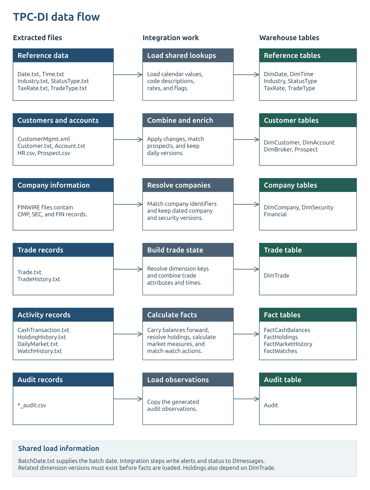
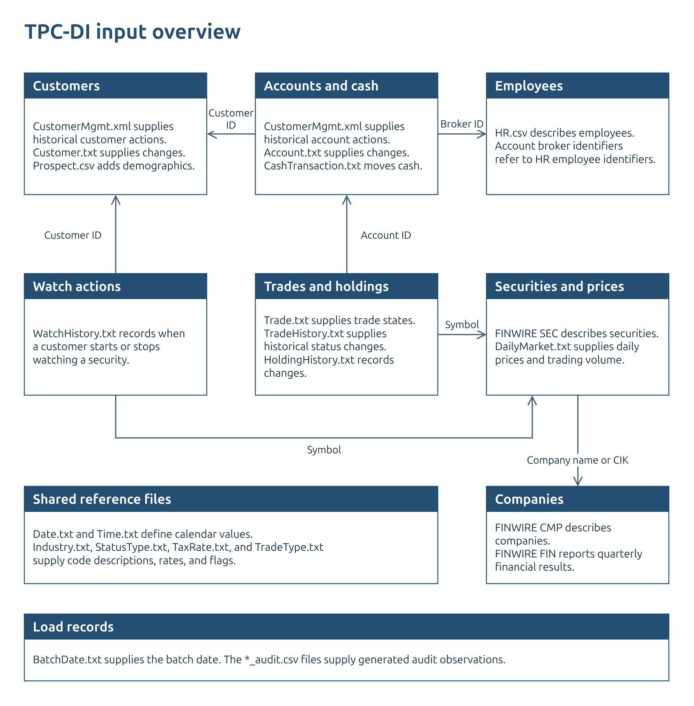
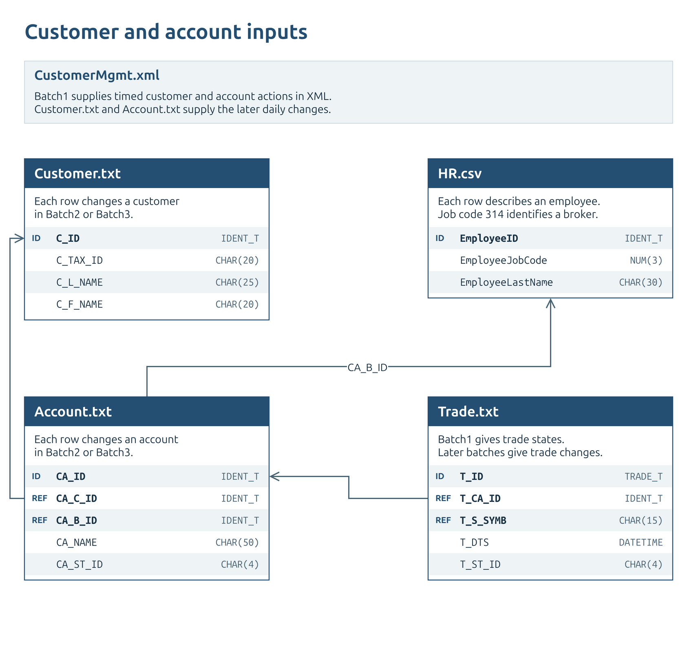
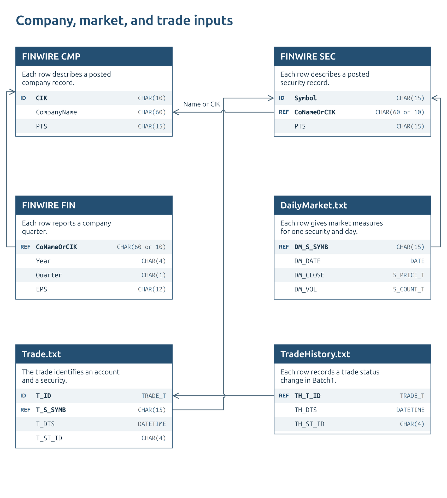
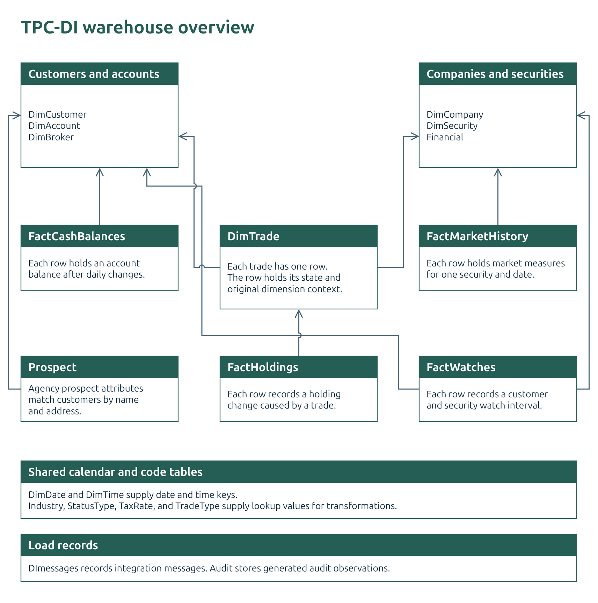
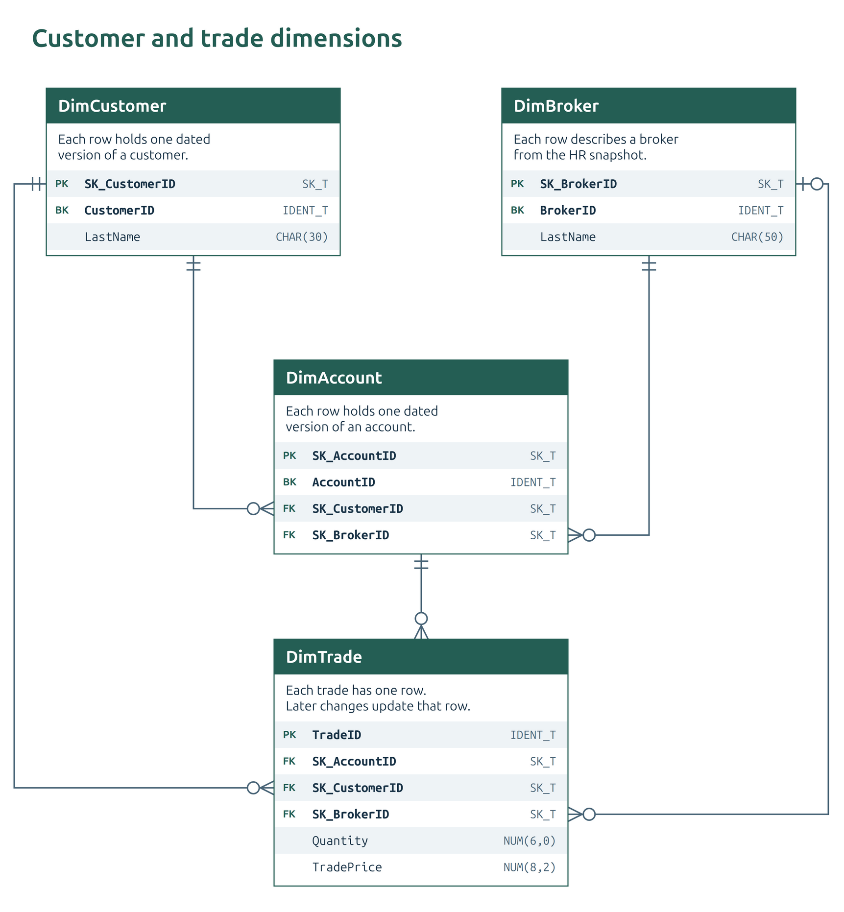
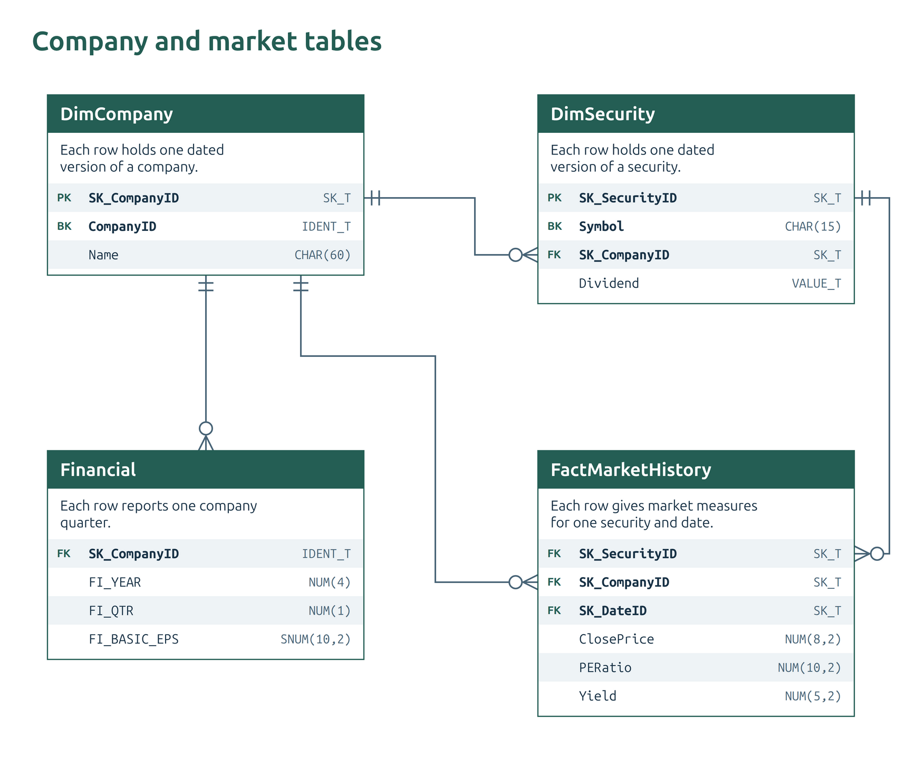
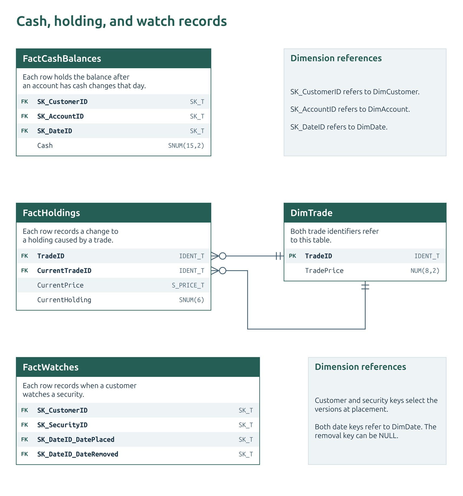

# TPC-DI

TPC-DI (Data Integration) is a benchmark from the Transaction Processing Performance Council (TPC) for evaluating data integration systems.

> The data model for the TPC-DI benchmark represents a retail brokerage. OLTP data is combined with data from additional sources to create the data warehouse.

> TPC-DI models an environment where all source system data has been extracted to flat files in a staging area before the remainder of the DI process begins. TPC-DI does not attempt to represent the wide range of data sources available in the marketplace, but models abstracted data sources and measures all systems involved in moving and transforming data from the Staging Area to the Data Warehouse.

The workload consists of a historical load followed by two daily incremental updates, with rules for transformation, validation, and performance measurement.

This reference document summarizes the information from the [TPC-DI 1.1.0 specification](TPC-DI_v1.1.0.pdf) relevant to this project.

| Section | Contents |
| --- | --- |
| [Load cycle](#load-cycle) | How the three batches build and maintain the warehouse. |
| [Sources and files](#source-systems-and-physical-files) | Where the data comes from, file contents, and batch use. |
| [Source-to-warehouse mapping](#source-to-warehouse-mapping) | How the inputs become warehouse records. |
| [Warehouse tables](#warehouse-tables) | What each table contains and how its records change. |
| [Detailed rules](#detailed-rules) | Exact identity, history, calculation, and matching rules. |
| [Field reference](#find-the-detailed-fields) | Raw samples and complete source and warehouse fields. |
| [Diagrams](#diagrams) | Existing data-flow and relationship views. |

## Load cycle

TPC-DI processes three batches in sequence. Each batch starts from the warehouse left by the previous batch.

| Batch | Starting state | Work |
| --- | --- | --- |
| Batch1: historical load | The warehouse is empty. | Load the historical records and reconstruct their history. |
| Batch2: first incremental update | Batch1 is complete. | Apply the next day's data. |
| Batch3: second incremental update | Batch2 is complete. | Apply another day's data using the same update process. |

The incremental batches are daily. OLTP extracts contain changes since the previous extraction; Prospect supplies another full snapshot. A batch can therefore combine CDC and full-snapshot inputs.

The historical load also contains action histories and archived reports. It does not consist only of current-state snapshots. FINWIRE's quarterly files organize its historical archive; the two incremental batches are still daily.

## Source systems and physical files

### Source systems

The brokerage has customers, accounts, and brokers. Trades connect accounts to securities; companies issue securities and publish financial results.

| Source | Data supplied |
| --- | --- |
| OLTP database | Customer and account changes, trades, cash movements, holding changes, market observations, and watch actions. |
| Customer Management System (CMS) | Historical customer and account actions. |
| HR database | Employees and their reporting relationships. |
| Prospect provider | Contact and demographic information for potential customers, including some existing customers. |
| FINWIRE service | Company records, security records, and quarterly financial reports. |
| Reference files | Dates, times, industries, statuses, tax rates, and trade types. |

### Physical source files

Batch2 and Batch3 share a column because they use the same file types and update rules. In that column, **new and changed records** means inserts and updates; **new records** means inserts only.

| Source or purpose | File | Contains | Format | Batch1: historical load | Batch2 and Batch3: daily updates |
| --- | --- | --- | --- | --- | --- |
| Customer Management System | `CustomerMgmt.xml` | Customer and account actions | XML | Historical actions | Not used |
| OLTP database | `Customer.txt` | Customer profiles | Pipe-delimited | Not used | New and changed records |
| OLTP database | `Account.txt` | Brokerage accounts | Pipe-delimited | Not used | New and changed records |
| OLTP database | `Trade.txt` | Trades | Pipe-delimited | Full extract | New and changed records |
| OLTP database | `TradeHistory.txt` | Trade status history | Pipe-delimited | Full extract | Not used |
| OLTP database | `CashTransaction.txt` | Cash movements | Pipe-delimited | Full extract | New records |
| OLTP database | `HoldingHistory.txt` | Changes in shares held | Pipe-delimited | Full extract | New records |
| OLTP database | `DailyMarket.txt` | Daily prices and volume | Pipe-delimited | Full extract | New records |
| OLTP database | `WatchHistory.txt` | Watchlist actions | Pipe-delimited | Full extract | New records |
| HR database | `HR.csv` | Employees | CSV | Full extract | Not used |
| Prospect provider | `Prospect.csv` | Potential customers | CSV | Full extract | Full extract |
| FINWIRE service | `FINWIRE` files | Companies, securities, and financial reports | Fixed-width | Quarterly archive | Not used |
| Reference data | `Date.txt`, `Time.txt` | Dates and times | Pipe-delimited | Full files | Not used |
| Reference data | `Industry.txt`, `StatusType.txt`, `TaxRate.txt`, `TradeType.txt` | Codes and descriptions | Pipe-delimited | Full files | Not used |
| Batch information | `BatchDate.txt` | Batch date | Text | Batch1 date | Current batch date |
| Audit data | `<name>_audit.csv` | Record counts and value totals | CSV | Batch1 observations | Current batch observations |

### Why the input patterns differ

- **Customers and accounts use two sources.** CMS actions supply the historical versions. Customer and account CDC files supply subsequent changes to the same entities.
- **Trades use two historical files.** `Trade.txt` supplies trade records; `TradeHistory.txt` supplies earlier status changes. Incremental `Trade.txt` rows already carry the status changes and their timestamps.
- **Prospects arrive as full snapshots.** The integration process compares each extract with stored values to detect changes.
- **FINWIRE, HR, and reference data stop after Batch1.** HR and reference data are fixed for the benchmark. FINWIRE updates are omitted because their volume has little effect on benchmark performance.

CDC rows carry `CDC_FLAG` and `CDC_DSN`. The flag specifies the operation; the sequence orders changes within the file. The sequence is not an event timestamp. `BatchDate.txt` supplies the batch date used by the load rules.

## Source-to-warehouse mapping

The integration process parses the files, resolves relationships, applies updates, and calculates the warehouse values below.

| Source records | Main transformation | Warehouse output |
| --- | --- | --- |
| CMS customer actions or `Customer.txt`, with Prospect and tax data | Reconstruct customer state, enrich attributes, and retain daily versions. | `DimCustomer` |
| CMS account actions or `Account.txt` | Reconstruct account state and resolve customer and broker keys. | `DimAccount` |
| `HR.csv` | Select brokers and map employee attributes. | `DimBroker` |
| FINWIRE `CMP` and `SEC` records | Build company and security histories; associate each security with its company. | `DimCompany`, `DimSecurity` |
| FINWIRE `FIN` records | Load quarterly financial values and resolve the company. | `Financial` |
| `Trade.txt` and historical `TradeHistory.txt` | Combine trade state and status history; resolve account and security context. | `DimTrade` |
| `CashTransaction.txt` | Sum each account's daily cash movements and add them to its previous balance. | `FactCashBalances` |
| `HoldingHistory.txt` | Join the modifying trade to obtain account, security, time, and price; retain the resulting quantity. | `FactHoldings` |
| `DailyMarket.txt` | Load daily prices and volume; calculate yearly highs/lows, price-to-earnings ratio, and dividend yield. | `FactMarketHistory` |
| `WatchHistory.txt` | Record the dates when a customer starts and stops watching a security. | `FactWatches` |
| `Prospect.csv` | Detect changes, match customers, and derive marketing tags. | `Prospect` and customer enrichment |
| Date, time, and code files | Load calendar attributes and lookup values. | Date/time dimensions and reference tables |
| Audit files and transformation checks | Store audit observations and integration messages. | `Audit`, `DImessages` |

**Load dependencies**

- Customer and broker records supply the keys used by accounts.
- Company records supply the keys used by securities and financial reports.
- Account and security records supply the context used by trades.
- Trades supply the context used by holdings. Account history supports cash balances; customer and security history supports watches.
- Prospect attributes enrich customers. After customer updates, the Prospect table's `IsCustomer` flag is matched against the active current customers.

These dependencies constrain processing order. A trade lookup cannot resolve an account version that has not been loaded.

## Warehouse tables

The output contains history-tracking dimensions, event and measurement tables, current records, and static lookups. They do not all use SCD2.

| Table | Contents | How records change |
| --- | --- | --- |
| `DimCustomer` | Customer profiles and enrichment. | SCD2. Historical versions come from CMS actions; later changes come from customer CDC and prospect data. |
| `DimAccount` | Accounts and their customer/broker relationships. | SCD2. Account changes and customer-version changes can create account versions. |
| `DimCompany` | Company attributes. | SCD2 history from FINWIRE. No Batch2 or Batch3 updates. |
| `DimSecurity` | Securities and their issuing companies. | SCD2 history from FINWIRE, including company-version changes. No Batch2 or Batch3 updates. |
| `DimBroker` | Broker attributes. | Uses the SCD2 structure, but receives one HR snapshot and no updates. |
| `DimTrade` | Trade status, creation/close times, quantities, and execution values. | One record per trade, updated as its lifecycle progresses. It is not SCD2. |
| `FactCashBalances` | Account cash balances. | Adds a daily balance for each account that had cash movements. |
| `FactHoldings` | Holding quantities after modifying trades. | Adds records for holding changes. Successive after-quantities are not additive. |
| `FactMarketHistory` | Daily security prices, volume, and calculated measures. | Adds daily observations. |
| `FactWatches` | Customer/security watch intervals. | Inserts an interval when a watch starts and updates its removal date when cancelled. |
| `Prospect` | Agency records, customer matches, and marketing tags. | Inserts new agency records and updates existing records. It is not SCD2. |
| `Financial` | Quarterly company financial results. | Loads the FINWIRE archive in Batch1; no later updates. |
| `DimDate`, `DimTime` | Calendar and time attributes. | Loaded once and unchanged. |
| `Industry`, `StatusType`, `TaxRate`, `TradeType` | Codes, descriptions, and tax rates. | Loaded once and unchanged. |
| `DImessages`, `Audit` | Integration messages and benchmark audit observations. | Records are added by the load and validation processes. |

**History and dates**

The five SCD2 tables use `IsCurrent`, `EffectiveDate`, and `EndDate`. TPC-DI combines changes into at most one new version per business key per day. A customer-version change also updates the related account versions; a company-version change updates related security versions.

Business timestamps, batch dates, and version dates have different roles. For example, historical cash balances use transaction dates, while incremental cash balances use the batch date. The [temporal rules](#temporal-rules) give the table-specific behavior.

Date partitioning is a physical storage choice. It does not replace SCD2 or determine whether a table appends or updates records.

The overview follows specification clauses 1.2 and 1.3 for loads and sources, Clause 3 for warehouse tables, and Clause 4 for transformations. The detailed rules and field references follow.

## Detailed rules

### Business objects and identifiers

The brokerage maintains customer accounts and handles requests to buy or sell securities.

| Object | Description | Identifier and relationship |
| --- | --- | --- |
| Customer | Can own several brokerage accounts. | `C_ID` identifies the customer. Account `CA_C_ID` refers to it. |
| Account | Holds a customer's trades and cash. | `CA_ID` identifies the account. Trade `T_CA_ID` refers to it. |
| Broker | Manages customer accounts. | HR `EmployeeID` becomes `BrokerID`. Account `CA_B_ID` refers to it. |
| Company | Issues securities and publishes financial results. | FINWIRE `CIK` becomes `CompanyID`. A security refers to its issuer by name or CIK. |
| Security | Represents a tradable financial instrument with market prices. | `Symbol` identifies it in security, trade, and daily market records. |
| Trade | Records a buy or sell order and its status, including uncompleted orders. | `T_ID` identifies the trade. Status history and holding changes refer to it. |
| Prospect | Represents an agency prospect who may already be a brokerage customer. | `AgencyID` identifies the prospect. Name and address matching connects it with customers. |

These identifiers can repeat across source changes. They identify business objects, not unique records across every extract.

### History and time

TPC-DI uses history-tracking dimensions, also called type 2 slowly changing dimensions (SCD2).

> History-tracking dimension tables retain information about changes to the data over time, while also allowing users to easily query for current information. This is accomplished using both the primary (or “natural”) key for a record in the source system, which is constant over time, and a surrogate key that is updated for each recorded change.
>
> Fact tables that reference a history-tracking dimension include a foreign key reference to the surrogate key, not the natural key.

When an existing natural key has an update, the load performs these steps:

1. Mark the existing record as not current and set its `EndDate`.
2. Insert a record with the same natural key, a new surrogate key, and all current field values.
3. Use the new surrogate key for new fact records that correspond to that natural key.

- The five history-tracking dimensions are `DimCustomer`, `DimAccount`, `DimCompany`, `DimSecurity`, and `DimBroker`.
- Changes to customer, account, company, and security records produce daily versions.
- `DimBroker` receives a single HR snapshot and is not updated during the benchmark.
- A version applies when `EffectiveDate <= date < EndDate`.

| Change | Required result |
| --- | --- |
| A natural key changes several times in one day. | The load combines those changes into one daily version. |
| A customer's version changes. | Related account versions receive the new customer key. |
| A company's version changes. | Related security versions receive the new company key. |

### Trade updates

> The DimTrade table is both a dimension table and a fact table, depending on how it is being used.

> Unlike other dimension tables in the Data Warehouse, DimTrade is not maintained as a history-tracking dimension. There are two state changes of concern for a trade: When it was initiated and when it was completed or cancelled. Therefore the record has date and time fields for the starting and ending states.

| Input or event | Effect |
| --- | --- |
| Historical `Trade.txt` | Trade state |
| Historical `TradeHistory.txt` | Trade's earlier status changes |
| Incremental `Trade.txt` | Full inserted or updated records |
| Creation | `PNDG` establishes creation time for a non-market order; `SBMT` does so for a market order. |
| Completion or cancellation | Close time, updated status, and execution values |
| Later updates | Account, customer, broker, security, and company keys retain the context selected at first load. |

### Calculations and enrichment

> The term “transformations” in this benchmark includes everything that must be done to prepare and load data into the Data Warehouse. This can include:
>
> - Conversion of data from character representations to data types compatible with the Data Warehouse specification
> - Lookups of business keys to obtain surrogate keys for the Data Warehouse
> - Merging or formatting multiple fields into one, or splitting one field into multiple
> - Checking data for errors or for adherence to business rules
> - Detecting changes in dimension data, and applying appropriate tracking mechanisms (retaining history or overwriting)
> - Detecting changes in fact data, and journaling updates to reflect current state

| Result | Calculation or rule |
| --- | --- |
| Cash balance | The new balance equals the previous balance plus the day's cash movements. |
| Balance continuity | The previous balance follows the business account across version changes. It starts at zero if no previous balance exists. |
| Holding change | `HH_T_ID` selects the modifying trade's dimensions, close time, and price. `HH_AFTER_QTY` supplies the resulting quantity, which can be negative. |
| One-year high and low | The load finds the highest and lowest prices over the specified one-year window. |
| Price-to-earnings ratio | Closing price / summed earnings per share for the previous four quarters gives the ratio. |
| Dividend yield | Dividend / closing price * 100 gives the percentage. |
| Watch interval | `ACTV` creates a row with no removal date. `CNCL` fills that date on the existing interval. |
| Prospect enrichment | Upper-cased name and address fields match customers. Attribute thresholds produce ordered marketing tags. Matching customer rows gain prospect attributes. |

### Historical actions are partial updates

| Action or input condition | Result |
| --- | --- |
| `NEW` or `ADDACCT` creates a record with an absent or empty property. | The property becomes NULL where allowed. |
| `UPDCUST` or `UPDACCT` omits a property. | The previous value remains. |
| An update supplies an explicitly empty element. | The corresponding value becomes NULL. |
| `CLOSEACCT` closes an account. | The account becomes inactive. |
| `INACT` inactivates a customer. | The customer and their current accounts become inactive. |

For an update, an omitted property retains its existing value. An empty element sets the value to NULL.

Inactivation changes the record's status without deleting it.

### Incremental files contain different kinds of change

- An incremental update carries the full source row.
- `CDC_DSN` orders changes within its file. It is not a timestamp and does not define an order across files.

| Files | Allowed CDC actions | Meaning |
| --- | --- | --- |
| Customer, account, and trade | `I` or `U` | The row inserts or updates a business record. |
| Cash, holding, market, and watch | `I` only | The row adds a source record. |

- No source file uses CDC deletion.
- A watch cancellation arrives as an inserted action with `W_ACTION=CNCL`.

### FINWIRE parsing and company lookup

| Rule | Behaviour |
| --- | --- |
| Record header | `PTS` occupies the first 15 characters. The three-character record type follows it. |
| Company identity | `CoNameOrCIK` contains either a company name or CIK. |
| File order | The load processes quarterly files in year and quarter order. |
| Company version | Lookup selects the version valid at posting time. |
| Later batches | FINWIRE supplies no incremental company, security, or financial updates. |

Padding preserves fixed field positions. Splitting on whitespace would lose those positions.

### Temporal rules

**Daily dimensions**

- Changes accumulate per natural key and day.
- The latest field value wins by timestamp. File order breaks timestamp ties.
- Multiple causes of an update produce one changed version.

**Trade times and context**

- `PNDG` supplies creation time. For market orders `TMB` and `TMS`, `SBMT` supplies creation time.
- `CMPT` or `CNCL` supplies close time.
- Historical status events come from `TradeHistory.txt`. Incremental updates use `Trade.txt.T_DTS`.
- Dimension keys and `BatchID` are set when the trade is first created. Later close updates retain them.

**Cash dates**

- Historical cash uses the transaction date and the account version valid on that date.
- Incremental cash uses the batch date and current account version.
- Both loads carry forward the business account's balance.

**Market window**

- The interval includes `DM_DATE` and excludes the same date one year earlier.
- Tied highs or lows use their earliest date.
- Prices span versions of the same security.

**Earnings ratio**

- Closing price is divided by summed company earnings per share for the previous four quarters before `DM_DATE`.
- The calculation includes company versions from that period.
- Missing earnings produce NULL and an alert.

**Watch cancellation**

- `W_C_ID` and `W_S_SYMB` identify the customer and security whose existing watch record must be found across version changes.
- Searching only with their latest surrogate keys can miss that record.
- Cancellation sets the removal date and changes `BatchID`.

The general history rule uses an exclusive `EndDate`, but the historical account lookup prints an inclusive comparison. This is a specification inconsistency.

### Prospect matching and tags

| Matching or update rule | Behaviour |
| --- | --- |
| Match fields | The comparison uses upper-cased `FirstName`, `LastName`, `AddressLine1`, `AddressLine2`, and `PostalCode`. |
| `IsCustomer` | Match against active current customers after the batch's customer updates. |
| `SK_RecordDateID` | Records the latest batch appearance date. |
| `SK_UpdateDateID` | First appearance or latest input-attribute change date. A change to `IsCustomer` alone does not advance it. |

Tags are joined with `+` in the order below. No matching tag produces NULL.

| Tag | Condition |
| --- | --- |
| `HighValue` | Net worth exceeds 1,000,000 or income exceeds 200,000. |
| `Expenses` | Children exceed 3 or credit cards exceed 5. |
| `Boomer` | Age exceeds 45. |
| `MoneyAlert` | Income is below 50,000, credit rating is below 600, or net worth is below 100,000. |
| `Spender` | Cars exceed 3 or credit cards exceed 7. |
| `Inherited` | Age is below 25 and net worth exceeds 1,000,000. |

### Customer enrichment

| Output | How it is populated |
| --- | --- |
| Phone fields | They combine available country, area, local-number, and extension fields. |
| National tax description and rate | The national tax identifier looks up both values in `TaxRate`. |
| Local tax description and rate | The local tax identifier looks up both values in `TaxRate`. |
| Historical demographic attributes | Prospect matching enriches the latest customer version only. |

### Error handling

DIGen supplies specified error conditions. The transformations retain the records and apply the required field changes and alerts.

| Condition | Required handling |
| --- | --- |
| Gender value | The output becomes uppercase M or F, or U for another value. |
| Invalid customer tier | The load records an alert. |
| Invalid date of birth | The load records an alert. |
| Invalid company credit rating | `SPrating` and `isLowGrade` become NULL, and the load records an alert. |
| Excessive trade commission or fee | The load records an alert. |

`DImessages` stores integration messages. `Audit` stores generated observations used to check the data.

## Find the detailed fields

The source and warehouse field references use the same subject groups.

- Source sections contain raw samples, format rules, and field tables.
- Warehouse sections define output fields and constraints.

| Subject | Source records | Warehouse tables |
| --- | --- | --- |
| Customers and accounts | [Open source fields](#customer-and-account-sources). | [Open warehouse fields](#customer-and-account-tables). |
| Companies and market data | [Open source fields](#company-and-market-sources). | [Open warehouse fields](#company-and-market-tables). |
| Trading and account activity | [Open source fields](#trading-and-account-activity-sources). | [Open warehouse fields](#trading-and-account-activity-tables). |
| Reference data | [Open source fields](#reference-data-sources). | [Open warehouse fields](#reference-data-tables). |
| Load records | [Open source fields](#load-record-sources). | [Open warehouse fields](#load-record-tables). |

### Sample data

Each source-file section includes a raw record from the local generated data.

- The values illustrate the format; they do not define benchmark dates, volumes, or behaviour.
- Long records scroll horizontally.
- FINWIRE samples omit trailing padding spaces only.

## Source field reference

- **Delimited layouts** list fields in file order.
- **XML layouts** show containment and attribute placement.
- **FINWIRE layouts** give physical field widths.
- **Constraints** state required values and allowed-value restrictions. A blank restriction in the specification adds no further rule.

### Formats and types

| Input | Record format | Date or time representation |
| --- | --- | --- |
| `.txt` files | Pipe-delimited text (`\|`) | `YYYY-MM-DD` dates; `YYYY-MM-DD HH:MM:SS` timestamps, without a time-zone offset |
| `.csv` files | Comma-separated values | As defined for each field |
| `CustomerMgmt.xml` | Nested customer and account elements within actions | `YYYY-MM-DDTHH:MM:SS` for `ActionTS` |
| FINWIRE | Fixed-width fields within each record type | `YYYYMMDD` dates; `YYYYMMDD-HHMMSS` posting timestamps |

Empty fields represent NULL where allowed. Numeric types define decimal precision.

### Source types and record conventions

Source types describe character sequences in text files.

- **Encoding:** The files use the specification's single-byte UTF-8 encoding.
- **Record endings:** The system under test determines the record terminators.
- **Ordering:** Rows have no defined order unless the file definition states one.
- **Dates:** The default format is `YYYY-MM-DD`; individual files can define another format.

| Type | Representation | Meaning and constraints |
| --- | --- | --- |
| `BOOLEAN` | `0` or `1` | `0` means false and `1` means true. |
| `CHAR(n)` | Up to `n` single-byte characters | Text. FINWIRE adds fixed-width padding rules. |
| `DATE` | `YYYY-MM-DD` | Month and day use leading zeroes. |
| `DATETIME` | `YYYY-MM-DD HH:MM:SS` | 24-hour time with leading zeroes; no time-zone offset |
| `NUM(m[,n])` | An unsigned decimal string | At most `m` digits appear in total, including at most `n` fractional digits. The string has at most `m+1` characters, including a decimal point. |
| `SNUM(m[,n])` | A signed decimal string | An optional `+` or `-` precedes at most `m` digits, including at most `n` fractional digits. The string has at most `m+2` characters. A missing sign means positive. |
| `BALANCE_T` | `SNUM(12,2)` | Aggregate account and transaction values |
| `CDC_FLAG_T` | `CHAR(1)` | The general type permits `I`, `U`, or `D`; each file narrows these values. |
| `CDC_DSN_T` | `NUM(12)` | The database sequence number increases monotonically. |
| `IDENT_T` | `NUM(11)` | Numeric identifiers |
| `S_COUNT_T` | `NUM(12)` | Aggregate share counts |
| `S_PRICE_T` | `SNUM(8,2)` | Share prices |
| `S_QTY_T` | `NUM(6)` | Share quantity of an individual trade |
| `TRADE_T` | `NUM(15)` | Trade identifiers |
| `VALUE_T` | `SNUM(10,2)` | Non-aggregated transaction and security values |

| Format | How an empty or missing value works |
| --- | --- |
| Delimited text | An empty field represents NULL where allowed. |
| FINWIRE | Spaces fill an empty field. |
| XML | An omitted property and an explicitly empty element have different update meanings. |

**Change data capture (CDC)**

- **Position:** `CDC_FLAG` and `CDC_DSN` occupy the first two fields in incremental OLTP files.
- **Content:** A changed row carries its values without identifying which fields changed. One business row can change several times in a day.
- **Ordering:** `CDC_DSN` orders changes within its file. It is neither a timestamp nor a specified sequence across files.
- **Deletion:** No individual file definition permits `D`.

### Customer and account sources

<details>
<summary>CustomerMgmt.xml</summary>

#### CustomerMgmt.xml fields

A raw action from `Batch1` is shown below. The enclosing document declares the `TPCDI` namespace.

```xml
<TPCDI:Action ActionType="CLOSEACCT" ActionTS="2007-07-16T00:29:01">
  <Customer C_ID="6">
    <Account CA_ID="6" />
  </Customer>
</TPCDI:Action>
```

| XML component | Structure |
| --- | --- |
| `Actions` | One or more `Action` elements in time order |
| `Action` | Exactly one `Customer` |
| `Customer` | Zero or more `Account` elements belonging to that customer |
| Namespace | The enclosing document declares `http://www.tpc.org/tpc-di`. |

This file supplies historical customer and account actions.

- The XML schema (XSD) defines attributes and nested elements.
- Value rules also depend on the action type.
- An empty element can appear as `<Element />`.
- An update supplies identifiers and changed properties; it omits other properties.

##### Action attributes

| Field | Type | Meaning and constraints |
| --- | --- | --- |
| `ActionType` | `CHAR(9)` | The value is `NEW`, `ADDACCT`, `UPDCUST`, `UPDACCT`, `CLOSEACCT`, or `INACT`. |
| `ActionTS` | `CHAR` | The action timestamp is nonempty and uses `YYYY-MM-DDTHH:MM:SS`, including the literal `T`. The table prints no character length. |

| ActionType | Meaning |
| --- | --- |
| `NEW` | Creation of a customer and one or more accounts |
| `ADDACCT` | Addition of one or more accounts to an existing customer |
| `UPDCUST` | Changes to an existing customer's properties |
| `UPDACCT` | Changes to one or more existing accounts |
| `CLOSEACCT` | Closure of one or more existing accounts |
| `INACT` | Inactivation of an existing customer |

##### Customer attributes

| Field | Type | Meaning and constraints |
| --- | --- | --- |
| `C_ID` | `IDENT_T` | The customer identifier is required and must be nonempty. |
| `C_TAX_ID` | `CHAR(20)` | The tax identifier must be nonempty when present and is required on `NEW`. |
| `C_GNDR` | `CHAR(1)` | The gender must be nonempty when present. |
| `C_TIER` | `NUM(1)` | The tier must be nonempty when present. |
| `C_DOB` | `DATE` | The date of birth must be nonempty when present and is required on `NEW`. |

##### Customer child elements

- **Group order:** The XSD places the optional groups `Name`, `Address`, `ContactInfo`, and `TaxInfo` before zero or more `Account` elements.
- **Field order:** Fields within the first four groups use `xsd:all`, so their order is not fixed.
- **Presence and value:** Requiring an element to appear does not necessarily require a nonempty value.

`Name` contains these elements.

| Field | Type | Meaning and constraints |
| --- | --- | --- |
| `C_L_NAME` | `CHAR(25)` | The last name must be nonempty when present and is required on `NEW`. The XSD requires this element if `Name` appears. |
| `C_F_NAME` | `CHAR(20)` | The first name must be nonempty when present and is required on `NEW`. The XSD requires this element if `Name` appears. |
| `C_M_NAME` | `CHAR(1)` | Middle initial. The XSD makes this element optional. |

`Address` contains these elements.

| Field | Type | Meaning and constraints |
| --- | --- | --- |
| `C_ADLINE1` | `CHAR(80)` | Address line 1 must be nonempty when present and is required on `NEW`. The XSD requires it if `Address` appears. |
| `C_ADLINE2` | `CHAR(80)` | Address line 2. The XSD makes it optional. |
| `C_ZIPCODE` | `CHAR(12)` | The postal code must be nonempty when present and is required on `NEW`. The XSD requires it if `Address` appears. |
| `C_CITY` | `CHAR(25)` | The city must be nonempty when present and is required on `NEW`. The XSD requires it if `Address` appears. |
| `C_STATE_PROV` | `CHAR(20)` | The state or province must be nonempty when present and is required on `NEW`. The XSD requires it if `Address` appears. |
| `C_CTRY` | `CHAR(24)` | Country. The XSD requires the element if `Address` appears, but its value can be empty. |

`ContactInfo` contains these optional elements.

| Field | Type | Meaning and constraints |
| --- | --- | --- |
| `C_PRIM_EMAIL` | `CHAR(50)` | Primary email address |
| `C_ALT_EMAIL` | `CHAR(50)` | Alternate email address |
| `C_PHONE_1` | `PhoneNumber` | Primary phone number |
| `C_PHONE_2` | `PhoneNumber` | Secondary phone number |
| `C_PHONE_3` | `PhoneNumber` | Third phone number |

Each `PhoneNumber` contains the elements below in the listed order.

- The XSD requires `C_AREA_CODE` and `C_LOCAL` when a phone element appears.
- `C_CTRY_CODE` and `C_EXT` are optional.
- The values can be empty.

| Field | Type | Meaning and constraints |
| --- | --- | --- |
| `C_CTRY_CODE` | `CHAR(3)` | Phone's country code |
| `C_AREA_CODE` | `CHAR(3)` | Phone's area code |
| `C_LOCAL` | `CHAR(10)` | Local phone number |
| `C_EXT` | `CHAR(5)` | Extension |

Both elements are required when `TaxInfo` appears. Their values can be empty.

| Field | Type | Meaning and constraints |
| --- | --- | --- |
| `C_LCL_TX_ID` | `CHAR(4)` | Local tax-rate identifier |
| `C_NAT_TX_ID` | `CHAR(4)` | National tax-rate identifier |

##### Account attributes and child elements

Each `Account` has the following attributes.

| Field | Type | Meaning and constraints |
| --- | --- | --- |
| `CA_ID` | `IDENT_T` | The account identifier is required and must be nonempty. |
| `CA_TAX_ST` | `NUM(1)` | The account tax status must be nonempty when present and is required on `NEW`. |

Each `Account` can contain these child elements. The XSD uses `xsd:all`, so their order is not fixed.

| Field | Type | Meaning and constraints |
| --- | --- | --- |
| `CA_B_ID` | `IDENT_T` | The managing broker's identifier must be nonempty when present and is required on `NEW`. |
| `CA_NAME` | `CHAR(50)` | Account name |

| Historical action | Property in the XML | Result |
| --- | --- | --- |
| Update | The property is omitted. | The previous value remains. |
| Update | The property is explicitly empty. | The value becomes NULL. |
| New record | The property is absent or empty. | The value becomes NULL where allowed. |

The parser must preserve the distinction between an omitted property and an empty property.

</details>

<details>
<summary>Customer.txt</summary>

#### Customer.txt fields

A raw `Batch2` record is shown below.

```text
I|6440|4728|031-80-9744|ACTV|Kempffer|Tandie|||3|1933-04-19|16132 Corsicana Road||85775|Overland Park|DC|United States of America|||880-2336|||266|978-6267||||||Tandie.Kempffer@gawab.com|Tandie.Kempffer@mail2world.com|DE2|MN1
```

- **Format:** The file uses `|` delimiters; an empty field represents NULL where allowed.
- **Order:** Rows follow `CDC_DSN` order.
- **Load:** This file supplies increments. Historical customer data comes from `CustomerMgmt.xml`.

| Field | Type | Meaning and constraints |
| --- | --- | --- |
| `CDC_FLAG` | `CDC_FLAG_T` | The value is `I` for insert or `U` for update. |
| `CDC_DSN` | `CDC_DSN_T` | The sequence number must not be NULL. |
| `C_ID` | `IDENT_T` | The customer identifier must not be NULL. |
| `C_TAX_ID` | `CHAR(20)` | The customer's tax identifier must not be NULL. |
| `C_ST_ID` | `CHAR(4)` | The customer status is `ACTV` or `INAC`. |
| `C_L_NAME` | `CHAR(25)` | The customer's last name must not be NULL. |
| `C_F_NAME` | `CHAR(20)` | The customer's first name must not be NULL. |
| `C_M_NAME` | `CHAR(1)` | Middle initial |
| `C_GNDR` | `CHAR(1)` | Customer's gender |
| `C_TIER` | `NUM(1)` | Customer tier |
| `C_DOB` | `DATE` | The date of birth must not be NULL. |
| `C_ADLINE1` | `CHAR(80)` | Address line 1 must not be NULL. |
| `C_ADLINE2` | `CHAR(80)` | Address line 2 |
| `C_ZIPCODE` | `CHAR(12)` | The postal code must not be NULL. |
| `C_CITY` | `CHAR(25)` | The city must not be NULL. |
| `C_STATE_PROV` | `CHAR(20)` | The state or province must not be NULL. |
| `C_CTRY` | `CHAR(24)` | Country |
| `C_CTRY_1` | `CHAR(3)` | Phone 1's country code |
| `C_AREA_1` | `CHAR(3)` | Phone 1's area code |
| `C_LOCAL_1` | `CHAR(10)` | Phone 1's local number |
| `C_EXT_1` | `CHAR(5)` | Phone 1's extension |
| `C_CTRY_2` | `CHAR(3)` | Phone 2's country code |
| `C_AREA_2` | `CHAR(3)` | Phone 2's area code |
| `C_LOCAL_2` | `CHAR(10)` | Phone 2's local number |
| `C_EXT_2` | `CHAR(5)` | Phone 2's extension |
| `C_CTRY_3` | `CHAR(3)` | Phone 3's country code |
| `C_AREA_3` | `CHAR(3)` | Phone 3's area code |
| `C_LOCAL_3` | `CHAR(10)` | Phone 3's local number |
| `C_EXT_3` | `CHAR(5)` | Phone 3's extension |
| `C_EMAIL_1` | `CHAR(50)` | Email address 1 |
| `C_EMAIL_2` | `CHAR(50)` | Email address 2 |
| `C_LCL_TX_ID` | `CHAR(4)` | The local tax-rate code must not be NULL. |
| `C_NAT_TX_ID` | `CHAR(4)` | The national tax-rate code must not be NULL. |

</details>

<details>
<summary>Account.txt</summary>

#### Account.txt fields

A raw `Batch2` record is shown below.

```text
I|12860|9008|11473|4728||1|ACTV
```

- **Format:** The file uses `|` delimiters; an empty field represents NULL where allowed.
- **Order:** Rows follow `CDC_DSN` order.
- **Load:** This file supplies increments. Historical account data comes from `CustomerMgmt.xml`.

| Field | Type | Meaning and constraints |
| --- | --- | --- |
| `CDC_FLAG` | `CDC_FLAG_T` | The value is `I` for insert or `U` for update. |
| `CDC_DSN` | `CDC_DSN_T` | The sequence number must not be NULL. |
| `CA_ID` | `IDENT_T` | The account identifier must not be NULL. |
| `CA_B_ID` | `IDENT_T` | The managing broker's identifier must not be NULL. |
| `CA_C_ID` | `IDENT_T` | The owning customer's identifier must not be NULL. |
| `CA_NAME` | `CHAR(50)` | Account name |
| `CA_TAX_ST` | `NUM(1)` | The account tax status is `0`, `1`, or `2`. |
| `CA_ST_ID` | `CHAR(4)` | The status code is `ACTV` or `INAC`. |

</details>

<details>
<summary>HR.csv</summary>

#### HR.csv fields

A raw `Batch1` record is shown below.

```text
0,211,Ozkan,Douglas,,647,EGZKSobTeknHCbLuHczvWmhTmCSGXD,OFFICE7152,(726) 088-3331
```

- **Format:** The file uses commas; an empty field represents NULL where allowed.
- **Order:** Rows follow `EmployeeID` order.
- **Content:** The historical extract describes employees and their reporting hierarchy.

| Field | Type | Meaning and constraints |
| --- | --- | --- |
| `EmployeeID` | `IDENT_T` | The employee identifier must not be NULL. |
| `ManagerID` | `IDENT_T` | The manager's employee identifier must not be NULL. |
| `EmployeeFirstName` | `CHAR(30)` | The first name must not be NULL. |
| `EmployeeLastName` | `CHAR(30)` | The last name must not be NULL. |
| `EmployeeMI` | `CHAR(1)` | Middle initial |
| `EmployeeJobCode` | `NUM(3)` | Numeric job code |
| `EmployeeBranch` | `CHAR(30)` | Facility containing the employee's office |
| `EmployeeOffice` | `CHAR(10)` | Office number or description |
| `EmployeePhone` | `CHAR(14)` | Employee's telephone number |

</details>

<details>
<summary>Prospect.csv</summary>

#### Prospect.csv fields

A raw `Batch1` record is shown below.

```text
PEL0,PELLAND,Netti,,f,21847 olympia street,,T6b 1i1,Fairbanks,MA,United States of America,1-712-522-6088,368776,,3,W,20,760,O,Brink's,,1058868
```

- **Format:** The file uses commas. An empty field represents NULL where allowed.
- **Load:** Each batch supplies a full extract without CDC fields.

| Field | Type | Meaning and constraints |
| --- | --- | --- |
| `AgencyID` | `CHAR(30)` | The agency's unique identifier must not be NULL. |
| `LastName` | `CHAR(30)` | The last name must not be NULL. |
| `FirstName` | `CHAR(30)` | The first name must not be NULL. |
| `MiddleInitial` | `CHAR(1)` | Middle initial |
| `Gender` | `CHAR(1)` | Gender: `M`, `F`, or `U` |
| `AddressLine1` | `CHAR(80)` | Postal address line 1 |
| `AddressLine2` | `CHAR(80)` | Postal address line 2 |
| `PostalCode` | `CHAR(12)` | Postal code |
| `City` | `CHAR(25)` | The city must not be NULL. |
| `State` | `CHAR(20)` | The state or province must not be NULL. |
| `Country` | `CHAR(24)` | Postal country |
| `Phone` | `CHAR(30)` | Telephone number |
| `Income` | `NUM(9)` | Annual income |
| `NumberCars` | `NUM(2)` | Number of cars owned |
| `NumberChildren` | `NUM(2)` | Number of dependent children |
| `MaritalStatus` | `CHAR(1)` | Marital status: `S`, `M`, `D`, `W`, or `U` |
| `Age` | `NUM(3)` | Current age |
| `CreditRating` | `NUM(4)` | Numeric credit rating |
| `OwnOrRentFlag` | `CHAR(1)` | Home ownership: `O`, `R`, or `U` |
| `Employer` | `CHAR(30)` | Employer name |
| `NumberCreditCards` | `NUM(2)` | Number of credit cards |
| `NetWorth` | `NUM(12)` | Estimated total net worth |

</details>

### Company and market sources

<details>
<summary>FINWIRE files</summary>

#### FINWIRE fields

| FINWIRE property | Rule |
| --- | --- |
| Filename | A quarterly historical file has a name such as `FINWIRE2003Q1`. |
| Record types | `CMP`, `SEC`, and `FIN` records can be mixed in one file. |
| Record order | Records follow increasing `PTS` order; record types need not form separate blocks. |
| Type marker | The record-type field starts at column 16. |
| Field boundaries | Fields have no delimiters. Each `CHAR(n)` field occupies exactly `n` characters, except for the two permitted `CoNameOrCIK` widths. |
| Text padding | Spaces pad text on the right. |
| Numeric padding | Spaces pad numeric content on the left. |
| CIK padding | Zeroes pad a CIK on the left to 10 characters. |
| Empty values | Spaces fill the entire field. |

- **Posting time:** `PTS` uses `YYYYMMDD-HHMMSS` in 24-hour time.
- **Other dates:** FINWIRE uses `YYYYMMDD`.
- **Physical types:** The fields use `CHAR` even when they contain numbers or dates.

##### CMP records

A raw `CMP` record is shown below.

```text
19670101-154842CMPkkhSvCsfgbDUvsiZWtPQwjkYPwKrfTUFMGMCWCBXBcOcTkaLSudO        0000000000ACTVDRA   1886072219918 Rogers North                                                                                                                                              35233       Long Beach               NC                  United States of AmericaEllebracht                                     CUpESkLIQ LBcTnhDEOCLVhfDjOopGKRBxRYGboIrPFcDxMSGkskSwAJdAPWSAPTf T
```

These fields describe a company. The fields appear in the order below.

| Field | Type | Meaning and constraints |
| --- | --- | --- |
| `PTS` | `CHAR(15)` | The posting timestamp must be nonempty. |
| `RecType` | `CHAR(3)` | The nonempty value is `CMP`. |
| `CompanyName` | `CHAR(60)` | The company name must be nonempty. |
| `CIK` | `CHAR(10)` | The SEC company identifier must be nonempty and uses leading zeroes. |
| `Status` | `CHAR(4)` | The nonempty status is `ACTV` or `INAC`. |
| `IndustryID` | `CHAR(2)` | The industry-segment code must be nonempty. |
| `SPrating` | `CHAR(4)` | The S&P credit rating must be nonempty. |
| `FoundingDate` | `CHAR(8)` | Founding date as `YYYYMMDD` |
| `AddrLine1` | `CHAR(80)` | Address line 1 must be nonempty. |
| `AddrLine2` | `CHAR(80)` | Address line 2 |
| `PostalCode` | `CHAR(12)` | The postal code must be nonempty. |
| `City` | `CHAR(25)` | The city must be nonempty. |
| `StateProvince` | `CHAR(20)` | The state or province must be nonempty. |
| `Country` | `CHAR(24)` | Country |
| `CEOname` | `CHAR(46)` | The CEO's name must be nonempty. |
| `Description` | `CHAR(150)` | The company description must be nonempty. |

##### SEC records

A raw `SEC` record is shown below.

```text
19670427-161251SECAAAAAAAAAAAAAAACOMMONACTVDiIPnSJHqplAHTPKTGIhStBRNgEpVZYuRSRDlerURQYDcFPMaJ                    NASDAQ652346051    1905061019660302        1.850000000005
```

These fields describe a security.

`CoNameOrCIK` identifies the issuing company by name or CIK.

| Field | Type | Meaning and constraints |
| --- | --- | --- |
| `PTS` | `CHAR(15)` | The posting timestamp must be nonempty. |
| `RecType` | `CHAR(3)` | The nonempty value is `SEC`. |
| `Symbol` | `CHAR(15)` | The security symbol must be nonempty. |
| `IssueType` | `CHAR(6)` | The issue type must be nonempty. |
| `Status` | `CHAR(4)` | The nonempty status is `ACTV` or `INAC`. |
| `Name` | `CHAR(70)` | The security name must be nonempty. |
| `ExID` | `CHAR(6)` | The exchange identifier must be nonempty. |
| `ShOut` | `CHAR(13)` | The number of outstanding shares must be nonempty. |
| `FirstTradeDate` | `CHAR(8)` | The first-trade date uses `YYYYMMDD` and must be nonempty. |
| `FirstTradeExchg` | `CHAR(8)` | The first-trade date on this exchange uses `YYYYMMDD` and must be nonempty. |
| `Dividend` | `CHAR(12)` | The dividend contains a `VALUE_T` value and must be nonempty. |
| `CoNameOrCIK` | `CHAR(60 or 10)` | The nonempty field contains a 10-digit CIK if it consists only of digits, or a 60-character company-name field otherwise. |

##### FIN records

A raw `FIN` record is shown below.

```text
19670401-063705FIN196721967040119670401    9288741181.53    2284183075.45       13.18       12.44        0.25     805819257.50  135871569610.30    4339544932.47    173262702    1836200100000000068
```

These fields describe a company's quarterly financial report.

`CoNameOrCIK` identifies the company by name or CIK, as in `SEC` records.

| Field | Type | Meaning and constraints |
| --- | --- | --- |
| `PTS` | `CHAR(15)` | The posting timestamp must be nonempty. |
| `RecType` | `CHAR(3)` | The nonempty value is `FIN`. |
| `Year` | `CHAR(4)` | The year of the quarter's end must be nonempty. |
| `Quarter` | `CHAR(1)` | The nonempty quarter number is `1`, `2`, `3`, or `4`. |
| `QtrStartDate` | `CHAR(8)` | The quarter's start date uses `YYYYMMDD` and must be nonempty. |
| `PostingDate` | `CHAR(8)` | The report's posting date uses `YYYYMMDD` and must be nonempty. |
| `Revenue` | `CHAR(17)` | Reported quarterly revenue must be nonempty. |
| `Earnings` | `CHAR(17)` | Reported quarterly net earnings must be nonempty. |
| `EPS` | `CHAR(12)` | Basic quarterly earnings per share must be nonempty. |
| `DilutedEPS` | `CHAR(12)` | Diluted quarterly earnings per share must be nonempty. |
| `Margin` | `CHAR(12)` | Quarterly profit divided by revenue must be nonempty. |
| `Inventory` | `CHAR(17)` | The inventory value at quarter-end must be nonempty. |
| `Assets` | `CHAR(17)` | The total asset value at quarter-end must be nonempty. |
| `Liabilities` | `CHAR(17)` | The total liability value at quarter-end must be nonempty. |
| `ShOut` | `CHAR(13)` | The average number of outstanding shares must be nonempty. |
| `DilutedShOut` | `CHAR(13)` | The diluted average number of outstanding shares must be nonempty. |
| `CoNameOrCIK` | `CHAR(60 or 10)` | The nonempty field contains a 10-digit CIK if it consists only of digits, or a 60-character company-name field otherwise. |

</details>

<details>
<summary>DailyMarket.txt</summary>

#### DailyMarket.txt fields

A raw `Batch1` record is shown below.

```text
2015-07-06|AAAAAAAAAAAABOY|242.93|284.42|185.08|111904727
```

- **Format:** The file uses `|` delimiters.
- **Historical rows:** They omit the first two CDC fields.
- **Incremental rows:** They contain only inserts and follow `CDC_DSN` order.

| Field | Type | Meaning and constraints |
| --- | --- | --- |
| `CDC_FLAG` | `CDC_FLAG_T` | The incremental value is `I`. |
| `CDC_DSN` | `CDC_DSN_T` | The incremental sequence number must not be NULL. |
| `DM_DATE` | `DATE` | The date of the last completed trading day must not be NULL. |
| `DM_S_SYMB` | `CHAR(15)` | The security symbol must not be NULL. |
| `DM_CLOSE` | `S_PRICE_T` | The day's closing price must not be NULL. |
| `DM_HIGH` | `S_PRICE_T` | The day's highest price must not be NULL. |
| `DM_LOW` | `S_PRICE_T` | The day's lowest price must not be NULL. |
| `DM_VOL` | `S_COUNT_T` | The day's trading volume must not be NULL. |

</details>

### Trading and account activity sources

<details>
<summary>Trade.txt</summary>

#### Trade.txt fields

A raw `Batch1` record is shown below.

```text
0|2012-07-07 00:02:34|CMPT|TMB|0|AAAAAAAAAAAACQP|2939|9.57|0|3160|10.02|58.95|27.31|1611.19
```

An incremental record adds the CDC fields.

```text
U|1488405|372101|2017-07-08 00:57:49|SBMT|TLS|0|AAAAAAAAAAAABFV|5225|4.06|428|990||||
```

- **Format:** The file uses `|` delimiters; an empty field represents NULL where allowed.
- **Historical order:** Rows follow `T_ID` order and omit the first two CDC fields.
- **Incremental order:** Rows follow `CDC_DSN` order.
- **Identifier types:** Source `T_ID` uses `TRADE_T`; target `DimTrade.TradeID` uses the printed type `IDENT_T`.

| Field | Type | Meaning and constraints |
| --- | --- | --- |
| `CDC_FLAG` | `CDC_FLAG_T` | The incremental value is `I` for insert or `U` for update. |
| `CDC_DSN` | `CDC_DSN_T` | The incremental sequence number must not be NULL. |
| `T_ID` | `TRADE_T` | The trade identifier must not be NULL. |
| `T_DTS` | `DATETIME` | The trade timestamp must not be NULL. |
| `T_ST_ID` | `CHAR(4)` | The status-type identifier must not be NULL. |
| `T_TT_ID` | `CHAR(3)` | The trade-type identifier must not be NULL. |
| `T_IS_CASH` | `BOOLEAN` | `1` identifies a cash trade and `0` identifies a margin trade. |
| `T_S_SYMB` | `CHAR(15)` | The security symbol must not be NULL. |
| `T_QTY` | `S_QTY_T` | The traded quantity must be greater than zero. |
| `T_BID_PRICE` | `S_PRICE_T` | The requested unit price must be greater than zero. |
| `T_CA_ID` | `IDENT_T` | The account identifier must not be NULL. |
| `T_EXEC_NAME` | `CHAR(49)` | The name of the person executing the trade must not be NULL. |
| `T_TRADE_PRICE` | `S_PRICE_T` | The execution price is NULL except for `CMPT` rows, where it must be greater than zero. |
| `T_CHRG` | `VALUE_T` | The fee is NULL except for `CMPT` rows, where it must be zero or greater. |
| `T_COMM` | `VALUE_T` | The commission is NULL except for `CMPT` rows, where it must be zero or greater. |
| `T_TAX` | `VALUE_T` | The tax is NULL except for `CMPT` rows, where it must be zero or greater. |

</details>

<details>
<summary>TradeHistory.txt</summary>

#### TradeHistory.txt fields

A raw `Batch1` record is shown below.

```text
0|2012-07-07 00:01:13|SBMT
```

- **Format:** The historical-only file uses `|` delimiters and has no CDC prefix.
- **Order:** Rows follow `TH_T_ID` order. This does not establish global timestamp order.

| Field | Type | Meaning and constraints |
| --- | --- | --- |
| `TH_T_ID` | `TRADE_T` | The trade identifier corresponds to `Trade.txt.T_ID` and must not be NULL. |
| `TH_DTS` | `DATETIME` | The time when the trade history was updated must not be NULL. |
| `TH_ST_ID` | `CHAR(4)` | The status-type identifier must not be NULL. |

</details>

<details>
<summary>CashTransaction.txt</summary>

#### CashTransaction.txt fields

A raw `Batch1` record is shown below.

```text
0|2012-07-11 08:10:42|-37215.14|TGDRsaHPherhApDuHfXUPdexIUoEzKdgRAGECsgXJIRZuinwrC IOgbbXOnYkqXdAsS
```

- **Format:** The file uses `|` delimiters.
- **Historical rows:** They omit the first two CDC fields.
- **Incremental rows:** They contain only inserts and follow `CDC_DSN` order.
- **Identity:** The file supplies no transaction identifier.

| Field | Type | Meaning and constraints |
| --- | --- | --- |
| `CDC_FLAG` | `CDC_FLAG_T` | The incremental value is `I`. |
| `CDC_DSN` | `CDC_DSN_T` | The incremental sequence number must not be NULL. |
| `CT_CA_ID` | `IDENT_T` | The account identifier must not be NULL. |
| `CT_DTS` | `DATETIME` | The timestamp must not be NULL. The source table describes it as the time when the trade took place. |
| `CT_AMT` | `VALUE_T` | The cash transaction amount must not be NULL. |
| `CT_NAME` | `CHAR(100)` | The transaction name or description must not be NULL. |

</details>

<details>
<summary>HoldingHistory.txt</summary>

#### HoldingHistory.txt fields

A raw `Batch1` record is shown below.

```text
0|0|0|2939
```

- **Format:** The file uses `|` delimiters.
- **Historical rows:** They omit the first two CDC fields.
- **Incremental rows:** They contain only inserts and follow `CDC_DSN` order.
- **Content:** Each row supplies two trade identifiers and before/after quantities.
- **Missing context:** The row has no timestamp, account identifier, or security symbol.

| Field | Type | Meaning and constraints |
| --- | --- | --- |
| `CDC_FLAG` | `CDC_FLAG_T` | The incremental value is `I`. |
| `CDC_DSN` | `CDC_DSN_T` | The incremental sequence number must not be NULL. |
| `HH_H_T_ID` | `TRADE_T` | The identifier of the trade that originally created the holding row must not be NULL. |
| `HH_T_ID` | `TRADE_T` | The identifier of the current modifying trade must not be NULL. |
| `HH_BEFORE_QTY` | `S_QTY_T` | The quantity held before the modifying trade must not be NULL. |
| `HH_AFTER_QTY` | `S_QTY_T` | The quantity held after the modifying trade must not be NULL. |

</details>

<details>
<summary>WatchHistory.txt</summary>

#### WatchHistory.txt fields

A raw `Batch1` record is shown below.

```text
17|AAAAAAAAAAAAAJR|2012-07-07 00:03:44|ACTV
```

- **Format:** The file uses `|` delimiters.
- **Historical rows:** They omit the first two CDC fields and follow `W_DTS` order.
- **Incremental rows:** They contain only inserts and follow `CDC_DSN` order.
- **Cancellation:** An inserted source action can cancel an existing watch.

| Field | Type | Meaning and constraints |
| --- | --- | --- |
| `CDC_FLAG` | `CDC_FLAG_T` | The incremental value is `I`. |
| `CDC_DSN` | `CDC_DSN_T` | The incremental sequence number must not be NULL. |
| `W_C_ID` | `IDENT_T` | The customer identifier must not be NULL. |
| `W_S_SYMB` | `CHAR(15)` | The watched security's symbol must not be NULL. |
| `W_DTS` | `DATETIME` | The action timestamp must not be NULL. |
| `W_ACTION` | `CHAR(4)` | `ACTV` activates the watch and `CNCL` cancels it. |

</details>

### Reference data sources

<details>
<summary>Date.txt</summary>

#### Date.txt fields

A raw `Batch1` record is shown below.

```text
19500101|1950-01-01|January 1, 1950|1950|1950|19501|1950 Q1|19501|1950 January|19501|1950-W1|7|Sunday|1950|1950|19503|1950 Q3|true
```

- **Format:** The file uses `|` delimiters; an empty field represents NULL where allowed.
- **Order:** Rows follow `SK_DateID` order.
- **Source type:** `DateValue` uses `CHAR(20)`, even though the warehouse stores a typed value.

| Field | Type | Meaning and constraints |
| --- | --- | --- |
| `SK_DateID` | `IDENT_T` | The date surrogate key must not be NULL. |
| `DateValue` | `CHAR(20)` | The date as text, such as `2004-07-07`, must not be NULL. |
| `DateDesc` | `CHAR(20)` | The date description, such as `July 7, 2004`, must not be NULL. |
| `CalendarYearID` | `NUM(4)` | The calendar year number must not be NULL. |
| `CalendarYearDesc` | `CHAR(20)` | The calendar year as text must not be NULL. |
| `CalendarQtrID` | `NUM(5)` | The calendar-quarter identifier, such as `20042`, must not be NULL. |
| `CalendarQtrDesc` | `CHAR(20)` | The calendar-quarter description, such as `2004 Q2`, must not be NULL. |
| `CalendarMonthID` | `NUM(6)` | The calendar-month identifier must not be NULL. |
| `CalendarMonthDesc` | `CHAR(20)` | The calendar-month description, such as `2004 July`, must not be NULL. |
| `CalendarWeekID` | `NUM(6)` | The calendar-week identifier, such as `200428`, must not be NULL. |
| `CalendarWeekDesc` | `CHAR(20)` | The calendar-week description, such as `2004-W28`, must not be NULL. |
| `DayOfWeekNum` | `NUM(1)` | The day-of-week number must not be NULL. |
| `DayOfWeekDesc` | `CHAR(10)` | The day name, such as `Wednesday`, must not be NULL. |
| `FiscalYearID` | `NUM(4)` | The fiscal-year number must not be NULL. |
| `FiscalYearDesc` | `CHAR(20)` | The fiscal-year description must not be NULL. |
| `FiscalQtrID` | `NUM(5)` | The fiscal-quarter identifier, such as `20051`, must not be NULL. |
| `FiscalQtrDesc` | `CHAR(20)` | The fiscal-quarter description, such as `2005 Q1`, must not be NULL. |
| `HolidayFlag` | `BOOLEAN` | The flag indicates a holiday. |

</details>

<details>
<summary>Time.txt</summary>

#### Time.txt fields

A raw `Batch1` record is shown below.

```text
000000|00:00:00|00|00|00|00:00|00|00:00:00|false|false
```

- **Format:** The file uses `|` delimiters; an empty field represents NULL where allowed.
- **Order:** Rows follow `SK_TimeID` order.
- **Source type:** `TimeValue` uses `CHAR(20)`, even though the warehouse stores a typed value.
- **Time:** Values use 24-hour time.

| Field | Type | Meaning and constraints |
| --- | --- | --- |
| `SK_TimeID` | `IDENT_T` | The time surrogate key must not be NULL. |
| `TimeValue` | `CHAR(20)` | The time as text, such as `01:23:45`, must not be NULL. |
| `HourID` | `NUM(2)` | The hour number, such as `01`, must not be NULL. |
| `HourDesc` | `CHAR(20)` | The hour as text, such as `01`, must not be NULL. |
| `MinuteID` | `NUM(2)` | The minute number, such as `23`, must not be NULL. |
| `MinuteDesc` | `CHAR(20)` | The hour and minute as text, such as `01:23`, must not be NULL. |
| `SecondID` | `NUM(2)` | The second number, such as `45`, must not be NULL. |
| `SecondDesc` | `CHAR(20)` | The hour, minute, and second as text, such as `01:23:45`, must not be NULL. |
| `MarketHoursFlag` | `BOOLEAN` | The flag indicates a time during market hours. |
| `OfficeHoursFlag` | `BOOLEAN` | The flag indicates a time during office hours. |

</details>

<details>
<summary>Industry.txt</summary>

#### Industry.txt fields

A raw `Batch1` record is shown below.

```text
AA|Misc. Capital Goods|FN
```

This reference file uses `|` delimiters.

| Field | Type | Meaning and constraints |
| --- | --- | --- |
| `IN_ID` | `CHAR(2)` | The industry code must not be NULL. |
| `IN_NAME` | `CHAR(50)` | The industry description must not be NULL. |
| `IN_SC_ID` | `CHAR(4)` | The sector identifier must not be NULL. |

</details>

<details>
<summary>StatusType.txt</summary>

#### StatusType.txt fields

A raw `Batch1` record is shown below.

```text
ACTV|Active
```

This reference file uses `|` delimiters.

| Field | Type | Meaning and constraints |
| --- | --- | --- |
| `ST_ID` | `CHAR(4)` | The status code must not be NULL. |
| `ST_NAME` | `CHAR(10)` | The status description must not be NULL. |

</details>

<details>
<summary>TaxRate.txt</summary>

#### TaxRate.txt fields

A raw `Batch1` record is shown below.

```text
US1|U.S. Income Tax Bracket for the poor|0.15000
```

This reference file uses `|` delimiters.

| Field | Type | Meaning and constraints |
| --- | --- | --- |
| `TX_ID` | `CHAR(4)` | The tax-rate code must not be NULL. |
| `TX_NAME` | `CHAR(50)` | The tax-rate description must not be NULL. |
| `TX_RATE` | `NUM(6,5)` | The tax rate must not be NULL. |

</details>

<details>
<summary>TradeType.txt</summary>

#### TradeType.txt fields

A raw `Batch1` record is shown below.

```text
TMB|Market Buy|0|1
```

- **Format:** The file uses `|` delimiters.
- **Types:** Both flags use `NUM(1)` in the specification.

| Field | Type | Meaning and constraints |
| --- | --- | --- |
| `TT_ID` | `CHAR(3)` | The trade-type code must not be NULL. |
| `TT_NAME` | `CHAR(12)` | The trade-type description must not be NULL. |
| `TT_IS_SELL` | `NUM(1)` | The flag indicates a sale and must not be NULL. |
| `TT_IS_MRKT` | `NUM(1)` | The flag indicates a market order and must not be NULL. |

</details>

### Load record sources

<details>
<summary>BatchDate.txt</summary>

#### BatchDate.txt fields

A raw `Batch1` record is shown below.

```text
2017-07-07
```

The file has one row and one field. It records the extraction date of the source files in the staging area.

| Field | Type | Meaning and constraints |
| --- | --- | --- |
| `BatchDate` | `DATE` | The batch date uses `YYYY-MM-DD` and must not be NULL. |

</details>

<details>
<summary>Audit files</summary>

#### Audit files fields

A raw row from `FINWIRE1996Q4_audit.csv` follows its header.

```csv
DataSet, BatchID ,Date , Attribute , Value, DValue
DimSecurity,1,,FW_SEC,11,
```

- **Location:** `<name>_audit.csv` files occur in each staging batch directory.
- **Content:** They describe generated-data components rather than business events.
- **Format:** The files use commas, and the first record contains field names.
- **NULL:** An empty field between commas, or before the record terminator, represents NULL where allowed.

| Field | Type | Meaning and constraints |
| --- | --- | --- |
| `DataSet` | `CHAR(20)` | The component name must not be NULL. |
| `BatchID` | `NUM(5)` | Associated batch identifier |
| `Date` | `DATE` | Date associated with the attribute |
| `Attribute` | `CHAR(50)` | The observed attribute name must not be NULL. |
| `Value` | `SNUM(15)` | Attribute's integer value |
| `DValue` | `SNUM(15,5)` | Attribute's decimal value |

</details>

## Warehouse field reference

- **Names and types:** The tables retain the specification's field names and printed types.
- **Required values:** Fields are `Not NULL` unless the description states otherwise.
- **Other restrictions:** Descriptions identify nullable fields and fields with only a value restriction.
- **Storage:** A type alias describes a requirement; it does not select a database type.

### Warehouse records

| Table | What one record represents | Source or transformation |
| --- | --- | --- |
| `DimCustomer` | Daily customer version | Customer data enriched with tax descriptions, formatted phones, and prospect attributes |
| `DimAccount` | Daily account version | Account data with customer and broker version keys |
| `DimBroker` | Broker | HR records with job code 314 |
| `DimCompany` | Daily company version | FINWIRE `CMP` records with industry and status descriptions |
| `DimSecurity` | Daily security version | FINWIRE `SEC` records with the company version key |
| `DimDate` | Calendar date | `Date.txt` |
| `DimTime` | Second of the day | `Time.txt` |
| `DimTrade` | Trade's current state | Trade attributes combined with status times |
| `FactCashBalances` | Account balance for a day with cash changes | Previous balance plus cash movements |
| `FactHoldings` | Holding change | Holding history with context and price from the modifying trade |
| `FactMarketHistory` | Market measures for one security and date | Daily market data with rolling prices, earnings ratios, and yield |
| `FactWatches` | Customer/security watch interval | Placement and removal dates from watch actions |
| `Financial` | Company fiscal quarter | FINWIRE `FIN` records with the company version key |
| `Prospect` | Agency prospect's current attributes | Prospect feed with marketing tags and customer matching |
| `Industry` | Industry code | `Industry.txt` |
| `StatusType` | Status code | `StatusType.txt` |
| `TaxRate` | Tax code and rate | `TaxRate.txt` |
| `TradeType` | Trade type and flags | `TradeType.txt` |
| `DImessages` | Integration message | Alerts and status information from transformations |
| `Audit` | Generator audit observation | Audit files |

### Common warehouse types and history fields

| Type | Definition |
| --- | --- |
| `BOOLEAN` | True or false |
| `CHAR(n)` | Up to `n` single-byte characters |
| `DATE` | Date from 1800-01-01 through 9999-12-31 |
| `DATETIME` | Timestamp to millisecond precision, from 1800-01-01 through 2199-12-31 |
| `TIME` | Time of day from 00:00:00.000 through 23:59:59.999, to millisecond precision |
| `NUM(m[,n])` | Unsigned exact number with at most `m` total digits and `n` fractional digits. Omitted `n` means an integer. |
| `SNUM(m[,n])` | Corresponding signed exact number |
| `IDENT_T`, `SK_T` | Both use `NUM(11)`. The specification describes `IDENT_T` as a numeric identifier from OLTP tables and `SK_T` as a dimension-row surrogate key. |
| `TRADE_T` | Uses `NUM(15)` for a trade identifier. |
| `S_COUNT_T` | Uses `NUM(12)` for a share count. |
| `S_PRICE_T` | Uses `SNUM(8,2)` for a share price. |
| `VALUE_T` | Uses `SNUM(10,2)` for an individual financial value. |
| `BALANCE_T` | Uses `SNUM(12,2)` for an aggregate balance. |
| `FIN_AGG_T` | Uses `SNUM(15,2)` for aggregate financial data. |

The five history-tracking tables below each contain these four fields. Their individual tables list the remaining fields in specification order.

| Field | Type | Meaning |
| --- | --- | --- |
| `IsCurrent` | `BOOLEAN` | Identifies the current version of the business object. |
| `BatchID` | `NUM(5)` | Identifies the batch that inserted the version. |
| `EffectiveDate` | `DATE` | Gives the first date for which the version applies. |
| `EndDate` | `DATE` | Gives the exclusive end of the version's date range. The current version uses 9999-12-31. |

### Customer and account tables

<details>
<summary>DimCustomer</summary>

#### DimCustomer fields

This table contains the 29 fields below, followed by the four common history fields.

| Field | Type | Meaning and constraints |
| --- | --- | --- |
| `SK_CustomerID` | `SK_T` | Identifies this customer version. |
| `CustomerID` | `IDENT_T` | Identifies the customer across versions. |
| `TaxID` | `CHAR(20)` | Customer's tax identifier |
| `Status` | `CHAR(10)` | Status description |
| `LastName` | `CHAR(30)` | Last name |
| `FirstName` | `CHAR(30)` | First name |
| `MiddleInitial` | `CHAR(1)` | Middle initial; may be NULL |
| `Gender` | `CHAR(1)` | Gender code; may be NULL |
| `Tier` | `NUM(1)` | Customer tier; may be NULL |
| `DOB` | `DATE` | Date of birth |
| `AddressLine1` | `CHAR(80)` | First address line |
| `AddressLine2` | `CHAR(80)` | Second address line; may be NULL |
| `PostalCode` | `CHAR(12)` | Postal code |
| `City` | `CHAR(25)` | City |
| `StateProv` | `CHAR(20)` | State or province |
| `Country` | `CHAR(24)` | Country; may be NULL |
| `Phone1` | `CHAR(30)` | First assembled phone number; may be NULL |
| `Phone2` | `CHAR(30)` | Second assembled phone number; may be NULL |
| `Phone3` | `CHAR(30)` | Third assembled phone number; may be NULL |
| `Email1` | `CHAR(50)` | First email address; may be NULL |
| `Email2` | `CHAR(50)` | Second email address; may be NULL |
| `NationalTaxRateDesc` | `CHAR(50)` | National tax description; may be NULL |
| `NationalTaxRate` | `NUM(6,5)` | National tax rate; may be NULL |
| `LocalTaxRateDesc` | `CHAR(50)` | Local tax description; may be NULL |
| `LocalTaxRate` | `NUM(6,5)` | Local tax rate; may be NULL |
| `AgencyID` | `CHAR(30)` | Identifies the matching agency prospect. It may be NULL. |
| `CreditRating` | `NUM(5)` | Matched prospect's credit rating; may be NULL |
| `NetWorth` | `SNUM(10)` | Matched prospect's net worth; may be NULL |
| `MarketingNameplate` | `CHAR(100)` | Derived marketing tags; may be NULL |

</details>

<details>
<summary>DimAccount</summary>

#### DimAccount fields

This table contains the seven fields below, followed by the four common history fields.

| Field | Type | Meaning and constraints |
| --- | --- | --- |
| `SK_AccountID` | `SK_T` | Identifies this account version. |
| `AccountID` | `IDENT_T` | Identifies the business account across versions. |
| `SK_BrokerID` | `SK_T` | References the managing broker. |
| `SK_CustomerID` | `SK_T` | References the owning customer version. |
| `Status` | `CHAR(10)` | Account status description |
| `AccountDesc` | `CHAR(50)` | Account name; may be NULL |
| `TaxStatus` | `NUM(1)` | 0, 1, or 2. The table does not require a non-NULL value. |

</details>

<details>
<summary>DimBroker</summary>

#### DimBroker fields

This table contains the nine fields below, followed by the four common history fields.

`ManagerID` is an HR employee identifier. The manager need not have a row in `DimBroker`.

| Field | Type | Meaning and constraints |
| --- | --- | --- |
| `SK_BrokerID` | `SK_T` | Identifies the warehouse broker row. |
| `BrokerID` | `IDENT_T` | Identifies the broker in HR. |
| `ManagerID` | `IDENT_T` | Identifies the manager's HR record. It may be NULL. |
| `FirstName` | `CHAR(50)` | Broker's first name |
| `LastName` | `CHAR(50)` | Broker's last name |
| `MiddleInitial` | `CHAR(1)` | Middle initial; may be NULL |
| `Branch` | `CHAR(50)` | Office facility; may be NULL |
| `Office` | `CHAR(50)` | Office number or description; may be NULL |
| `Phone` | `CHAR(14)` | Phone number; may be NULL |

</details>

<details>
<summary>Prospect</summary>

#### Prospect fields

The table keeps current prospect attributes and matching results. It does not use SCD2.

| Field | Type | Meaning and constraints |
| --- | --- | --- |
| `AgencyID` | `CHAR(30)` | Identifies the prospect in the agency feed. |
| `SK_RecordDateID` | `SK_T` | References the most recent batch date on which the prospect appears in the feed. |
| `SK_UpdateDateID` | `SK_T` | References the first appearance or latest input-attribute change date. An `IsCustomer` change alone does not advance it. |
| `BatchID` | `NUM(5)` | The load sets this field to the current batch for each processed prospect. |
| `IsCustomer` | `BOOLEAN` | Indicates a match to an active current customer under the specified name/address rule, after the batch's customer updates. |
| `LastName` | `CHAR(30)` | Last name |
| `FirstName` | `CHAR(30)` | First name |
| `MiddleInitial` | `CHAR(1)` | Middle initial; may be NULL |
| `Gender` | `CHAR(1)` | M, F, or U; may be NULL |
| `AddressLine1` | `CHAR(80)` | First address line; may be NULL |
| `AddressLine2` | `CHAR(80)` | Second address line; may be NULL |
| `PostalCode` | `CHAR(12)` | Postal code; may be NULL |
| `City` | `CHAR(25)` | City |
| `State` | `CHAR(20)` | State or province |
| `Country` | `CHAR(24)` | Country; may be NULL |
| `Phone` | `CHAR(30)` | Phone number; may be NULL |
| `Income` | `NUM(9)` | Annual income; may be NULL |
| `NumberCars` | `NUM(2)` | Number of cars; may be NULL |
| `NumberChildren` | `NUM(2)` | Number of dependent children; may be NULL |
| `MaritalStatus` | `CHAR(1)` | S, M, D, W, or U; may be NULL |
| `Age` | `NUM(3)` | Age; may be NULL |
| `CreditRating` | `NUM(4)` | Credit rating; may be NULL |
| `OwnOrRentFlag` | `CHAR(1)` | O, R, or U; may be NULL |
| `Employer` | `CHAR(30)` | Employer name; may be NULL |
| `NumberCreditCards` | `NUM(2)` | Number of credit cards; may be NULL |
| `NetWorth` | `NUM(12)` | Estimated net worth; may be NULL |
| `MarketingNameplate` | `CHAR(100)` | Derived marketing tags; may be NULL |

</details>

### Company and market tables

<details>
<summary>DimCompany</summary>

#### DimCompany fields

This table contains the 16 fields below, followed by the four common history fields.

| Field | Type | Meaning and constraints |
| --- | --- | --- |
| `SK_CompanyID` | `SK_T` | Identifies this company version. |
| `CompanyID` | `IDENT_T` | Company's CIK identifier |
| `Status` | `CHAR(10)` | Company status description |
| `Name` | `CHAR(60)` | Company name |
| `Industry` | `CHAR(50)` | Industry description |
| `SPrating` | `CHAR(4)` | Credit rating; may be NULL |
| `isLowGrade` | `BOOLEAN` | Indicates a low-grade credit rating. It may be NULL. |
| `CEO` | `CHAR(100)` | CEO's name |
| `AddressLine1` | `CHAR(80)` | First address line; may be NULL |
| `AddressLine2` | `CHAR(80)` | Second address line; may be NULL |
| `PostalCode` | `CHAR(12)` | Postal code |
| `City` | `CHAR(25)` | City |
| `StateProv` | `CHAR(20)` | State or province |
| `Country` | `CHAR(24)` | Country; may be NULL |
| `Description` | `CHAR(150)` | Company description |
| `FoundingDate` | `DATE` | Founding date; may be NULL |

</details>

<details>
<summary>DimSecurity</summary>

#### DimSecurity fields

This table contains the 11 fields below, followed by the four common history fields.

| Field | Type | Meaning |
| --- | --- | --- |
| `SK_SecurityID` | `SK_T` | Identifies this security version. |
| `Symbol` | `CHAR(15)` | Identifies the security across versions. |
| `Issue` | `CHAR(6)` | Issue type |
| `Status` | `CHAR(10)` | Status description |
| `Name` | `CHAR(70)` | Security name |
| `ExchangeID` | `CHAR(6)` | Identifies the exchange. |
| `SK_CompanyID` | `SK_T` | References the issuing company version. |
| `SharesOutstanding` | `S_COUNT_T` | Shares outstanding |
| `FirstTrade` | `DATE` | First trade date |
| `FirstTradeOnExchange` | `DATE` | First trade date on this exchange |
| `Dividend` | `VALUE_T` | Annual dividend per share |

</details>

<details>
<summary>Financial</summary>

#### Financial fields

Each row describes a company fiscal quarter.

`SK_CompanyID` references a company surrogate key. The specification gives its type as `IDENT_T`.

| Field | Type | Meaning |
| --- | --- | --- |
| `SK_CompanyID` | `IDENT_T` | References the company version. |
| `FI_YEAR` | `NUM(4)` | Fiscal year of the quarter end |
| `FI_QTR` | `NUM(1)` | Quarter 1, 2, 3, or 4 |
| `FI_QTR_START_DATE` | `DATE` | Quarter's start date |
| `FI_REVENUE` | `SNUM(15,2)` | Quarterly revenue |
| `FI_NET_EARN` | `SNUM(15,2)` | Quarterly net earnings |
| `FI_BASIC_EPS` | `SNUM(10,2)` | Basic earnings per share |
| `FI_DILUT_EPS` | `SNUM(10,2)` | Diluted earnings per share |
| `FI_MARGIN` | `SNUM(10,2)` | Profit divided by revenue |
| `FI_INVENTORY` | `SNUM(15,2)` | Reported value of company inventory at quarter end |
| `FI_ASSETS` | `SNUM(15,2)` | Total assets at quarter end |
| `FI_LIABILITY` | `SNUM(15,2)` | Total liabilities at quarter end |
| `FI_OUT_BASIC` | `SNUM(12)` | Average basic shares outstanding |
| `FI_OUT_DILUT` | `SNUM(12)` | Average diluted shares outstanding |

</details>

<details>
<summary>FactMarketHistory</summary>

#### FactMarketHistory fields

Each row records market measures for one security and date.

| Field | Type | Meaning and constraints |
| --- | --- | --- |
| `SK_SecurityID` | `SK_T` | References the security version. |
| `SK_CompanyID` | `SK_T` | References the company version. |
| `SK_DateID` | `SK_T` | References the market date. |
| `PERatio` | `NUM(10,2)` | Price-to-earnings ratio; may be NULL |
| `Yield` | `NUM(5,2)` | Dividend yield as a percentage |
| `FiftyTwoWeekHigh` | `NUM(8,2)` | High over the specified one-year interval |
| `SK_FiftyTwoWeekHighDate` | `SK_T` | References the earliest date of that high. |
| `FiftyTwoWeekLow` | `NUM(8,2)` | Low over the same interval |
| `SK_FiftyTwoWeekLowDate` | `SK_T` | References the earliest date of that low. |
| `ClosePrice` | `NUM(8,2)` | Closing price |
| `DayHigh` | `NUM(8,2)` | Day's high price |
| `DayLow` | `NUM(8,2)` | Day's low price |
| `Volume` | `NUM(12)` | Day's trading volume |
| `BatchID` | `NUM(5)` | Identifies the inserting batch. |

</details>

### Trading and account activity tables

<details>
<summary>DimTrade</summary>

#### DimTrade fields

This table has one mutable row per trade and no common SCD2 fields.

The specification gives `TradeID` the type `IDENT_T`. The source field `T_ID` uses `TRADE_T`.

| Field | Type | Meaning and constraints |
| --- | --- | --- |
| `TradeID` | `IDENT_T` | Identifies the trade. |
| `SK_BrokerID` | `SK_T` | References its original broker context. It may be NULL. |
| `SK_CreateDateID` | `SK_T` | References the creation date. |
| `SK_CreateTimeID` | `SK_T` | References the creation time. |
| `SK_CloseDateID` | `SK_T` | References the completion or cancellation date. It may be NULL. |
| `SK_CloseTimeID` | `SK_T` | References the completion or cancellation time. It may be NULL. |
| `Status` | `CHAR(10)` | Trade status description |
| `Type` | `CHAR(12)` | Trade type description |
| `CashFlag` | `BOOLEAN` | 1 for a cash trade or 0 for a margin trade |
| `SK_SecurityID` | `SK_T` | References its original security context. |
| `SK_CompanyID` | `SK_T` | References its original company context. |
| `Quantity` | `NUM(6,0)` | Number of shares traded |
| `BidPrice` | `NUM(8,2)` | Requested unit price |
| `SK_CustomerID` | `SK_T` | References its original customer context. |
| `SK_AccountID` | `SK_T` | References its original account context. |
| `ExecutedBy` | `CHAR(64)` | Executor name |
| `TradePrice` | `NUM(8,2)` | Execution price; may be NULL |
| `Fee` | `NUM(10,2)` | Placement fee; may be NULL |
| `Commission` | `NUM(10,2)` | Commission; may be NULL |
| `Tax` | `NUM(10,2)` | Trade tax; may be NULL |
| `BatchID` | `NUM(5)` | Identifies the batch in which the trade row was first created. Later trade updates retain it. |

</details>

<details>
<summary>FactCashBalances</summary>

#### FactCashBalances fields

Each row records the balance after an account's movements for a day.

| Field | Type | Meaning |
| --- | --- | --- |
| `SK_CustomerID` | `SK_T` | References the customer version. |
| `SK_AccountID` | `SK_T` | References the account version. |
| `SK_DateID` | `SK_T` | References the balance date. |
| `Cash` | `SNUM(15,2)` | Closing balance after the day's changes |
| `BatchID` | `NUM(5)` | Identifies the inserting batch. |

</details>

<details>
<summary>FactHoldings</summary>

#### FactHoldings fields

Each row records a holding change. Both trade fields have the printed type `IDENT_T`.

| Field | Type | Meaning and constraints |
| --- | --- | --- |
| `TradeID` | `IDENT_T` | Identifies the trade that opened the holding. |
| `CurrentTradeID` | `IDENT_T` | Identifies the trade that changed the holding. |
| `SK_CustomerID` | `SK_T` | References the customer context of the current trade. |
| `SK_AccountID` | `SK_T` | References its account context. |
| `SK_SecurityID` | `SK_T` | References its security context. |
| `SK_CompanyID` | `SK_T` | References its company context. |
| `SK_DateID` | `SK_T` | References its closing date. |
| `SK_TimeID` | `SK_T` | References its closing time. |
| `CurrentPrice` | `S_PRICE_T` | Its unit price. The printed restriction is greater than zero, without an explicit non-NULL restriction. |
| `CurrentHolding` | `SNUM(6)` | Quantity after the change. It can be negative. |
| `BatchID` | `NUM(5)` | Identifies the inserting batch. |

</details>

<details>
<summary>FactWatches</summary>

#### FactWatches fields

Each row records an interval during which a customer watches a security.

| Field | Type | Meaning and constraints |
| --- | --- | --- |
| `SK_CustomerID` | `SK_T` | References the customer version at placement. |
| `SK_SecurityID` | `SK_T` | References the security version at placement. |
| `SK_DateID_DatePlaced` | `SK_T` | References the placement date. |
| `SK_DateID_DateRemoved` | `SK_T` | References the removal date. It is NULL while the watch remains active. |
| `BatchID` | `NUM(5)` | Identifies the inserting batch and is set again in the cancellation batch. |

</details>

### Reference data tables

<details>
<summary>DimDate</summary>

#### DimDate fields

The source `Date.txt` supplies these fields in this order.

| Field | Type | Meaning and constraints |
| --- | --- | --- |
| `SK_DateID` | `SK_T` | Identifies the calendar date. |
| `DateValue` | `DATE` | Date as a comparable date value |
| `DateDesc` | `CHAR(20)` | Written date |
| `CalendarYearID` | `NUM(4)` | Calendar year number |
| `CalendarYearDesc` | `CHAR(20)` | Calendar year label |
| `CalendarQtrID` | `NUM(5)` | Calendar year and quarter code |
| `CalendarQtrDesc` | `CHAR(20)` | Calendar quarter label |
| `CalendarMonthID` | `NUM(6)` | Calendar year and month code |
| `CalendarMonthDesc` | `CHAR(20)` | Calendar month label |
| `CalendarWeekID` | `NUM(6)` | Calendar year and week code |
| `CalendarWeekDesc` | `CHAR(20)` | Calendar week label |
| `DayOfWeekNum` | `NUM(1)` | Weekday number |
| `DayOfWeekDesc` | `CHAR(10)` | Weekday name |
| `FiscalYearID` | `NUM(4)` | Fiscal year number |
| `FiscalYearDesc` | `CHAR(20)` | Fiscal year label |
| `FiscalQtrID` | `NUM(5)` | Fiscal year and quarter code |
| `FiscalQtrDesc` | `CHAR(20)` | Fiscal quarter label |
| `HolidayFlag` | `BOOLEAN` | Indicates a holiday. It may be NULL in the target definition. |

</details>

<details>
<summary>DimTime</summary>

#### DimTime fields

The source `Time.txt` supplies these fields in this order.

| Field | Type | Meaning and constraints |
| --- | --- | --- |
| `SK_TimeID` | `SK_T` | Identifies the time of day. |
| `TimeValue` | `TIME` | Comparable time value |
| `HourID` | `NUM(2)` | Hour |
| `HourDesc` | `CHAR(20)` | Hour label |
| `MinuteID` | `NUM(2)` | Minute |
| `MinuteDesc` | `CHAR(20)` | Hour-and-minute label |
| `SecondID` | `NUM(2)` | Second |
| `SecondDesc` | `CHAR(20)` | Hour-minute-second label |
| `MarketHoursFlag` | `BOOLEAN` | Indicates market hours. It may be NULL in the target definition. |
| `OfficeHoursFlag` | `BOOLEAN` | Indicates office hours. It may be NULL in the target definition. |

</details>

<details>
<summary>Reference-code</summary>

#### Reference-code fields

These four tables preserve their source-file fields. All fields are required.

| Table | Fields in order | Meaning |
| --- | --- | --- |
| `Industry` | `IN_ID CHAR(2)`; `IN_NAME CHAR(50)`; `IN_SC_ID CHAR(4)` | Industry code, its name, and its sector code |
| `StatusType` | `ST_ID CHAR(4)`; `ST_NAME CHAR(10)` | Status code and description |
| `TaxRate` | `TX_ID CHAR(4)`; `TX_NAME CHAR(50)`; `TX_RATE NUM(6,5)` | Tax code, description, and rate |
| `TradeType` | `TT_ID CHAR(3)`; `TT_NAME CHAR(12)`; `TT_IS_SELL NUM(1)`; `TT_IS_MRKT NUM(1)` | Trade type, description, and sale/market-order flags |

</details>

### Load record tables

<details>
<summary>DImessages</summary>

#### DImessages fields

The integration process writes these records.

| Field | Type | Meaning and constraints |
| --- | --- | --- |
| `MessageDateAndTime` | `DATETIME` | Records message time. |
| `BatchID` | `NUM(5)` | Identifies the load phase. |
| `MessageSource` | `CHAR(30)` | Names the transform or other message source. It may be NULL. |
| `MessageText` | `CHAR(50)` | States the condition or event. |
| `MessageType` | `CHAR(12)` | Identifies the message class. |
| `MessageData` | `CHAR(100)` | Condition-specific values; may be NULL |

</details>

<details>
<summary>Audit</summary>

#### Audit fields

The table stores the generated audit observations.

| Field | Type | Meaning and constraints |
| --- | --- | --- |
| `DataSet` | `CHAR(20)` | Identifies the component being measured. |
| `BatchID` | `NUM(5)` | Identifies the batch. It may be NULL. |
| `Date` | `DATE` | Gives the date associated with the observation. It may be NULL. |
| `Attribute` | `CHAR(50)` | Identifies the measured attribute. |
| `Value` | `SNUM(15)` | Integer observation; may be NULL |
| `DValue` | `SNUM(15,5)` | Decimal observation; may be NULL |

</details>

## Diagrams

<details>
<summary>Data flow</summary>

### Data flow

The source files supply the dimensions, facts, and reference tables shown below.



[Open the editable data-flow diagram.](diagrams/tpc-di-data-flow.drawio)

</details>

<details>
<summary>Source files and relationships</summary>

The diagram groups files by business object. Arrows show identifier references between groups.



[Open the editable input overview.](diagrams/tpc-di-input-overview.drawio)

`REF` marks a reference field. Arrows point to the business identifier used for lookup. These identifiers can repeat across source changes.



[Open the editable customer and account input diagram.](diagrams/tpc-di-input-accounts.drawio)



[Open the editable company and market input diagram.](diagrams/tpc-di-input-market.drawio)

</details>

<details>
<summary>Warehouse tables and relationships</summary>



[Open the editable warehouse overview.](diagrams/tpc-di-warehouse-overview.drawio)

| Diagram notation | Meaning |
| --- | --- |
| `PK` | Row key |
| `BK` | Business identifier |
| `FK` | Reference to another table |
| Two bars | Exactly one related row |
| Circle | Zero related rows allowed |
| Crow's foot | Many related rows allowed |



[Open the editable customer and trade dimension diagram.](diagrams/tpc-di-warehouse-accounts.drawio)



[Open the editable company and market warehouse diagram.](diagrams/tpc-di-warehouse-market.drawio)



[Open the editable cash, holding, and watch diagram.](diagrams/tpc-di-warehouse-activity.drawio)

</details>
