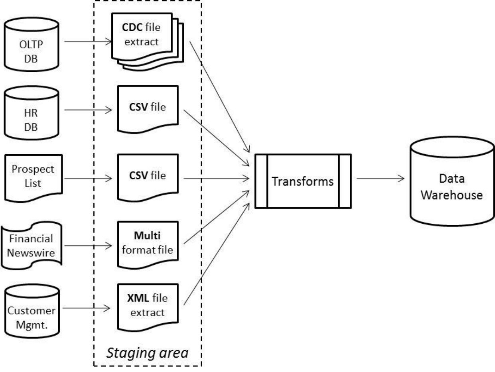
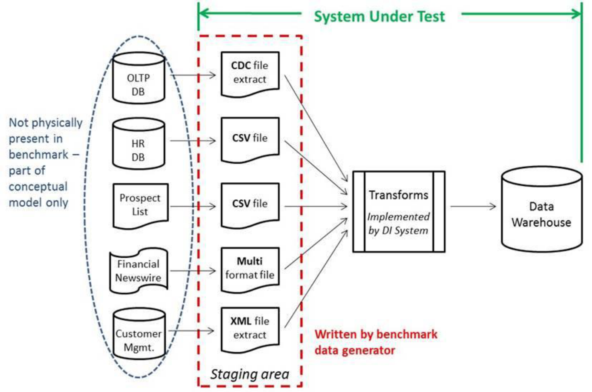
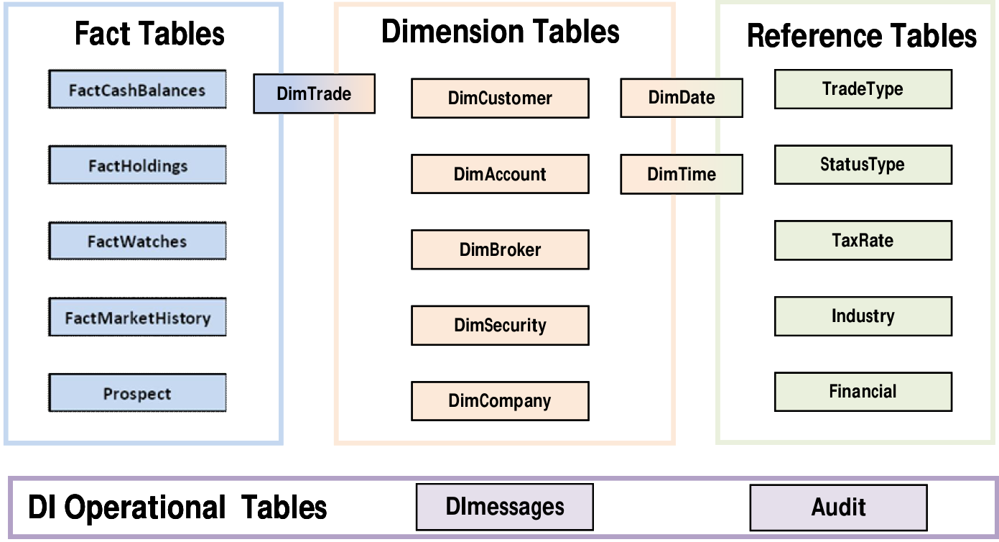

# TPC-DI specification: Chapters 1 to 4

This is an extraction of Clauses 1 to 4 of the TPC-DI 1.1.0 specification, pages 12 to 79. It keeps the source wording and order. Tables split across pages are joined, and the three original figures are included. Line breaks, heading levels, and dash characters are normalized. Original names, types, and numbering are retained.

[Original layout PDF](Chapters-1-4.pdf) | [Complete specification](../TPC-DI_v1.1.0.pdf)

| Chapter | Original pages |
| --- | --- |
| [1. Benchmark Overview](#clause-1-benchmark-overview) | 12 to 19 |
| [2. Source Data Files](#clause-2-source-data-files) | 20 to 36 |
| [3. Data Warehouse](#clause-3-data-warehouse) | 37 to 51 |
| [4. Transformations](#clause-4-transformations) | 52 to 79 |

TPC Benchmark DI (Data Integration), Standard Specification, Version 1.1.0, November 2014. © 2013, 2014 Transaction Processing Performance Council. Copied by permission of the Transaction Processing Performance Council.

<!-- Original page 12 -->

## Clause 1: Benchmark Overview

### 1.1 Business and Application Environment

The data model for the TPC-DI benchmark represents a retail brokerage. OLTP data is combined with data from additional sources to create the data warehouse. Figure 1.1-1 illustrates the conceptual model of the brokerage DI system.



Figure 1.1-1: Conceptual Overview

There are multiple tables in the OLTP system that are extracted into a staging area; the OLTP system contains data on customers, accounts, brokers, securities, trade details, account balances, market information, and so on. Extracts from these tables are represented as flat files in the Staging Area. For Incremental Updates the extracts are Changed Data Capture (CDC) extracts of changes to the tables since the last extract while for the Historical Load the extract is modeled as a full dump of the tables.

The HR database has one table with employee data that is represented as a full table extract into the Staging Area formatted comma separated value (CSV) file.

The Prospects file contains names, addresses and demographic data for prospective customers, such as a company might purchase from a syndicated data provider. This data arrives in a comma separated value (CSV) file format, this being the lowest common denominator of information exchange. The DI process must determine what changes have occurred since the last update.

<!-- Original page 13 -->

In the Historical Load phase of the benchmark, two other sources are used to provide information that is not directly available from the OLTP system. Financial information about companies and securities is obtained from a financial newswire (FINWIRE) service that has been archived over an extended period of time. This data comes in variable-format records in files saved in the Staging Area. Customer and account information is retrieved from a Customer Management System. Historical CMS information is saved in the Staging Area as an XML-formatted extract.

### 1.2 Summary of Operations

#### 1.2.1 Scope of the benchmark

In many real world systems, it is necessary to integrate data from different types of source systems, including different database vendors. While it would be desirable to include the extraction from these often heterogeneous source systems in the benchmark, it is simply an intractable problem from a benchmark logistics point of view. Hence, TPC-DI models an environment where all source system data has been extracted to flat files in a staging area before the remainder of the DI process begins. TPC-DI does not attempt to represent the wide range of data sources available in the marketplace, but models abstracted data sources and measures all systems involved in moving and transforming data from the Staging Area to the Data Warehouse.

The use of a staging area in TPC-DI does not limit its relevance as it is common in real world DI applications to use staging areas for allowing extracts to be performed on a different schedule from the rest of the DI process, for allowing backups of extracts that can be returned to in case of failures, and for potentially providing an audit trail.

Figure 1.2-1 shows what parts of the conceptual model are implemented in the benchmark.

<!-- Original page 14 -->



Figure 1.2-1: The System Under Test

#### 1.2.2 Phases of operation

In many real world DI applications, there are two variants of the DI process. One variant performs an historical load, at times when the data warehouse is initially created or when it is recreated from historical records such as when the data warehouse schema is restructured. The second variant performs incremental updates, representing the load of new data into an existing data warehouse. There are many different rates at which incremental updates may occur, from rarely to near real-time. Daily updates are common, and are the model for the TPC-DI benchmark.

Many DI applications have a constrained time window in which they must perform their regular updates. Updates are often done as an overnight operation and must fit with backups and other activities. At the same time, modern DI systems must deal with large volumes of historical data. The benchmark models both large historical data and constrained timing. The benchmark consists of several phases which are executed in sequence.

##### 1.2.2.1 Preparation phase

##### 1.2.2.1.1 Data Generation

Data generation is performed using the data generator described in Clause 6. The data may be generated directly in the Staging Area or it may be generated in a different location and copied to the Staging Area before the Historical Load. Generating data and copying it to the Staging Area are not timed for the benchmark.

<!-- Original page 15 -->

##### 1.2.2.1.2 Data Warehouse Creation

Creation of the Data Warehouse database and tables, including allocation of disk space, is not a DI operation and is not timed for the benchmark.

##### 1.2.2.1.3 Data Integration Preparation

The data integration software may require additional preparation and configuration to perform the benchmark operations. The work performed in this step will vary among implementations, and is not timed for the benchmark.

##### 1.2.2.2 Historical Load phase

The Historical Load includes different transformations than the Incremental Updates. Destination tables are initially empty and being populated with new data, and the source files may have different ordering properties (an unload of the data from an OLTP table might be in primary key order, while a CDC extract would be in order of the time that changes occurred). In addition, there are sources of data that are different from the Incremental Updates. The Historical Load naturally uses a larger set of data than an Incremental Update. Following the Historical Load, the Validation Query collects certain information that will be used to check for correctness in the automated audit phase.

The Historical Load phase may run for as much time as needed to completely process the data and is timed for use in the computation of the benchmark metric.

##### 1.2.2.3 Incremental Update phase

An Incremental Update includes different transformations than the Historical Load. The input files from the OLTP database are modeled as CDC extracts, which show the changes in the table data since the last extract. The Prospect file is a full data set (not CDC), so it is up to the DI application to determine what changes have occurred.

Two Incremental Update phases are required in a TPC-DI benchmark run. By requiring more than one Incremental Update, the benchmark ensures repeatability. Following each Incremental Update, the Validation Query collects certain information that will be used to check for correctness in the automated audit phase.

The Incremental Update phases are each required to complete in 30-60 minutes, and are timed for use in the computation of the benchmark metric.

##### 1.2.2.4 Automated Audit phase

After all of the other phases are complete, the automated audit queries the Data Warehouse to perform extensive tests on the resulting data and creates a simple report of the results. The automated audit phase is not timed, but all tests must pass for the run to be valid.

### 1.3 Source Data Models

**1.3.1** Section 1.1 introduced the concept of the OLTP, HR, Prospects, FINWIRE and Customer Management data sources. In addition, there are a small number of reference files that <!-- Original page 16 --> contain data that is loaded only once during the Historical Load and not modified again in the benchmark. The fields in each source file are described in Clause 2.

**1.3.2** The OLTP database represents a database with transactional information about securities market trading and the entities involved, i.e. customers, accounts, brokers, securities, trade details, account balances, market information, and so on. Files used in the Historical Load are full extracts containing all the rows in the table. Files used as input to an Incremental Update are CDC extracts, and as such they contain additional “CDC_FLAG” and “CDC_DSN” columns at the beginning of each row. The CDC_FLAG is a single character I, U or D that tells whether the row has been inserted, updated or deleted since the last change. For updates there is no indication as to what in the row has been changed. Rows that have not changed since the last extract will not appear in the CDC extract file at all. A row may change multiple times in the course of a day. The CDC_DSN is a sequence number, a value whose exact definition is meaningful only to the source database, but will be monotonically increasing in value throughout the rows in a file. The rows in a file will be ordered by the CDC_DSN value, which also reflects the time order in which the changes were applied to the database. Files from the OLTP system are:

- Account.txt ( Incremental Update)

- Customer.txt ( Incremental Update)

- Trade.txt ( Historical Load and Incremental Update)

- TradeHistory.txt ( Historical Load)

- CashTransaction.txt ( Historical Load and Incremental Update)

- HoldingHistory.txt ( Historical Load and Incremental Update)

- DailyMarket.txt ( Historical Load and Incremental Update)

- WatchItem.txt ( Historical Load and Incremental Update)

**1.3.3** The HR database is represented by a single extract file, HR.csv. This file contains information about the employees of the company and the employee reporting hierarchy. There is no CDC on this data source; it is modeled as a full table extract for the Historical Load.

**1.3.4** The Prospect.csv represents data that is obtained from an external data provider. The file contains names, contact information and demographic data on potential customers, some of whom are already customers of the brokerage. This file is modeled as a full daily extract from the data provider, i.e. there is no indication in the data as to what has changed from the previous extract.

**1.3.5** There is a FINWIRE file for each quarter of historical data. There are three types of records that may appear in a FINWIRE file, each with a different format. Within a record type the fields are fixed-width. The various record types will provide data for the tables DimCompany, DimSecurity and Financial in the Historical Load phase. One would normally expect updates to company and security data while maintaining a data warehouse. However, the number of these changes is too small to have a performance impact in this benchmark, so they are not considered in the Incremental Update phases.

**1.3.6** The CustomerMgmt.xml file represents data extracted from a Customer Management System (CMS). The CMS handles new and updated customer and account information. The data in the file is transactional in nature and uses a hierarchical structure to represent data <!-- Original page 17 --> relationships. This source provides the data for the DimAccount and DimCustomer tables in the Historical Load phase.

**1.3.7** Reference data is loaded only during the Historical Load and not modified again in the course of the benchmark. The following files represent the set of reference data for the benchmark:

- Date.txt

- Time.txt

- Industry.txt

- StatusType.txt

- TaxRate.txt

- TradeType.txt

Although some of these tables would be expected to change in the lifetime of a real-world system, they will not change over the lifetime of a benchmark run.

### 1.4 Destination Data Model

The destination of the TPC-DI workload is a dimensional data warehouse, such as described in The Data Warehouse Toolkit (Ralph Kimball and Margy Ross, Wiley, April 2002). Dimensional models are designed to enable efficient responses to a variety of business questions and are common practice in the industry. There are other ways to define a data warehouse, but this format provides a well understood structure in the benchmark Data Warehouse while also allowing for an appropriate variety of data transformations to be exercised in the TPC-DI workload.



Figure 1.4-1: Pictorial overview of the Data Warehouse Tables

In a dimensional model, “dimension tables” describe the business entities of interest. In the TPC-DI benchmark they are dates (in the DimDate table), times (DimTime), customers (DimCustomer), accounts (DimAccount), brokers (DimBroker), securities (DimSecurity), <!-- Original page 18 --> companies (DimCompany), and trades (DimTrade). “Fact tables” give measurement information describing what occurred, such as the price and volume of a transaction, or the status of something, such as the number of shares held on a certain date. In the TPC-DI benchmark the fact tables describe holdings (FactHoldings), trades (DimTrade), cash balances (FactCashBalances), the market history (FactMarketHistory), and customer watches on securities (FactWatches). Note that is it possible for certain tables to serve more than one role: The DimTrade table is both a dimension table and a fact table, depending on how it is being used.

### 1.5 Transformations

The term “transformations” in this benchmark includes everything that must be done to prepare and load data into the Data Warehouse. This can include:

- Conversion of data from character representations to data types compatible with the Data Warehouse specification

- Lookups of business keys to obtain surrogate keys for the Data Warehouse

- Merging or formatting multiple fields into one, or splitting one field into multiple

- Checking data for errors or for adherence to business rules

- Detecting changes in dimension data, and applying appropriate tracking mechanisms (retaining history or overwriting)

- Detecting changes in fact data, and journaling updates to reflect current state

<!-- Original page 19 -->

**1.5.1** Clause 4 gives the detailed transformation rules for both the Historical Load and for Incremental Updates.

### 1.6 Result Reporting Classes

**1.6.1** In basic data warehousing applications, the data warehouse is used for data analysis and reporting. Data is initially loaded into the data warehouse and then periodically updated with more current information. The data warehouse might also be rebuilt and reloaded from time to time. Typically the data warehouse is ‘offline’ (i.e. unavailable to end users) during initial loads and reloads. Loading and updating the data warehouse is controlled by a data integration process. The end users access the data warehouse only for querying the data, not for updating. Whether or not full ACID database properties are required in a data warehouse is a choice unique to each organization.

**1.6.2** To reflect the variety of systems used to implement data warehouses, TPC-DI defines two data warehouse classes, called ACID and OPEN. The ACID data warehouse class requires the Data Warehouse system to be ACID compliant, while the OPEN class allows the Data Warehouse system to adhere to a minimal set of concurrency requirements.

**1.6.3** Data Warehouses eligible to run the TPC-DI benchmark must meet at least the OPEN class criteria. Test sponsors may choose to subject their implementations to additional criteria to establish eligibility for the ACID class.

**1.6.4** Benchmark Results from different classes are not comparable and will be listed separately on the TPC website.

<!-- Original page 20 -->

## Clause 2: Source Data Files

### 2.1 Introduction

This section describes the formats of files created by the data generator. The number of rows in the files are variable, determined by the data generator based on the Scale Factor chosen by the test sponsor.

Throughout this benchmark, input date values are written as YYYY-MM-DD unless a specific alternate format is given.

### 2.2 File format definitions

#### 2.2.1 General Formatting definitions

**2.2.1.1** The file format definitions refer to a common set of data types, defined in Table 2.2.1, and meta-types defined in Table 2.2.2. The DI System needs to be able to parse the base data types. The meta-types are all defined in terms of base data types, with names that indicate their function and possibly value restrictions.

Rationale: The input data all comes from text files, and in that context all values are character sequences. These are not “native data types” in the sense that a database has native data types that it can store, but are abstractions that describe the character sequences. These types do however correlate to the data types used in section 3.2 to define the Data Warehouse tables.

**Table 2.2.1: Common data type definitions for source data files**

| Base Type | Input formatting |
| --- | --- |
| BOOLEAN | “0” for False and “1” for True. |
| CHAR(n) | Character string of up to n single-byte characters. |
| DATE | Formatted as “YYYY-MM-DD”, were YYYY is the year, MM is the month number and DD is the day number. MM and DD will have leading zeroes when appropriate. |
| DATETIME | Formatted as “YYYY-MM-DD HH:MM:SS”, were YYYY is the year, MM is the month number, DD is the day number, HH is the hour, MM is the minute, and SS is the second in 24-hour format. Each part of the value will have leading zeroes when appropriate. |
| NUM(m[,n]) | Unsigned numeric value with at most m total Digits, of which up to n Digits are to the right (after) the decimal point. The length does not exceed m+1 characters, including the decimal point. |
| SNUM(m[,n]) | Signed numeric value with an optional “+” or “-” followed by at most m total Digits, of which up to n Digits are to the right (after) the decimal point. The length does not exceed m+2 characters, including the sign and decimal point. If there is no sign, the value is positive. |

**Table 2.2.2: Meta-type definitions for source data files**

| Meta Type | Base Type | Usage / Restrictions |
| --- | --- | --- |
| BALANCE_T | SNUM(12,2) | Aggregate account and transaction related values such as account balances, total commissions, etc. |
| CDC_FLAG_T | CHAR(1) | “I”, “U” or “D” for insert, update or delete |
| CDC_DSN_T | NUM(12) | Database Sequence Number, a monotonically increasing value |
| IDENT_T | NUM(11) | Numeric identifiers |
| S_COUNT_T | NUM(12) | Aggregate count of shares |
| S_PRICE_T | SNUM(8,2) | Share prices |
| S_QTY_T | NUM(6) | Quantity of shares for an individual trade |
| TRADE_T | NUM(15) | Trade identifiers |
| VALUE_T | SNUM(10,2) | Non-aggregated transaction and security related values such as cost, dividend, etc. |

<!-- Original page 21 -->

**2.2.1.2** The character set encoding for all generated source data files is single-byte UTF-8.

**2.2.1.3** Unless specifically mentioned, the rows in all generated files are not sorted in any particular order.

#### 2.2.2 Specific file format definitions

##### 2.2.2.1 Account.txt

**2.2.2.1.1** The Account.txt file is a plain-text file with variable length fields separated by a vertical bar (“|”). Records have a terminator character appropriate for the System Under Test. Null values, where allowed, are indicated by there being no characters between vertical bars.

**2.2.2.1.2** Rows are ordered by the CDC_DSN field.

**Table 2.2.3: Account.txt file fields**

| Field Name | Type | Restrictions | Description / Explanation |
| --- | --- | --- | --- |
| CDC_FLAG | CDC_FLAG_T | ‘I’ or ‘U’ | Denotes insert or update |
| CDC_DSN | CDC_DSN_T | Not NULL | Database Sequence Number |
| CA_ID | IDENT_T | Not NULL | Customer account identifier |
| CA_B_ID | IDENT_T | Not NULL | Identifier of the managing broker |
| CA_C_ID | IDENT_T | Not NULL | Owning customer identifier |
| CA_NAME | CHAR(50) |  | Name of customer account |
| CA_TAX_ST | NUM(1) | 0, 1 or 2 | Tax status of this account |
| CA_ST_ID | CHAR(4) | ‘ACTV’ or ‘INAC’ | Customer status type identifier |

##### 2.2.2.2 BatchDate.txt

**2.2.2.2.1** This file has a single row with a single field containing the date of extraction of the data files in the Staging Area, formatted as YYYY-MM-DD. This date will be referred to as the Batch Date elsewhere in the specification.

**Table 2.2.4: BatchDate.txt file field**

| Field Name | Type | Restrictions | Description / Explanation |
| --- | --- | --- | --- |
| BatchDate | DATE | Not NULL | Date of the data batch in the Staging Area |

##### 2.2.2.3 CashTransaction.txt

The CashTransaction.txt file is a plain-text file with variable length fields separated by a vertical bar (“|”). Records have a terminator character appropriate for the System Under

<!-- Original page 22 -->

Test. The CDC_FLAG and CDC_DSN fields are not present in the data set used by the Historical Load.

**2.2.2.3.1** For Incremental Updates this file is ordered by CDC_DSN.

**Table 2.2.5: CashTransaction.txt file fields**

| Field Name | Type | Restrictions | Description / Explanation |
| --- | --- | --- | --- |
| CDC_FLAG | CDC_FLAG_T | ‘I’ | Denotes insert |
| CDC_DSN | CDC_DSN_T | Not NULL | Database Sequence Number |
| CT_CA_ID | IDENT_T | Not Null | Customer account identifier |
| CT_DTS | DATETIME | Not Null | Timestamp of when the trade took place |
| CT_AMT | VALUE_T | Not Null | Amount of the cash transaction. |
| CT_NAME | CHAR(100) | Not Null | Transaction name, or description: e.g. “Cash from sale of DuPont stock”. |

##### 2.2.2.4 Customer.txt

The Customer.txt file is a plain-text file with variable length fields separated by a vertical bar (“|”). Records have a terminator character appropriate for the System Under Test. This file is not used by the Historical Load. Null values, where allowed, are indicated by there being no characters between vertical bars.

**2.2.2.4.1** Customer.txt is ordered by CDC_DSN.

**Table 2.2.6: Customer.txt file fields**

| Field Name | Type | Restrictions | Description / Explanation |
| --- | --- | --- | --- |
| CDC_FLAG | CDC_FLAG_T | ‘I’ or ‘U’ | Denotes insert or update |
| CDC_DSN | CDC_DSN_T | Not NULL | Database Sequence Number |
| C_ID | IDENT_T | Not NULL | Customer identifier |
| C_TAX_ID | CHAR(20) | Not NULL | Customer’s tax identifier |
| C_ST_ID | CHAR(4) | ‘ACTV’ or ‘INAC’ | Customer status type identifier |
| C_L_NAME | CHAR(25) | Not NULL | Primary Customer's last name. |
| C_F_NAME | CHAR(20) | Not NULL | Primary Customer's first name. |
| C_M_NAME | CHAR(1) |  | Primary Customer's middle initial |
| C_GNDR | CHAR(1) |  | Gender of the primary customer |
| C_TIER | NUM(1) |  | Customer tier |
| C_DOB | DATE | Not NULL | Customer’s date of birth, as YYYY-MM-DD. |
| C_ADLINE1 | CHAR(80) | Not NULL | Address Line 1 |
| C_ADLINE2 | CHAR(80) |  | Address Line 2 |
| C_ZIPCODE | CHAR(12) | Not NULL | Zip or postal code |
| C_CITY | CHAR(25) | Not NULL | City |
| C_STATE_PRO V | CHAR(20) | Not NULL | State or province |
| C_CTRY | CHAR(24) |  | Country |
| C_CTRY_1 | CHAR(3) |  | Country code for Customer's phone 1. |
| C_AREA_1 | CHAR(3) |  | Area code for customer’s phone 1. |
| C_LOCAL_1 | CHAR(10) |  | Local number for customer’s phone 1. |
| C_EXT_1 | CHAR(5) |  | Extension number for Customer’s phone 1. |
| C_CTRY_2 | CHAR(3) |  | Country code for Customer's phone 2. |
| C_AREA_2 | CHAR(3) |  | Area code for Customer’s phone 2. |
| C_LOCAL_2 | CHAR(10) |  | Local number for Customer’s phone 2. |
| C_EXT_2 | CHAR(5) |  | Extension number for Customer’s phone 2. |
| C_CTRY_3 | CHAR(3) |  | Country code for Customer's phone 3. |
| C_AREA_3 | CHAR(3) |  | Area code for Customer’s phone 3. |
| C_LOCAL_3 | CHAR(10) |  | Local number for Customer’s phone 3. |
| C_EXT_3 | CHAR(5) |  | Extension number for Customer’s phone 3. |
| C_EMAIL_1 | CHAR(50) |  | Customer's e-mail address 1. |
| C_EMAIL_2 | CHAR(50) |  | Customer's e-mail address 2. |
| C_LCL_TX_ID | CHAR(4) | Not NULL | Customer's local tax rate |
| C_NAT_TX_ID | CHAR(4) | Not NULL | Customer's national tax rate |

<!-- Original page 23 -->

##### 2.2.2.5 CustomerMgmt.xml

CustomerMgmt.xml is an XML document, i.e. an XML formatted file, representing actions resulting in new or changed customer and account information. This file is only used in the Historical Load to populate the DimAccount and DimCustomer tables. The data in the document is ordered in time sequence.

**2.2.2.5.1** The document consists of a set of Action data elements. Each Action specifies an ActionType and is related to an Account and/or a Customer. All Actions have at least a related Customer, and all Accounts are associated with a single Customer. The document uses a hierarchical structure to represent the relationship between these data elements.

**2.2.2.5.2** The data fields and properties of their values are provided in the table below. In the XML document, these data fields are manifested as attributes or contained (nested) elements. The table describes the characteristics of the values supplied in these data fields. Empty elements are expressed as an empty XML tag, e.g. `<Element />`.

**Table 2.2.7: CustomerMgmt element properties**

| Field Name | Type | Restrictions | Description / Explanation |
| --- | --- | --- | --- |
| Action | XML Element |  | XML element containing the following attributes and elements |
| Action Attributes: |  |  |  |
| ActionType | CHAR(9) | ’NEW’, ‘ADDACCT’, ‘UPDCUST’, ‘UPDACCT’, ‘CLOSEACCT’, ‘INACT’ | One of: NEW - A new customer. A new customer is always created with 1 or more accounts. ADDACCT - One or more new accounts for an existing customer. UPDACCT - Changes to one or more existing accounts. UPDCUST - A change to an existing customer. CLOSEACCT - Close one or more existing accounts. INACT - An existing customer has become inactive. |
| ActionTS | CHAR | Not empty | Date and time of the action as YYYY-MM-DDTHH:MM:SS. Note the ‘T’ is a literal value. |
| Action Contained Element: |  |  |  |
| Customer | XML Element |  | XML element contained by Action, and containing the following attributes and elements |
| Customer Attributes: |  |  |  |
| C_ID | IDENT_T | Not empty, Required | Customer identifier |
| C_TAX_ID | CHAR(20) | Not empty, Required on ‘NEW’ | Customer’s tax identifier |
| C_GNDR | CHAR(1) | Not empty | Gender of the customer |
| C_TIER | NUM(1) | Not empty | Customer tier |
| C_DOB | DATE | Not empty, Required on ‘NEW’ | Customer’s date of birth as YYYY-MM-DD |
| C_ID | IDENT_T | Not empty, Required | Customer identifier |
| Customer Contained Elements: |  |  |  |
| Name | XML Element |  | XML element contained by Customer, and containing the following attributes |
| Name Attributes: |  |  |  |
| C_L_NAME | CHAR(25) | Not empty, Required on ‘NEW’ | Customer's last name. |
| C_F_NAME | CHAR(20) | Not empty, Required on ‘NEW’ | Customer's first name. |
| C_M_NAME | CHAR(1) |  | Customer's middle initial |
| Address | XML Element |  | XML element contained by Customer, and containing the following attributes |
| Address Attributes: |  |  |  |
| C_ADLINE1 | CHAR(80) | Not empty, Required on ‘NEW’ | Address Line 1 |
| C_ADLINE2 | CHAR(80) |  | Address Line 2 |
| C_ZIPCODE | CHAR(12) | Not empty, Required on ‘NEW’ | Zip or postal code |
| C_CITY | CHAR(25) | Not empty, Required on ‘NEW’ | City |
| C_STATE_PROV | CHAR(20) | Not empty, Required on ‘NEW’ | State or province |
| C_CTRY | CHAR(24) |  | Country |
| ContactInfo | XML Element |  | XML element contained by Customer, and containing the following attributes |
| ContactInfo Attributes: |  |  |  |
| C_PRIM_EMAIL | CHAR(50) |  | Customer's primary e-mail address |
| C_ALT_EMAIL | CHAR(50) |  | Customer's alternate e-mail address |
| C_PHONE_1 | PhoneNumber\* |  | Customer’s primary phone number |
| C_PHONE_2 | PhoneNumber\* |  | Customer’s secondary phone number |
| C_PHONE_3 | PhoneNumber\* |  | Customer’s third phone number |
| TaxInfo | XML Element |  | XML element contained by Customer, and containing the following attributes |
| TaxInfo Attributes: |  |  |  |
| C_LCL_TX_ID | CHAR(4) |  | Customer's local tax rate |
| C_NAT_TX_ID | CHAR(4) |  | Customer's national tax rate |
| Account | XML Element |  | XML element contained by Customer, and containing the following attributes and elements |
| Account Attributes: |  |  |  |
| CA_ID | IDENT_T | Not empty, Required | Customer account identifier |
| CA_TAX_ST | NUM(1) | Not empty, Required on ‘NEW’ | Tax status of this account |
| Account Contained Elements: |  |  |  |
| CA_B_ID | IDENT_T | Not empty, Required on ‘NEW’ | Identifier of the managing broker |
| CA_NAME | CHAR(50) |  | Name of customer account |

<!-- Original page 24 -->

<!-- Original page 25 -->

<!-- Original page 26 -->

**2.2.2.5.3** The PhoneNumber data type is defined within the scope of the CustomerMgmt XML Schema and used to define Action.Customer.ContactInfo.C_PHONE_1, Action.Customer.ContactInfo.C_PHONE_2, and Action.Customer.ContactInfo.C_PHONE_3.

|  |  |  |
| --- | --- | --- |
| PhoneNumber | XML Type | Defined within the scope of the CustomerMgmt schema. |
| PhoneNumber Contained Elements: |  |  |
| C_CTRY_CODE | CHAR(3) | Country code for Customer's phone |
| C_AREA_CODE | CHAR(3) | Area code for customer’s phone |
| C_LOCAL | CHAR(10) | Local number for customer’s phone |
| C_EXT | CHAR(5) | Extension number for Customer’s phone |

<!-- Original page 27 -->

**2.2.2.5.4** For each action, only required properties are supplied. For example, a ‘NEW’ action will contain customer identifying information, many properties (e.g. name, address), and one or more sets of account information. In contrast, an update action may update one or more customer or account properties. For that action, only the properties used to identify the account and/or customer, and the updated properties will be supplied, the other properties will be omitted from the XML document.

**2.2.2.5.5** The structure of the XML document is described by an XML Schema (xsd). The XML schema can be used to parse and validate the XML document. Note that the XML schema may not enforce all of the data constraints defined in table 2.2.7. While the XML schema definition allows for more variation in the data values, the data used by the benchmark will conform to the characteristics described in table 2.2.8.

**2.2.2.5.6** The formal XML Schema definition is provided here:

CustomerMgmt XML schema definition

```xml
<xsd:schema targetNamespace="http://www.tpc.org/tpc-di"
xmlns:xsd="http://www.w3.org/2001/XMLSchema" xmlns:TPCDI="http://www.tpc.org/tpc-di">
  <xsd:element name="Action" type="TPCDI:ActionDef" />
  <xsd:element name="Actions">
    <xsd:complexType>
      <xsd:sequence>
        <xsd:element ref="TPCDI:Action" maxOccurs="unbounded" />
      </xsd:sequence>
    </xsd:complexType>
  </xsd:element>
  <xsd:complexType name="ActionDef">
    <xsd:all>
      <xsd:element name="Customer" minOccurs="1" maxOccurs="1">
        <xsd:complexType>
          <xsd:sequence>
            <xsd:element name="Name" minOccurs="0" >
              <xsd:complexType>
                <xsd:all>
                  <xsd:element name="C_L_NAME" type="xsd:string" />
                  <xsd:element name="C_F_NAME" type="xsd:string" />
                  <xsd:element name="C_M_NAME" type="xsd:string" minOccurs="0" />
                </xsd:all>
              </xsd:complexType>
            </xsd:element>
            <xsd:element name="Address" minOccurs="0">
              <xsd:complexType>
                <xsd:all>
                  <xsd:element name="C_ADLINE1" type="xsd:string" />
                  <xsd:element name="C_ADLINE2" type="xsd:string" minOccurs="0" />
                  <xsd:element name="C_ZIPCODE" type="xsd:string" />
                  <xsd:element name="C_CITY" type="xsd:string" />
                  <xsd:element name="C_STATE_PROV" type="xsd:string" />
                  <xsd:element name="C_CTRY" type="xsd:string" />
                </xsd:all>
              </xsd:complexType>
            </xsd:element>
            <xsd:element name="ContactInfo" minOccurs="0">
              <xsd:complexType>
                <xsd:all>
                  <xsd:element name="C_PRIM_EMAIL" type="xsd:string" minOccurs="0" />
                  <xsd:element name="C_ALT_EMAIL" type="xsd:string" minOccurs="0" />
                  <xsd:element name="C_PHONE_1" type="TPCDI:PhoneNumber" minOccurs="0" />
                  <xsd:element name="C_PHONE_2" type="TPCDI:PhoneNumber" minOccurs="0" />
                  <xsd:element name="C_PHONE_3" type="TPCDI:PhoneNumber" minOccurs="0" />
                </xsd:all>
              </xsd:complexType>
            </xsd:element>
            <xsd:element name="TaxInfo" minOccurs="0">
              <xsd:complexType>
                <xsd:all>
                  <xsd:element name="C_LCL_TX_ID" type="xsd:string" />
                  <xsd:element name="C_NAT_TX_ID" type="xsd:string" />
                </xsd:all>
              </xsd:complexType>
            </xsd:element>
            <xsd:element name="Account" minOccurs="0" maxOccurs=”unbounded”>
              <xsd:complexType>
                <xsd:all>
                  <xsd:element name="CA_B_ID" type="xsd:string" minOccurs="0" />
                  <xsd:element name="CA_NAME" type="xsd:string" minOccurs="0" />
                </xsd:all>
                <xsd:attribute name="CA_ID" type="xsd:string" use="required" />
                <xsd:attribute name="CA_TAX_ST" type="xsd:string" />
              </xsd:complexType>
            </xsd:element>
          </xsd:sequence>
          <xsd:attribute name="C_ID" type="xsd:string" use="required" />
          <xsd:attribute name="C_TAX_ID" type="xsd:string" />
          <xsd:attribute name="C_GNDR" type="xsd:string" />
          <xsd:attribute name="C_TIER" type="xsd:unsignedByte" />
          <xsd:attribute name="C_DOB" type="xsd:date" />
        </xsd:complexType>
      </xsd:element>
    </xsd:all>
    <xsd:attribute name="ActionType" type="xsd:string" />
    <!-- restrict to certain values? -->
    <xsd:attribute name="ActionTS" type="xsd:dateTime" />
    <!-- yyyy-mm-dd -->
  </xsd:complexType>
  <xsd:complexType name="PhoneNumber">
    <xsd:sequence>
      <xsd:element name="C_CTRY_CODE" type="xsd:string" minOccurs="0" />
      <xsd:element name="C_AREA_CODE" type="xsd:string" />
      <xsd:element name="C_LOCAL" type="xsd:string" />
      <xsd:element name="C_EXT" type="xsd:string" minOccurs="0" />
    </xsd:sequence>
  </xsd:complexType>
</xsd:schema>
```

<!-- Original page 28 -->

##### 2.2.2.6 DailyMarket.txt

The DailyMarket.txt file is a plain-text file with variable length fields separated by a vertical bar (“|”). Records have a terminator character appropriate for the System Under Test. The CDC_FLAG and CDC_DSN fields are not present in the data set used by the Historical Load.

**2.2.2.6.1** This file is ordered by CDC_DSN for Incremental Updates.

**Table 2.2.10: DailyMarket.txt file fields**

| Field Name | Type | Restrictions | Description / Explanation |
| --- | --- | --- | --- |
| CDC_FLAG | CDC_FLAG_T | ‘I’ | Denotes insert |
| CDC_DSN | CDC_DSN_T | Not NULL | Database Sequence Number |
| DM_DATE | DATE | Not Null | Date of last completed trading day. |
| DM_S_SYMB | CHAR(15) | Not Null | Security symbol of the security |
| DM_CLOSE | S_PRICE_T | Not Null | Closing price of the security on this day. |
| DM_HIGH | S_PRICE_T | Not Null | Highest price for the secuirity on this day. |
| DM_LOW | S_PRICE_T | Not Null | Lowest price for the security on this day. |
| DM_VOL | S_COUNT_T | Not Null | Volume of the security on this day. |

<!-- Original page 29 -->

##### 2.2.2.7 Date.txt

The Date.txt file is a plain-text file with variable length fields separated by a vertical bar (“|”). Records have a terminator character appropriate for the System Under Test. Null values, where allowed, are indicated by there being no characters between vertical bars.

**2.2.2.7.1** This file is ordered by the SK_DateID field.

**Table 2.2.11: Date file fields**

| Field Name | Type | Restrictions | Description / Explanation |
| --- | --- | --- | --- |
| SK_DateID | IDENT_T | Not NULL | Surrogate key for the date |
| DateValue | CHAR(20) | Not NULL | The date as text, e.g. “2004-07-07” |
| DateDesc | CHAR(20) | Not NULL | The date Month Day, YYYY, e.g. July 7, 2004 |
| CalendarYearID | NUM(4) | Not NULL | Year number as a number |
| CalendarYearDesc | CHAR(20) | Not NULL | Year number as text |
| CalendarQtrID | NUM(5) | Not NULL | Quarter as a number, e.g. 20042 |
| CalendarQtrDesc | CHAR(20) | Not NULL | Quarter as text, e.g. “2004 Q2” |
| CalendarMonthID | NUM(6) | Not NULL | Month as a number, e.g. 20047 |
| CalendarMonthDesc | CHAR(20) | Not NULL | Month as text, e.g. “2004 July” |
| CalendarWeekID | NUM(6) | Not NULL | Week as a number, e.g. 200428 |
| CalendarWeekDesc | CHAR(20) | Not NULL | Week as text, e.g. “2004-W28” |
| DayOfWeekNum | NUM(1) | Not NULL | Day of week as a number, e.g. 3 |
| DayOfWeekDesc | CHAR(10) | Not NULL | Day of week as text, e.g. “Wednesday” |
| FiscalYearID | NUM(4) | Not NULL | Fiscal year as a number, e.g. 2005 |
| FiscalYearDesc | CHAR(20) | Not NULL | Fiscal year as text, e.g. “2005” |
| FiscalQtrID | NUM(5) | Not NULL | Fiscal quarter as a number, e.g. 20051 |
| FiscalQtrDesc | CHAR(20) | Not NULL | Fiscal quarter as text, e.g. “2005 Q1” |
| HolidayFlag | BOOLEAN |  | Indicates holidays |

##### 2.2.2.8 FINWIRE

Data from a “financial newswire” has been recorded over time, and stored in files with a new file being created each quarter using names like FINWIRE2003Q1, FINWIRE2003Q2, etc. The formatting of records in the file depends on the type of record, as indicated by three characters of each record starting at column 16. Records of any type may appear in any order in the file. Records have a terminator character appropriate for the System Under Test.

There are three record types in FINWIRE files: ‘CMP’, ‘SEC’, and ‘FIN’. There are no field separators in these files; each of the record types contains fixed-width fields with the exception that in some cases the last field may contain a company name (60 characters) or a CIK number (10 digits). Where dates appear, they are formatted as YYYYMMDD. Each record begins with a Posting Time Stamp (PTS) showing when the record was originally posted on the FINWIRE; the format of a PTS is YYYYMMDD-HHMMSS using 24-hour time. Records in each FINWIRE file are in increasing order of the PTS.

All fields listed in the table below will be as wide as given in the Type column. Text fields will be padded with spaces on the right and numeric fields will be padded with spaces on the left.

<!-- Original page 30 -->

Where CIK numbers appear, they are padded with leading zeroes on the left to fill out the 10-character width. An “empty” field is padded with all spaces.

**Table 2.2.8: FINWIRE file fields**

| Field Name | Type | Restrictions | Description / Explanation |
| --- | --- | --- | --- |
| CMP records |  |  |  |
| PTS | CHAR(15) | Not empty | Posting date &amp; time as YYYYMMDD-HHMMSS |
| RecType | CHAR(3) | Not empty | “CMP” |
| CompanyName | CHAR(60) | Not empty | Name of the company |
| CIK | CHAR(10) | Not empty | Company identification code from SEC |
| Status | CHAR(4) | Not empty | ‘ACTV’ for Active company, ‘INAC’ for inactive |
| IndustryID | CHAR(2) | Not empty | Code for industry segment |
| SPrating | CHAR(4) | Not empty | S&amp;P rating |
| FoundingDate | CHAR(8) |  | A date as YYYYMMDD |
| AddrLine1 | CHAR(80) | Not empty | Mailing address |
| AddrLine2 | CHAR(80) |  | Mailing address |
| PostalCode | CHAR(12) | Not empty | Mailing address |
| City | CHAR(25) | Not empty | Mailing address |
| StateProvince | CHAR(20) | Not empty | Mailing address |
| Country | CHAR(24) |  | Mailing address |
| CEOname | CHAR(46) | Not empty | Name of company CEO |
| Description | CHAR(150) | Not empty | Description of the company |
| SEC records |  |  |  |
| PTS | CHAR(15) | Not empty | Posting date &amp; time as YYYYMMDD-HHMMSS |
| RecType | CHAR(3) | Not empty | “SEC” |
| Symbol | CHAR(15) | Not empty | Security symbol |
| IssueType | CHAR(6) | Not empty | Issue type |
| Status | CHAR(4) | Not empty | ‘ACTV’ for Active security, ‘INAC’ for inactive |
| Name | CHAR(70) | Not empty | Security name |
| ExID | CHAR(6) | Not empty | ID of the exchange the security is traded on |
| ShOut | CHAR(13) | Not empty | Number of shares outstanding |
| FirstTradeDate | CHAR(8) | Not empty | Date of first trade as YYYYMMDD |
| FirstTradeExchg | CHAR(8) | Not empty | Date of first trade on exchange as YYYYMMDD |
| Dividend | CHAR(12) | Not empty | Dividend as VALUE_T |
| CoNameOrCIK | CHAR(60 or 10) | Not empty | Company CIK number (if only digits, 10 chars) or name (if not only digits, 60 chars) |
| FIN records |  |  |  |
| PTS | CHAR(15) | Not empty | Posting date &amp; time as YYYYMMDD-HHMMSS |
| RecType | CHAR(3) | Not empty | “FIN” |
| Year | CHAR(4) | Not empty | Year of the quarter end. |
| Quarter | CHAR(1) | Not empty | Quarter number: valid values are ‘1’, ‘2’, ‘3’, ‘4’ |
| QtrStartDate | CHAR(8) | Not empty | Start date of quarter, as YYYYMMDD |
| PostingDate | CHAR(8) | Not empty | Posting date of quarterly report as YYYYMMDD |
| Revenue | CHAR(17) | Not empty | Reported revenue for the quarter |
| Earnings | CHAR(17) | Not empty | Net earnings reported for the quarter |
| EPS | CHAR(12) | Not empty | Basic earnings per share for the quarter |
| DilutedEPS | CHAR(12) | Not empty | Diluted earnings per share for the quarter |
| Margin | CHAR(12) | Not empty | Profit divided by revenues for the quarter |
| Inventory | CHAR(17) | Not empty | Value of inventory on hand at end of quarter |
| Assets | CHAR(17) | Not empty | Value of total assets at the end of quarter |
| Liabilities | CHAR(17) | Not empty | Value of total liabilities at the end of quarter |
| ShOut | CHAR(13) | Not empty | Average number of shares outstanding |
| DilutedShOut | CHAR(13) | Not empty | Average number of shares outstanding (diluted) |
| CoNameOrCIK | CHAR(60 or 10) | Not empty | Company CIK number (if only digits, 10 chars) or name (if not only digits, 60 chars) |

<!-- Original page 31 -->

##### 2.2.2.9 HoldingHistory.txt

The HoldingHistory.txt file is a plain-text file with variable length fields separated by a vertical bar (“|”). Records have a terminator character appropriate for the System Under Test. The CDC_FLAG and CDC_DSN fields are not present in the data set used by the Historical Load.

**2.2.2.9.1** This file is ordered by CDC_DSN for Incremental Updates.

**Table 2.2.9: HoldingHistory.txt file fields**

| Field Name | Type | Restrictions | Description / Explanation |
| --- | --- | --- | --- |
| CDC_FLAG | CDC_FLAG_T | ‘I’ | Denotes insert |
| CDC_DSN | CDC_DSN_T | Not NULL | Database Sequence Number |
| HH_H_T_ID | TRADE_T | Not Null | Trade Identifier of the trade that originally created the holding row. |
| HH_T_ID | TRADE_T | Not Null | Trade Identifier of the current trade |
| HH_BEFORE_QTY | S_QTY_T | Not Null | Quantity of this security held before the modifying trade. |
| HH_AFTER_QTY | S_QTY_T | Not Null | Quantity of this security held after the modifying trade. |

##### 2.2.2.10 HR.csv

The HR.csv file is a plain-text file with variable length fields separated by a comma (“,”). Records have a terminator character appropriate for the System Under Test. Null values, where allowed, are indicated by there being no characters between commas.

**2.2.2.10.1** This file is ordered by EmployeeID.

**Table 2.2.10: HR.csv file fields**

| Field Name | Type | Restrictions | Description / Explanation |
| --- | --- | --- | --- |
| EmployeeID | IDENT_T | Not NULL | ID of employee |
| ManagerID | IDENT_T | Not NULL | ID of employee’s manager |
| EmployeeFirstName | CHAR(30) | Not NULL | First name |
| EmployeeLastName | CHAR(30) | Not NULL | Last name |
| EmployeeMI | CHAR(1) |  | Middle initial |
| EmployeeJobCode | NUM(3) |  | Numeric job code |
| EmployeeBranch | CHAR(30) |  | Facility in which employee has office |
| EmployeeOffice | CHAR(10) |  | Office number or description |
| EmployeePhone | CHAR(14) |  | Employee phone number |

<!-- Original page 32 -->

##### 2.2.2.11 Industry.txt

The Industry.txt file is a plain-text file with variable length fields separated by a vertical bar (“|”). Records have a terminator character appropriate for the System Under Test.

**Table 2.2.11: Industry.txt file fields**

| Field Name | Type | Restrictions | Description / Explanation |
| --- | --- | --- | --- |
| IN_ID | CHAR(2) | Not NULL | Industry code |
| IN_NAME | CHAR(50) | Not NULL | Industry description |
| IN_SC_ID | CHAR(4) | Not NULL | Sector identifier |

##### 2.2.2.12 Prospect.csv

The Prospect.csv file is a plain-text file with variable length fields separated by a comma (“,”). Records have a terminator character appropriate for the System Under Test. Null values, where allowed, are indicated by there being no characters between commas.

**Table 2.2.12: Prospect.csv file fields**

| Field Name | Type | Restrictions | Description / Explanation |
| --- | --- | --- | --- |
| AgencyID | CHAR(30) | Not NULL | Unique identifier from agency |
| LastName | CHAR(30) | Not NULL | Last name |
| FirstName | CHAR(30) | Not NULL | First name |
| MiddleInitial | CHAR(1) |  | Middle initial |
| Gender | CHAR(1) |  | ‘M’ or ‘F’ or ‘U’ |
| AddressLine1 | CHAR(80) |  | Postal address |
| AddressLine2 | CHAR(80) |  | Postal address |
| PostalCode | CHAR(12) |  | Postal code |
| City | CHAR(25) | Not NULL | City |
| State | CHAR(20) | Not NULL | State or province |
| Country | CHAR(24) |  | Postal country |
| Phone | CHAR(30) |  | Telephone number |
| Income | NUM(9) |  | Annual income |
| NumberCars | NUM(2) |  | Cars owned |
| NumberChildren | NUM(2) |  | Dependent children |
| MaritalStatus | CHAR(1) |  | ‘S’ or ‘M’ or ‘D’ or ‘W’ or ‘U’ |
| Age | NUM(3) |  | Current age |
| CreditRating | NUM(4) |  | Numeric rating |
| OwnOrRentFlag | CHAR(1) |  | ‘O’ or ‘R’ or ‘U’ |
| Employer | CHAR(30) |  | Name of employer |
| NumberCreditCards | NUM(2) |  | Credit cards |
| NetWorth | NUM(12) |  | Estimated total net worth |

##### 2.2.2.13 StatusType.txt

The StatusType.txt file is a plain-text file with variable length fields separated by a vertical bar (“|”). Records have a terminator character appropriate for the System Under Test.

<!-- Original page 33 -->

**Table 2.2.13: StatusType.txt file fields**

| Field Name | Type | Restrictions | Description / Explanation |
| --- | --- | --- | --- |
| ST_ID | CHAR(4) | Not NULL | Status code |
| ST_NAME | CHAR(10) | Not NULL | Status description |

##### 2.2.2.14 TaxRate.txt

The TaxRate.txt file is a plain-text file with variable length fields separated by a vertical bar (“|”). Records have a terminator character appropriate for the System Under Test.

**Table 2.2.14: TaxRate.txt file fields**

| Field Name | Type | Restrictions | Description / Explanation |
| --- | --- | --- | --- |
| TX_ID | CHAR(4) | Not NULL | Tax rate code |
| TX_NAME | CHAR(50) | Not NULL | Tax rate description |
| TX_RATE | NUM(6,5) | Not NULL | Tax rate |

##### 2.2.2.15 Time.txt

The Time.txt file is a plain-text file with variable length fields separated by a vertical bar (“|”). Records have a terminator character appropriate for the System Under Test. Null values, where allowed, are indicated by there being no characters between vertical bars.

**2.2.2.15.1** This file is ordered by the SK_TimeID field. Hour values are based on 24-hour time.

**Table 2.2.12: Time.txt file fields**

| Field Name | Type | Restrictions | Description / Explanation |
| --- | --- | --- | --- |
| SK_TimeID | IDENT_T | Not NULL | Surrogate key for the time |
| TimeValue | CHAR(20) | Not NULL | The time as text, e.g. “01:23:45” |
| HourID | NUM(2) | Not NULL | Hour number as a number, e.g. 01 |
| HourDesc | CHAR(20) | Not NULL | Hour number as text, e.g. “01” |
| MinuteID | NUM(2) | Not NULL | Minute as a number, e.g. 23 |
| MinuteDesc | CHAR(20) | Not NULL | Minute as text, e.g. “01:23” |
| SecondID | NUM(2) | Not NULL | Second as a number, e.g. 45 |
| SecondDesc | CHAR(20) | Not NULL | Second as text, e.g. “01:23:45” |
| MarketHoursFlag | BOOLEAN |  | Indicates a time during market hours |
| OfficeHoursFlag | BOOLEAN |  | Indicates a time during office hours |

##### 2.2.2.16 TradeHistory.txt

The TradeHistory.txt file is a plain-text file with variable length fields separated by a vertical bar (“|”). Records have a terminator character appropriate for the System Under Test. This file is used only in the Historical Load.

**2.2.2.16.1** This file is ordered by the TH_T_ID field.

**Table 2.2.15: TradeHistory file fields**

| Column Name | Data Type | Constraints | Description |
| --- | --- | --- | --- |
| TH_T_ID | TRADE_T | Not Null | Trade identifier. Corresponds to T_ID in the Trade.txt file |
| TH_DTS | DATETIME | Not Null | When the trade history was updated. |
| TH_ST_ID | CHAR(4) | Not Null | Status type identifier. |

<!-- Original page 34 -->

##### 2.2.2.17 Trade.txt

The Trade.txt file is a plain-text file with variable length fields separated by a vertical bar (“|”). Records have a terminator character appropriate for the System Under Test. The CDC_FLAG and CDC_DSN fields are not present in the data set used by the Historical Load. Null values, where allowed, are indicated by there being no characters between vertical bars.

**2.2.2.17.1** Rows in Historical Load files are ordered by the T_ID field; rows in the Incremental Update files are ordered by CDC_DSN.

**Table 2.2.16: Trade.txt file fields**

| Column Name | Data Type | Constraints | Description |
| --- | --- | --- | --- |
| CDC_FLAG | CDC_FLAG_T | ‘I’, ‘U’ | Denotes insert, update |
| CDC_DSN | CDC_DSN_T | Not NULL | Database Sequence Number |
| T_ID | TRADE_T | Not Null | Trade identifier. |
| T_DTS | DATETIME | Not Null | Date and time of trade. |
| T_ST_ID | CHAR(4) | Not Null | Status type identifier |
| T_TT_ID | CHAR(3) | Not Null | Trade type identifier |
| T_IS_CASH | BOOLEAN | ‘0’ or ’1’ | Is this trade a cash (‘1’) or margin (‘0’) trade? |
| T_S_SYMB | CHAR(15) | Not Null | Security symbol of the security |
| T_QTY | S_QTY_T | &gt; 0 | Quantity of securities traded. |
| T_BID_PRICE | S_PRICE_T | &gt; 0 | The requested unit price. |
| T_CA_ID | IDENT_T | Not Null | Customer account identifier. |
| T_EXEC_NAME | CHAR(49) | Not Null | Name of the person executing the trade. |
| T_TRADE_PRICE | S_PRICE_T | Null except in CMPT records, then &gt; 0 | Unit price at which the security was traded. |
| T_CHRG | VALUE_T | Null except in CMPT records, then &gt;= 0 | Fee charged for placing this trade request. |
| T_COMM | VALUE_T | Null except in CMPT records, then &gt;= 0 | Commission earned on this trade |
| T_TAX | VALUE_T | Null except in CMPT records, then &gt;= 0 | Amount of tax due on this trade |

##### 2.2.2.18 TradeType.txt

The TradeType.txt file is a plain-text file with variable length fields separated by a vertical bar (“|”). Records have a terminator character appropriate for the System Under Test.

**Table 2.2.17: TradeType.txt file fields**

| Field Name | Type | Restrictions | Description / Explanation |
| --- | --- | --- | --- |
| TT_ID | CHAR(3) | Not NULL | Trade type code |
| TT_NAME | CHAR(12) | Not NULL | Trade type description |
| TT_IS_SELL | NUM(1) | Not NULL | Flag indicating a sale |
| TT_IS_MRKT | NUM(1) | Not NULL | Flag indicating a market order |

<!-- Original page 35 -->

##### 2.2.2.19 WatchHistory.txt

The WatchHistory.txt file is a plain-text file with variable length fields separated by a vertical bar (“|”). Records have a terminator character appropriate for the System Under Test. The CDC_FLAG and CDC_DSN fields are not present in the data set used by the Historical Load.

**2.2.2.19.1** Rows in the Historical Load files are ordered by the W_DTS field; rows in the Incremental Update files are ordered by CDC_DSN.

**Table 2.2.18: WatchHistory.txt file fields**

| Field Name | Type | Restrictions | Description / Explanation |
| --- | --- | --- | --- |
| CDC_FLAG | CDC_FLAG_T | ‘I’ | Rows are only added |
| CDC_DSN | CDC_DSN_T | Not NULL | Database Sequence Number |
| W_C_ID | IDENT_T | Not Null | Customer identifier |
| W_S_SYMB | CHAR(15) | Not Null | Symbol of the security to watch |
| W_DTS | DATETIME | Not Null | Date and Time Stamp for the action |
| W_ACTION | CHAR(4) | ‘ACTV’ or ‘CNCL’ | Whether activating or canceling the watch |

##### 2.2.2.20 Audit Data

A number of files used for auditing are generated in all directories of the Staging Area. Each file contains information about a component of the generated data. The files use a naming convention, <name>_audit.csv, where <name> corresponds to the component the data is associated with.

**2.2.2.20.1** All audit files are of the same format; a text file with variable length fields separated by a comma (“,”). The first record in each file contains the field names. Records have a terminator character appropriate for the System Under Test. Null values, where allowed, are indicated by there being no characters between commas, or between a comma and the record delimiter.

**Table 2.2.19: Audit files fields**

| Field Name | Type | Restrictions | Description / Explanation |
| --- | --- | --- | --- |
| DataSet | CHAR(20) | Not Null | Component the data is associated with |
| BatchID | NUM(5) |  | BatchID the data is associated with |
| Date | DATE |  | Date value corresponding to the Attribute |
| Attribute | CHAR(50) | Not Null | Attribute this row of data corresponds to |
| Value | SNUM(15) |  | Integer value corresponding to the Attribute |
| DValue | SNUM(15,5) |  | Decimal value corresponding to the Attribute |

### 2.3 Structure of the Staging Area

The Staging Area contains one directory or folder (as appropriate for the System Under Test) for each batch of data to be loaded. DIGen will generate data directly into these directories:

- Batch1 contains all files used for the Historical Load.

- Batch2 contains all files used for Incremental Update 1.

<!-- Original page 36 -->

- Batch3 contains all files used for Incremental Update 2.

### 2.4 Staging Area Implementation Rules

**2.4.1** The Staging Area must guarantee durability. Once the Source Data has been generated or copied into the Staging Area, the consistency of the Source Data must be preserved when presented with all of the following failures:

- Permanent irrecoverable failure of any single Durable Medium containing data of the Staging Area. The media to be failed is to be chosen at random by the auditor, and cannot be specially prepared.

- Staging Area Server Power Failure: Loss of all external power to the Staging Area Server for an indefinite time period.

- Note: No system provides complete durability (i.e., durability under all possible types of failures). The specific set of single failures addressed above is deemed sufficiently significant to justify demonstration of durability across such failures.

**2.4.2** Access to the Source Data files in the Staging Area must be maintained despite any single media failure.

**2.4.3** The Source Data may be generated directly into the Staging Area or generated elsewhere and copied into the Staging Area.

**2.4.4** The directory and file structure in the Staging Area must be as described in Clause 2.3. Modifications to the structure including creating additional files are not allowed.

**2.4.5** The Source Data files must be those generated by DIGen or exact copies. Changes to file contents are not allowed.

Rationale: The intent is to disallow changes that add, remove, replace, modify, or restructure data to aid in the execution of the benchmark, while allowing copying to a file system appropriate for the SUT.

<!-- Original page 37 -->

## Clause 3: Data Warehouse

### 3.1 Introduction

#### 3.1.1 Data Structures

The Data Warehouse is defined only in terms of the tables it contains. This specification does not specify the storage structures to be used or the presence or absence of indices on the structures.

### 3.2 Table Definitions

The Data Warehouse table definitions refer to a common set of data types, defined in Table 3.2.1, and meta-types defined in Table 3.2.2. The Data Warehouse implementation must be able to store the base data types using publicly documented native or built-in data types provided by the Data Warehouse. Storage must accommodate exact values for any number in the input range.

Note: Real or floating-point representations that store approximate values are not allowed unless it can be demonstrated that all possible valid values can be stored and retrieved exactly.

**Table 3.2.1: Common data type definitions for Data Warehouse tables**

| Base Type | Storage Requirement |
| --- | --- |
| BOOLEAN | Holds at least two distinct values that represent FALSE and TRUE or 0 and 1. |
| CHAR(n) | Holds a character string of up to n single-byte characters. |
| DATE | Represents a unique day in the range of January 1, 1800 to December 31, 9999, inclusive. |
| DATETIME | Represents a time value with a precision of 1 millisecond in the range of January 1, 1800 to December 31, 2199, inclusive. |
| NUM(m[,n]) | Unsigned exact numeric value with at most m total Digits, of which n Digits are to the right (after) the decimal point. |
| SNUM(m[,n]) | Signed exact numeric value with at most m total Digits, of which n Digits are to the right (after) the decimal point. |
| TIME | Represents a time of day value to a precision of 1 millisecond. The range is 00:00:00.000 to 23:59:59.999. |

The meta-types are all defined in terms of base data types, with names that indicate their function and possibly value restrictions. There is no requirement to implement the meta-types as user-defined types in the Data Warehouse. A meta-type may be implemented using a user-defined type in the Data Warehouse as long as the user-defined type encorporates a native data type.

**Table 3.2.2: Meta-type definitions for Data Warehouse tables**

| Meta Type | Base Type | Usage / Restrictions |
| --- | --- | --- |
| BALANCE_T | SNUM(12,2) | Aggregate account and transaction related values such as account balances, total commissions, etc. |
| FIN_AGG_T | SNUM(15,2) | Aggregated financial data such as revenue figures, valuations, and asset values |
| IDENT_T | NUM(11) | Numeric identifiers from several OLTP system tables |
| S_COUNT_T | NUM(12) | Aggregate count of shares |
| S_PRICE_T SK_T | SNUM(8,2) NUM(11) | Share prices Surrogagte key; identifies a row in a dimension table |
| TRADE_T | NUM(15) | Trade identifiers |
| VALUE_T | SNUM(10,2) | Non-aggregated transaction and security related values such as cost, dividend, etc. |

<!-- Original page 38 -->

DIT- 3-1: Definitions of all tables (e.g. DDL)

#### 3.2.1 DimAccount

**Table 3.2.3: DimAccount table fields**

| Field Name | Type | Restrictions | Description / Explanation |
| --- | --- | --- | --- |
| SK_AccountID | SK_T | Not NULL | Surrogate key for AccountID |
| AccountID | IDENT_T | Not NULL | Customer account identifier |
| SK_BrokerID | SK_T | Not NULL | Surrogate key of managing broker |
| SK_CustomerID | SK_T | Not NULL | Surrogate key of customer |
| Status | CHAR(10) | Not NULL | Account status, active or closed |
| AccountDesc | CHAR(50) |  | Name of customer account |
| TaxStatus | NUM(1) | 0, 1 or 2 | Tax status of this account |
| IsCurrent | BOOLEAN | Not NULL | True if this is the current record |
| BatchID | NUM(5) | Not NULL | Batch ID when this record was inserted |
| EffectiveDate | DATE | Not NULL | Beginning of date range when this record was the current record |
| EndDate | DATE | Not NULL | Ending of date range when this record was the current record. A record that is not expired will use the date 9999-12-31. |

#### 3.2.2 DimBroker

**Table 3.2.4: DimBroker table fields**

| Field Name | Type | Restrictions | Description / Explanation |
| --- | --- | --- | --- |
| SK_BrokerID | SK_T | Not NULL | Surrogate key for broker |
| BrokerID | IDENT_T | Not NULL | Natural key for broker |
| ManagerID | IDENT_T |  | Natural key for manager’s HR record |
| FirstName | CHAR(50) | Not NULL | First name |
| LastName | CHAR(50) | Not NULL | Last Name |
| MiddleInitial | CHAR(1) |  | Middle initial |
| Branch | CHAR(50) |  | Facility in which employee has office |
| Office | CHAR(50) |  | Office number or description |
| Phone | CHAR(14) |  | Employee phone number |
| IsCurrent | BOOLEAN | Not NULL | True if this is the current record |
| BatchID | NUM(5) | Not NULL | Batch ID when this record was inserted |
| EffectiveDate | DATE | Not NULL | Beginning of date range when this record was the current record |
| EndDate | DATE | Not NULL | Ending of date range when this record was the current record. A record that is not expired will use the date 9999-12-31. |

<!-- Original page 39 -->

#### 3.2.3 DimCompany

**Table 3.2.5: DimCompany table fields**

| Field Name | Type | Restrictions | Description / Explanation |
| --- | --- | --- | --- |
| SK_CompanyID | SK_T | Not NULL | Surrogate key for CompanyID |
| CompanyID | IDENT_T | Not NULL | Company identifier (CIK number) |
| Status | CHAR(10) | Not NULL | Company status |
| Name | CHAR(60) | Not NULL | Company name |
| Industry | CHAR(50) | Not NULL | Company’s industry |
| SPrating | CHAR(4) |  | Standard &amp; Poor company’s rating |
| isLowGrade | BOOLEAN |  | True if this company is low grade |
| CEO | CHAR(100) | Not NULL | CEO name |
| AddressLine1 | CHAR(80) |  | Address Line 1 |
| AddressLine2 | CHAR(80) |  | Address Line 2 |
| PostalCode | CHAR(12) | Not NULL | Zip or postal code |
| City | CHAR(25) | Not NULL | City |
| StateProv | CHAR(20) | Not NULL | State or Province |
| Country | CHAR(24) |  | Country |
| Description | CHAR(150) | Not NULL | Company description |
| FoundingDate | DATE |  | Date the company was founded |
| IsCurrent | BOOLEAN | Not NULL | True if this is the current record |
| BatchID | NUM(5) | Not NULL | Batch ID when this record was inserted |
| EffectiveDate | DATE | Not NULL | Beginning of date range when this record was the current record |
| EndDate | DATE | Not NULL | Ending of date range when this record was the current record. A record that is not expired will use the date 9999-12-31. |

#### 3.2.4 DimCustomer

**Table 3.2.6: DimCustomer table fields**

| Field Name | Type | Restrictions | Description / Explanation |
| --- | --- | --- | --- |
| SK_CustomerID | SK_T | Not NULL | Surrogate key for CustomerID |
| CustomerID | IDENT_T | Not NULL | Customer identifier |
| TaxID | CHAR(20) | Not NULL | Customer’s tax identifier |
| Status | CHAR(10) | Not NULL | Customer status type |
| LastName | CHAR(30) | Not NULL | Customer's last name. |
| FirstName | CHAR(30) | Not NULL | Customer's first name. |
| MiddleInitial | CHAR(1) |  | Customer's middle name initial |
| Gender | CHAR(1) |  | Gender of the customer |
| Tier | NUM(1) |  | Customer tier |
| DOB | DATE | Not NULL | Customer’s date of birth. |
| AddressLine1 | CHAR(80) | Not NULL | Address Line 1 |
| AddressLine2 | CHAR(80) |  | Address Line 2 |
| PostalCode | CHAR(12) | Not NULL | Zip or Postal Code |
| City | CHAR(25) | Not NULL | City |
| StateProv | CHAR(20) | Not NULL | State or Province |
| Country | CHAR(24) |  | Country |
| Phone1 | CHAR(30) |  | Phone number 1 |
| Phone2 | CHAR(30) |  | Phone number 2 |
| Phone3 | CHAR(30) |  | Phone number 3 |
| Email1 | CHAR(50) |  | Email address 1 |
| Email2 | CHAR(50) |  | Email address 2 |
| NationalTaxRateDesc | CHAR(50) |  | National Tax rate description |
| NationalTaxRate | NUM(6,5) |  | National Tax rate |
| LocalTaxRateDesc | CHAR(50) |  | Local Tax rate description |
| LocalTaxRate | NUM(6,5) |  | Local Tax rate |
| AgencyID | CHAR(30) |  | Agency identifier |
| CreditRating | NUM(5) |  | Credit rating |
| NetWorth | SNUM(10) |  | Net worth |
| MarketingNameplate | CHAR(100) |  | Marketing nameplate |
| IsCurrent | BOOLEAN | Not NULL | True if this is the current record |
| BatchID | NUM(5) | Not NULL | Batch ID when this record was inserted |
| EffectiveDate | DATE | Not NULL | Beginning of date range when this record was the current record |
| EndDate | DATE | Not NULL | Ending of date range when this record was the current record. A record that is not expired will use the date 9999-12-31. |

<!-- Original page 40 -->

#### 3.2.5 DimDate

**Table 3.2.7: DimDate table fields**

| Field Name | Type | Restrictions | Description / Explanation |
| --- | --- | --- | --- |
| SK_DateID | SK_T | Not NULL | Surrogate key for the date |
| DateValue | DATE | Not NULL | The date stored appropriately for doing comparisons in the Data Warehouse |
| DateDesc | CHAR(20) | Not NULL | The date in full written form, e.g. “July 7, 2004” |
| CalendarYearID | NUM(4) | Not NULL | Year number as a number |
| CalendarYearDesc | CHAR(20) | Not NULL | Year number as text |
| CalendarQtrID | NUM(5) | Not NULL | Quarter as a number, e.g. 20042 |
| CalendarQtrDesc | CHAR(20) | Not NULL | Quarter as text, e.g. “2004 Q2” |
| CalendarMonthID | NUM(6) | Not NULL | Month as a number, e.g. 20047 |
| CalendarMonthDesc | CHAR(20) | Not NULL | Month as text, e.g. “2004 July” |
| CalendarWeekID | NUM(6) | Not NULL | Week as a number, e.g. 200428 |
| CalendarWeekDesc | CHAR(20) | Not NULL | Week as text, e.g. “2004-W28” |
| DayOfWeekNum | NUM(1) | Not NULL | Day of week as a number, e.g. 3 |
| DayOfWeekDesc | CHAR(10) | Not NULL | Day of week as text, e.g. “Wednesday” |
| FiscalYearID | NUM(4) | Not NULL | Fiscal year as a number, e.g. 2005 |
| FiscalYearDesc | CHAR(20) | Not NULL | Fiscal year as text, e.g. “2005” |
| FiscalQtrID | NUM(5) | Not NULL | Fiscal quarter as a number, e.g. 20051 |
| FiscalQtrDesc | CHAR(20) | Not NULL | Fiscal quarter as text, e.g. “2005 Q1” |
| HolidayFlag | BOOLEAN |  | Indicates holidays |

<!-- Original page 41 -->

#### 3.2.6 DimSecurity

**Table 3.2.8: DimSecurity table fields**

| Field Name | Type | Restrictions | Description / Explanation |
| --- | --- | --- | --- |
| SK_SecurityID | SK_T | Not NULL | Surrogate key for Symbol |
| Symbol | CHAR(15) | Not NULL | Identifies security on “ticker” |
| Issue | CHAR(6) | Not NULL | Issue type |
| Status | CHAR(10) | Not NULL | Status type |
| Name | CHAR(70) | Not NULL | Security name |
| ExchangeID | CHAR(6) | Not NULL | Exchange the security is traded on |
| SK_CompanyID | SK_T | Not NULL | Company issuing security |
| SharesOutstanding | S_COUNT_T | Not NULL | Shares outstanding |
| FirstTrade | DATE | Not NULL | Date of first trade |
| FirstTradeOnExchange | DATE | Not NULL | Date of first trade on this exchange |
| Dividend | VALUE_T | Not NULL | Annual dividend per share |
| IsCurrent | BOOLEAN | Not NULL | True if this is the current record |
| BatchID | NUM(5) | Not NULL | Batch ID when this record was inserted |
| EffectiveDate | DATE | Not NULL | Beginning of date range when this record was the current record |
| EndDate | DATE | Not NULL | Ending of date range when this record was the current record. A record that is not expired will use the date 9999-12-31. |

#### 3.2.7 DimTime

**Table 3.2.9: DimTime table fields**

| Field Name | Type | Restrictions | Description / Explanation |
| --- | --- | --- | --- |
| SK_TimeID | SK_T | Not NULL | Surrogate key for the time |
| TimeValue | TIME | Not NULL | The time stored appropriately for doing comparisons in the Data Warehouse |
| HourID | NUM(2) | Not NULL | Hour number as a number, e.g. 01 |
| HourDesc | CHAR(20) | Not NULL | Hour number as text, e.g. “01” |
| MinuteID | NUM(2) | Not NULL | Minute as a number, e.g. 23 |
| MinuteDesc | CHAR(20) | Not NULL | Minute as text, e.g. “01:23” |
| SecondID | NUM(2) | Not NULL | Second as a number, e.g. 45 |
| SecondDesc | CHAR(20) | Not NULL | Second as text, e.g. “01:23:45” |
| MarketHoursFlag | BOOLEAN |  | Indicates a time during market hours |
| OfficeHoursFlag | BOOLEAN |  | Indicates a time during office hours |

##### 3.2.7.1 DimTrade

Unlike other dimension tables in the Data Warehouse, DimTrade is not maintained as a history-tracking dimension. There are two state changes of concern for a trade: When it was initiated and when it was completed or cancelled. Therefore the record has date and time fields for the starting and ending states.

Rationale: This design is friendlier for users querying DimTrade as a fact table, because there won’t be multiple records to consider for the same trade.

<!-- Original page 42 -->

**Table 3.2.10: DimTrade table fields**

| Field Name | Type | Restrictions | Description / Explanation |
| --- | --- | --- | --- |
| TradeID | IDENT_T | Not NULL | Trade identifier |
| SK_BrokerID | SK_T |  | Surrogate key for BrokerID |
| SK_CreateDateID | SK_T | Not NULL | Surrogate key for date created |
| SK_CreateTimeID | SK_T | Not NULL | Surrogate key for time created |
| SK_CloseDateID | SK_T |  | Surrogate key for date closed |
| SK_CloseTimeID | SK_T |  | Surrogate key for time closed |
| Status | CHAR(10) | Not NULL | Trade status |
| Type | CHAR(12) | Not NULL | Trade type |
| CashFlag | BOOLEAN | Not NULL | Is this trade a cash (1) or margin (0) trade? |
| SK_SecurityID | SK_T | Not NULL | Surrogate key for SecurityID |
| SK_CompanyID | SK_T | Not NULL | Surrogate key for CompanyID |
| Quantity | NUM(6,0) | Not NULL | Quantity of securities traded. |
| BidPrice | NUM(8,2) | Not NULL | The requested unit price. |
| SK_CustomerID | SK_T | Not NULL | Surrogate key for CustomerID |
| SK_AccountID | SK_T | Not NULL | Surrogate key for AccountID |
| ExecutedBy | CHAR(64) | Not NULL | Name of person executing the trade. |
| TradePrice | NUM(8,2) |  | Unit price at which the security was traded. |
| Fee | NUM(10,2) |  | Fee charged for placing this trade request |
| Commission | NUM(10,2) |  | Commission earned on this trade |
| Tax | NUM(10,2) |  | Amount of tax due on this trade |
| BatchID | NUM(5) | Not Null | Batch ID when this record was inserted |

#### 3.2.8 DImessages

There are five types of messages defined in the benchmark:

- “Status” messages give information about the DI processing.

- “Alert” messages provide information that certain conditions were detected which may need attention, but do not warrant excluding the data from the data warehouse. For example, customer tiers have the value 1, 2 or 3. If a different value appeared in a customer record, the record would be fully processed and an alert message would be written.

- Phase Complete Records (“PCR”) are written at the end of each phase and are used to calculate the phase elapsed times.

- “Validation” messages are written by the Batch Validation query (see Clause 7.4)

- “Visibility_1” and “Visibility_2” messages are written by the Data Visibility query (see Clause 7.3)

**3.2.8.1** Test Sponsors may include other messages in the DImessages table, as long as they use a MessageType value that is not one of types defined above.

Rationale: The DImessages table provides one place where the DI system places any messages to the operator in response to various conditions encountered during execution of DI jobs.

**Table 3.2.11: DImessages table fields**

<!-- Original page 43 -->

| Field Name | Type | Restrictions | Description / Explanation |
| --- | --- | --- | --- |
| MessageDateAndTime | DATETIME | Not NULL | Date and time of the message |
| BatchID | NUM(5) | Not NULL | DI run number; see the section “Overview of BatchID usage” |
| MessageSource | CHAR(30) |  | Typically the name of the transform that logs the message |
| MessageText | CHAR(50) | Not NULL | Description of why the message was logged |
| MessageType | CHAR(12) | Not NULL | “Status” or “Alert” or “Reject” |
| MessageData | CHAR(100) |  | Varies with the reason for logging the message |

#### 3.2.9 FactCashBalances

**Table 3.2.12: FactCashBalances table fields**

| Field Name | Type | Restrictions | Description / Explanation |
| --- | --- | --- | --- |
| SK_CustomerID | SK_T | Not Null | Surrogate key for CustomerID |
| SK_AccountID | SK_T | Not Null | Surrogate key for AccountID |
| SK_DateID | SK_T | Not Null | Surrogate key for the date |
| Cash | SNUM(15,2) | Not Null | Cash balance for the account after applying changes for this day |
| BatchID | NUM(5) | Not Null | Batch ID when this record was inserted |

#### 3.2.10 FactHoldings

**Table 3.2.13: FactHoldings table fields**

| Field Name | Type | Restrictions | Description / Explanation |
| --- | --- | --- | --- |
| TradeID | IDENT_T | Not NULL | Key for Orignial Trade Indentifier |
| CurrentTradeID | IDENT_T | Not Null | Key for the current trade |
| SK_CustomerID | SK_T | Not NULL | Surrogate key for Customer Identifier |
| SK_AccountID | SK_T | Not NULL | Surrogate key for Account Identifier |
| SK_SecurityID | SK_T | Not NULL | Surrogate key for Security Identifier |
| SK_CompanyID | SK_T | Not NULL | Surrogate key for Company Identifier |
| SK_DateID | SK_T | Not NULL | Surrogate key for the date associated with the current trade |
| SK_TimeID | SK_T | Not NULL | Surrogate key for the time associated with the current trade |
| CurrentPrice | S_PRICE_T | &gt; 0 | Unit price of this security for the current trade |
| CurrentHolding | SNUM(6) | Not NULL | Quantity of a security held after the current trade. The value can be a positive or negative integer |
| BatchID | NUM(5) | Not Null | Batch ID when this record was inserted |

#### 3.2.11 FactMarketHistory

**Table 3.2.14: FactMarketHistory table fields**

| Field Name | Type | Restrictions | Description / Explanation |
| --- | --- | --- | --- |
| SK_SecurityID | SK_T | Not Null | Surrogate key for SecurityID |
| SK_CompanyID | SK_T | Not Null | Surrogate key for CompanyID |
| SK_DateID | SK_T | Not Null | Surrogate key for the date |
| PERatio | NUM(10,2) |  | Price to earnings per share ratio |
| Yield | NUM(5,2) | Not Null | Dividend to price ratio, as a percentage |
| FiftyTwoWeekHigh | NUM(8,2) | Not Null | Security highest price in last 52 weeks from this day |
| SK_FiftyTwoWeek HighDate | SK_T | Not Null | Earliest date on which the 52 week high price was set |
| FiftyTwoWeekLow | NUM(8,2) | Not Null | Security lowest price in last 52 weeks from this day |
| SK_FiftyTwoWeekL owDate | SK_T | Not Null | Earliest date on which the 52 week low price was set |
| ClosePrice | NUM(8,2) | Not Null | Security closing price on this day |
| DayHigh | NUM(8,2) | Not Null | Highest price for the security on this day |
| DayLow | NUM(8,2) | Not Null | Lowest price for the security on this day |
| Volume | NUM(12) | Not Null | Trading volume of the security on this day |
| BatchID | NUM(5) | Not Null | Batch ID when this record was inserted |

<!-- Original page 44 -->

#### 3.2.12 FactWatches

**Table 3.2.15: FactWatches table fields**

| Field Name | Type | Restrictions | Description / Explanation |
| --- | --- | --- | --- |
| SK_CustomerID | SK_T | Not NULL | Customer associated with watch list |
| SK_SecurityID | SK_T | Not NULL | Security listed on watch list |
| SK_DateID_DatePlaced | SK_T | Not NULL | Date the watch list item was added |
| SK_DateID_DateRemoved | SK_T |  | Date the watch list item was removed |
| BatchID | NUM(5) | Not Null | Batch ID when this record was inserted |

#### 3.2.13 Industry

**Table 3.2.16: Industry table fields**

| Field Name | Type | Restrictions | Description / Explanation |
| --- | --- | --- | --- |
| IN_ID | CHAR(2) | Not NULL | Industry code |
| IN_NAME | CHAR(50) | Not NULL | Industry description |
| IN_SC_ID | CHAR(4) | Not NULL | Sector identifier |

#### 3.2.14 Financial

**Table 3.2.17: Financial table fields**

| Field Name | Type | Restrictions | Description / Explanation |
| --- | --- | --- | --- |
| SK_CompanyID | IDENT_T | Not NULL | Company SK. |
| FI_YEAR | NUM(4) | Not NULL | Year of the quarter end. |
| FI_QTR | NUM(1) | Not NULL | Quarter number that the financial information is for: valid values 1, 2, 3, 4. |
| FI_QTR_START_DATE | DATE | Not NULL | Start date of quarter. |
| FI_REVENUE | SNUM(15,2) | Not NULL | Reported revenue for the quarter. |
| FI_NET_EARN | SNUM(15,2) | Not NULL | Net earnings reported for the quarter. |
| FI_BASIC_EPS | SNUM(10,2) | Not NULL | Basic earnings per share for the quarter. |
| FI_DILUT_EPS | SNUM(10,2) | Not NULL | Diluted earnings per share for the quarter. |
| FI_MARGIN | SNUM(10,2) | Not NULL | Profit divided by revenues for the quarter. |
| FI_INVENTORY | SNUM(15,2) | Not NULL | Value of inventory on hand at the end of quarter. |
| FI_ASSETS | SNUM(15,2) | Not NULL | Value of total assets at the end of the quarter. |
| FI_LIABILITY | SNUM(15,2) | Not NULL | Value of total liabilities at the end of the quarter. |
| FI_OUT_BASIC | SNUM(12) | Not NULL | Average number of shares outstanding (basic). |
| FI_OUT_DILUT | SNUM(12) | Not NULL | Average number of shares outstanding (diluted). |

<!-- Original page 45 -->

#### 3.2.15 Prospect

**Table 3.2.18: Prospect table fields**

| Field Name | Type | Restrictions | Description / Explanation |
| --- | --- | --- | --- |
| AgencyID | CHAR(30) | Not NULL | Unique identifier from agency |
| SK_RecordDateID | SK_T | Not NULL | Last date this prospect appeared in input |
| SK_UpdateDateID | SK_T | Not NULL | Latest change date for this prospect |
| BatchID | NUM(5) | Not Null | Batch ID when this record was last modified |
| IsCustomer | BOOLEAN | Not NULL | True if this person is also in DimCustomer, else False |
| LastName | CHAR(30) | Not NULL | Last name |
| FirstName | CHAR(30) | Not NULL | First name |
| MiddleInitial | CHAR(1) |  | Middle initial |
| Gender | CHAR(1) |  | M / F / U |
| AddressLine1 | CHAR(80) |  | Postal address |
| AddressLine2 | CHAR(80) |  | Postal address |
| PostalCode | CHAR(12) |  | Postal code |
| City | CHAR(25) | Not NULL | City |
| State | CHAR(20) | Not NULL | State or province |
| Country | CHAR(24) |  | Postal country |
| Phone | CHAR(30) |  | Telephone number |
| Income | NUM(9) |  | Annual income |
| NumberCars | NUM(2) |  | Cars owned |
| NumberChildren | NUM(2) |  | Dependent children |
| MaritalStatus | CHAR(1) |  | S / M / D / W / U |
| Age | NUM(3) |  | Current age |
| CreditRating | NUM(4) |  | Numeric rating |
| OwnOrRentFlag | CHAR(1) |  | O / R / U |
| Employer | CHAR(30) |  | Name of employer |
| NumberCreditCards | NUM(2) |  | Credit cards |
| NetWorth | NUM(12) |  | Estimated total net worth |
| MarketingNameplate | CHAR(100) |  | For marketing purposes |

#### 3.2.16 StatusType

**Table 3.2.19: StatusType table fields**

| Field Name | Type | Restrictions | Description / Explanation |
| --- | --- | --- | --- |
| ST_ID | CHAR(4) | Not NULL | Status code |
| ST_NAME | CHAR(10) | Not NULL | Status description |

#### 3.2.17 TaxRate

**Table 3.2.20: TaxRate table fields**

<!-- Original page 46 -->

| Field Name | Type | Restrictions | Description / Explanation |
| --- | --- | --- | --- |
| TX_ID | CHAR(4) | Not NULL | Tax rate code |
| TX_NAME | CHAR(50) | Not NULL | Tax rate description |
| TX_RATE | NUM(6,5) | Not NULL | Tax rate |

#### 3.2.18 TradeType

**Table 3.2.21: TradeType table fields**

| Field Name | Type | Restrictions | Description / Explanation |
| --- | --- | --- | --- |
| TT_ID | CHAR(3) | Not NULL | Trade type code |
| TT_NAME | CHAR(12) | Not NULL | Trade type description |
| TT_IS_SELL | NUM(1) | Not NULL | Flag indicating a sale |
| TT_IS_MRKT | NUM(1) | Not NULL | Flag indicating a market order |

#### 3.2.19 Audit

**Table 3.2.23: Audit table fields**

| Field Name | Type | Restrictions | Description / Explanation |
| --- | --- | --- | --- |
| DataSet | CHAR(20) | Not Null | Component the data is associated with |
| BatchID | NUM(5) |  | BatchID the data is associated with |
| Date | DATE |  | Date value corresponding to the Attribute |
| Attribute | CHAR(50) | Not Null | Attribute this row of data corresponds to |
| Value | SNUM(15) |  | Integer value corresponding to the Attribute |
| DValue | SNUM(15,5) |  | Decimal value corresponding to the Attribute |

### 3.3 Data Warehouse Properties

**3.3.1** The Data Warehouse must be implemented using a commercially available product, as defined by the TPC-Pricing specification.

DIT- 3-2: Name, optional components, and version number that uniquely identifies the product that implements the Data Warehouse

**3.3.2** The Data Warehouse must provide access to data using logical structures (i.e. tables, columns).

**3.3.3** The Data Warehouse must allow concurrent Data Warehouse sessions.

**3.3.4** The Data Warehouse must provide a means for Data Warehouse sessions to commit data. In the context of this specification, to commit data means the data is made permanent in the Data Warehouse and visible to other Data Warehouse sessions. Committed data must meet the data durability requirements specified in Clause 3.4.6.

### 3.4 Data Warehouse Implementation Rules

**3.4.1** The benchmark does not give requirements for the Data Warehouse internal implementation. Various techniques, including vertical partitioning, horizontal partitioning, replication and the use of various storage mechanisms, are allowed as long as they do not <!-- Original page 47 --> rely on any knowledge of the Source Data other than date ranges, total record counts, source file sizes, or information provided in this specification.

**3.4.2** No ill-formed rows may exist in any data that is available to all Data Warehouse sessions. An ill-formed row occurs when the value of any column cannot be determined. In the context of this specification, NULL is considered a value that can be determined. For example, in the case of a vertically partitioned table, a row must exist in all the partitions.

**3.4.3** The surrogate key of any table must not directly represent the physical disk addresses of the row or any offsets thereof. Queries are not allowed to reference rows using relative addressing since they are simply offsets from the beginning of the storage space.

**3.4.4** The Data Warehouse must allow for insertion of arbitrary data values that conform to the datatype of columns of the tables.

**3.4.5** The columns within a given table may be implemented in any order, but all columns listed in the table definition shall be implemented and there shall be no columns added to or removed from the tables.

#### 3.4.6 Data Durability

**3.4.6.1** The Data Warehouse must guarantee durability. The Data Warehouse must preserve committed data and ensure database consistency after recovery from all of the following failures:

- Permanent irrecoverable failure of any single Durable Medium containing data of the Data Warehouse. The media to be failed is to be chosen at random by the auditor, and cannot be specially prepared.

- Data Warehouse Server Power Failure: Loss of all external power to the Data Warehouse Server for an indefinite time period.

- Note: No system provides complete durability (i.e., durability under all possible types of failures). The specific set of single failures addressed above is deemed sufficiently significant to justify demonstration of durability across such failures.

#### 3.4.7 Data Visibility

Data visibility is the ability for all Data Warehouse sessions to operate on data that was committed by another Data Warehouse session. The following are the rules governing data visibility:

<!-- Original page 48 -->

**3.4.7.1** The Data Warehouse may automatically commit data or allow the DI application to control when data is committed.

**3.4.7.2** Once data has been committed, it must remain visible at all times.

#### 3.4.8 Auxiliary data structures

**3.4.8.1** Auxiliary data structures are allowed to be created and maintained in the Data Warehouse. 3.4.8.2 Data modifications performed during a Benchmark Run phase (see Clause 7.2) must be reflected in associated auxiliary data structures before the phase is completed.

#### 3.4.9 Execution rules

**3.4.9.1** Data Warehouse tables must not exist at the start of the Benchmark Run.

**3.4.9.2** At the end of each phase, all transformations must have completed successfully and their output data must be committed in the Data Warehouse.

**3.4.9.3** While inserts, updates and deletes are not performed on all tables, the system must not be configured to take special advantage of this fact during the test.

**3.4.9.4** Although inserts are inherently limited by the storage space available on the configured system, there must be no restriction preventing the execution of seven more incremental updates. To determine the number of rows added to each table in an incremental update, row counts from Batch2 may be used.

**3.4.9.5** It is required that the space for the additional seven incremental updates (and corresponding growth in associated auxiliary data structures, such as indices) be configured for the Benchmark Run and priced accordingly, as per Clause 9.2.1.

#### 3.4.10 Data Warehouse classification

**3.4.10.1** A TPC-DI benchmark Result will be listed either under the TPC-DI ACID class or the TPC-DI OPEN class. Only TPC-DI benchmark Results listed in the same class are comparable. DIT- 3-3: Data Warehouse class (must be either ACID or OPEN)

**3.4.10.2** In order for a benchmark Result to be listed in the ACID class of TPC-DI, the Data Warehouse must demonstrate ACID compliance. ACID compliance can be demonstrated using any of the two following procedures. It is under the discretion of the Test Sponsor to choose the procedure. The FDR must clearly state which procedure was followed:

   1. The version of the software that implements the Data Warehouse has demonstrated ACID compliance as part of one or more published TPC-C, TPC-E, TPC-H, TPC-DS, or TPC-DI Result, hereafter referred to as ACID Benchmark Proof (ABP). The same mechanisms that were enabled to demonstrate ACID compliance in the ABP must also be enabled during both Incremental Update phases of TPC-DI. If this software relied on any hardware or software features of the server or storage areas or devices to pass the ACID tests, e.g. RAID, the Data Warehouse Server must implement these features and have them enabled during both Incremental Update phases of TPC-DI. If, for any reason, the benchmark publication listed in the ABP is withdrawn, then the TPC-DI Result must be withdrawn.

<!-- Original page 49 -->

2. The version of the software that implements the Data Warehouse has demonstrated ACID compliance using any of the ACID tests required for TPC-C, TPC-E, TPC-H or TPC-DS, hereafter referred to as AT. The Test Sponsor is required to build all necessary database objects for the AT on the SUT and demonstrate ACID compliance to the auditor following the rules in the AT specification. The same mechanisms that were enabled to demonstrate ACID compliance during the AT must also be enabled during both Incremental Update phases of TPC-DI. If this software relied on any hardware or software features of the server or storage areas or devices to pass the ACID tests, e.g. RAID, the Data Warehouse Server must have them enabled during both Incremental Update phases of TPC-DI.

DIT- 3-4: Method use to demonstrate ACID compliance and details of ABP or AT

**3.4.10.3** If ACID compliance is not demonstrated, then the Result must be listed in the TPC-DI OPEN class.

#### 3.4.11 SQL Compliance

SQL statements in this specification must be executed as provided by this specification unless a Data Warehouse implementation requires modified versions of the SQL statements to be able run them. If modifications are necessary, they must fall under one of the following categories:

- Minor query modifications

- Major query modifications

##### 3.4.11.1 Minor query modifications

SQL statements provided in this specification may be modified applying minor query modifications as defined in this clause. They do not need approval by the auditor or the TPC. The application of minor query modifications to SQL statements must be applied consistently to all SQL statements. For example, if a particular vendor-specific date expression or table name syntax is used in one query, it must be used in all other queries involving date expressions or table names.

OID 3-1: The use of minor query modifications must be disclosed and justified.

**3.4.11.1.1** The following modifications are considered minor query modifications

- a) Table names - The table names found in the FROM clause of each query may be modified to reflect the customary naming conventions of the system under test.

- b) Select-list expression aliases - For queries that include the definition of an alias for a SELECT-list item (e.g., “AS” clause), vendor-specific syntax may be used instead of the specified syntax. Replacement syntax must have equivalent semantic behavior. Examples of acceptable implementations include "TITLE <string>", or "WITH HEADING <string>".

<!-- Original page 50 -->

- c) Date expressions - For queries that include an expression involving manipulation of dates (e.g., adding/subtracting days/months/years, or extracting years from dates), vendor-specific syntax may be used instead of the specified syntax. Replacement syntax must have equivalent semantic behavior. Examples of acceptable implementations include "YEAR(<column>)" to extract the year from a date column or "DATE(<date>) + 3 MONTHS" to add 3 months to a date.

- d) GROUP BY and ORDER BY - For queries that utilize a nested table-expression or select-list alias solely for the purposes of grouping or ordering on an expression, vendors may replace the view, nested table-expression or select-list alias with a vendor-specific SQL extension to the GROUP BY or ORDER BY clause. Examples of acceptable implementations include "GROUP BY <ordinal>", "GROUP BY <expression>", "ORDER BY <ordinal>", and "ORDER BY <expression>".

- e) Command delimiters - Additional syntax may be inserted at the end of the executable query text for the purpose of signaling the end of the query and requesting its execution. Examples of such command delimiters are a semicolon or the word "GO".

- f) Output formatting functions - Scalar functions whose sole purpose is to affect output formatting may be applied to items in the outermost SELECT list of the query.

- g) Correlation names - Table-name aliases may be added to the executable query text. The keyword "AS" before the table-name alias may be omitted.

- h) Explicit ASC - ASC may be explicitly appended to columns in an ORDER BY clause.

- i) In cases where identifier names conflict with reserved words in a given implementation, delimited identifiers may be used.

- j) Relational operators - Relational operators used in queries such as "<", ">", "<>", "<=", and "=", may be replaced by equivalent vendor-specific operators, for example ".LT.", ".GT.", "!=" or "^=", ".LE.", and "==", respectively.

- k) Nested table-expression aliasing - For queries involving nested table-expressions, the nested keyword "AS" before the table alias may be omitted.

- l) At large scale factors, the aggregates may exceed the range of the values supported by an integer. The aggregate functions AVG and COUNT may be replaced with equivalent vendor-specific functions to handle the expanded range of values (e.g., AVG_BIG and COUNT_BIG).

- m) Outer Join - For outer join queries, vendor specific syntax may be used instead of the specified syntax. Replacement syntax must have equivalent semantic behavior. For example, the join expression “CUSTOMER LEFT OUTER JOIN ORDERS ON C_CUSTKEY = O_CUSTKEY” may be replaced by adding CUSTOMER and ORDERS to the from clause and adding a specially-marked join predicate (e.g., C_CUSTKEY *= O_CUSTKEY).

- n) String concatenation operator: For queries which use string concatenation operators, vendor specific syntax can be used (e.g. || can be substituted with +). Replacement syntax must have equivalent semantic behavior.

- o) Table-less Queries - Queries that do not require any tables may be modified to select from a system defined table, e.g. sysibm.sysdummy for DB2 or dual for Oracle.

<!-- Original page 51 -->

##### 3.4.11.2 Major query modifications

All query modifications that do not fall under Clause 3.4.11.1.1 are considered major query modifications, which includes queries not expressed in SQL. The Test Sponsor must prove to the auditor that statements containing major query modifications are functionally equivalent to the SQL statements provided by the specification.

OID 3-2: The use of major query modifications must be disclosed and justified.

<!-- Original page 52 -->

## Clause 4: Transformations

### 4.1 Introduction

Data Integration (DI) Systems provide capabilities to specify data sources and destinations, and actions to be taken to move and transform data from sources to destinations. Typically a DI System provides a design time environment for specifying data transformation logic, and a runtime environment for executing the specified data transformations.

### 4.2 Data Integration System Properties

**4.2.1** The Data Integration (DI) System must be a commercially available product, as defined by the TPC-Pricing specification.

DIT- 4-1: The name, options and version number that uniquely identifies the product implementing the Data Integration System

**4.2.2** The Data Integration System must provide the ability to read and write data to and from more than one data store and provide data transformation capabilities that can be applied to general data integration tasks.

**4.2.3** The DI System may require additional software to access particular data stores. For example, database client software provided by a database system vendor may be required for the DI System to access the particular database system. If additional software is required, the software must be generally available.

**4.2.4** The DI System must translate the DI specification into the DI application format, which can be executed in the DI System’s runtime environment or other general purpose program execution system.

DIT- 4-2: The translation of the DI specification into the DI aplication format

<!-- Original page 53 -->

### 4.3 Transformation Implementation Rules

#### 4.3.1 Data Integration (DI) System

**4.3.1.1** Implementation of the benchmark transformations must be created using a DI System.

**4.3.1.2** The benchmark transformations may be transcribed in the optimal form for the DI System.

**4.3.1.3** Creation of the DI specification on a different installation of the DI System is allowed, however the translation into the DI application must be done on the benchmark DI System.

**4.3.1.4** The DI application may not be altered from the form generated by the DI System.

**4.3.1.5** If the DI System uses the same format for the DI specification and the DI application, e.g. the DI System interprets the DI specification at run time, it is permissible to create this application on a DI System that is not part of the SUT, provided:

- All software components that are required by the DI System to create the DI specification are installed and included in the priced configuration, as described in Clause 9.

- The DI specification is not altered from the form generated by the DI System.

**4.3.2** Use of extension mechanisms provided by the DI System for extending base capabilities is allowed, with the following rules:

- The extension is generally available as software, or provided as source in the FDR.

- If charged for, included in the priced configuration as described in Clause 9.

#### 4.3.3 Data Dependencies

There are dependencies between tables in the Data Warehouse that require data from some tables to be processed before data in the dependent tables, within the scope of a Benchmark Run phase. When a dependent table column refers to a column in a source table, any rows in the source table that would change the outcome of processing of a row in the dependent table must be processed before the dependent row.

**Table 4.3: Table and column dependencies**

| Dependent Table | Dependent Column | Source Table | Source Column |
| --- | --- | --- | --- |
| DimAccount | SK_BrokerID | DimBroker | SK_BrokerID |
| DimAccount | SK_CustomerID | DimCustomer | SK_CustomerID |
| DimSecurity | SK_CompanyID | DimCompany | SK_CompanyID |
| DimTrade | SK_BrokerID | DimBroker | SK_BrokerID |
| DimTrade | SK_CreateDateID | DimDate | SK_DateID |
| DimTrade | SK_CreateTimeID | DimTime | SK_TimeID |
| DimTrade | SK_CloseDateID | DimDate | SK_DateID |
| DimTrade | SK_CloseTimeID | DimTime | SK_TimeID |
| DimTrade | SK_SecurityID | DimSecurity | SK_SecurityID |
| DimTrade | SK_CompanyID | DimCompany | SK_CompanyID |
| DimTrade | SK_CustomerID | DimCustomer | SK_CustomerID |
| DimTrade | SK_AccountID | DimAccount | SK_AccountID |
| FactCashBalances | SK_CustomerID | DimCustomer | SK_CustomerID |
| FactCashBalances | SK_AccountID | DimAccount | SK_AccountID |
| FactCashBalances | SK_DateID | DimDate | SK_DateID |
| FactCashBalances | SK_TimeID | DimTime | SK_TimeID |
| FactHoldings | SK_TradeID | DimTrade | SK_TradeID |
| FactHoldings | SK_CurrentTradeID | DimTrade | SK_CurrentTradeID |
| FactHoldings | SK_CustomerID | DimCustomer | SK_CustomerID |
| FactHoldings | SK_AccountID | DimAccount | SK_AccountID |
| FactHoldings | SK_SecurityID | DimSecurity | SK_SecurityID |
| FactHoldings | SK_CompanyID | DimCompany | SK_CompanyID |
| FactHoldings | SK_DateID | DimDate | SK_DateID |
| FactHoldings | SK_TimeID | DimTime | SK_TimeID |
| FactMarketHistory | SK_SecurityID | DimSecurity | SK_SecurityID |
| FactMarketHistory | SK_CompanyID | DimCompany | SK_CompanyID |
| FactMarketHistory | SK_DateID | DimDate | SK_DateID |
| FactWatches | SK_CustomerID | DimCustomer | SK_CustomerID |
| FactWatches | SK_SecurityID | DimSecurity | SK_SecurityID |
| FactWatches | SK_DateID_DatePlaced | DimDate | SK_DateID |
| FactWatches | SK_DateID_DateRemoved | DimDate | SK_DateID |
| Prospect | SK_UpdateDateID | DimDate | SK_DateID |

<!-- Original page 54 -->

Rationale: When there are dependencies between data in tables (whether declared or not) it is common in developing DI applications to process tables in order of their dependencies; e.g., DimCustomer is fully processed before DimAccount because the account records refer to customer records. The benchmark specification does not require that certain tables must be processed before others. However, data dependencies do exist, and must be honored: An account record cannot be processed until related customer records have been processed. How the application accomplishes this is not specified.

**4.3.4** If the DI System requires additional software to interact with the Data Warehouse, the software must be installed on the SUT and included in the priced configuration.

#### 4.3.5 Execution Phases

The benchmark is executed in a series of phases, as described in Clause 7. The following are the rules associated with execution of the phases:

<!-- Original page 55 -->

**4.3.5.1** At the end of each phase, all transformations must have completed successfully and their output data must be committed into the Data Warehouse.

**4.3.5.2** A subset of the transformed data may be committed into the Data Warehouse during the execution of any phase as long as all of the transformations on the subset have been completed, the rows are not ill-formed as described in clause 3.4.2.2, and the data dependencies described in Clause 4.3.3 are honored.

**4.3.5.3** The DI application is allowed to perform the transformations defined within each phase in any order, provided the data dependencies described in clause 4.3.3 are honored.

**4.3.5.4** The DI application must determine the Staging Area directory from which to read the Source Data based on an input parameter or calculation.

**4.3.5.5** The DI application must not access data from a Staging Area directory associated with a subsequent execution phase.

**4.3.5.6** While executing the Historical Load phase, the DI application may assume it has exclusive access to the Data Warehouse tables.

**4.3.5.7** The same DI application must be used to perform all Incremental Update phases.

**4.3.5.8** Starting from the first Incremental Update phase, the Data Warehouse must be operational and accessible to Data Warehouse sessions that are not managed by the DI application.

- The DI application may assume the Data Warehouse sessions that it manages are the only sessions that may be updating or inserting data into the Data Warehouse.

- Data that has been committed in the Data Warehouse must remain visible to other Data Warehouse sessions. DI applications may not temporarily remove data from the Data Warehouse tables.

**4.3.6** Various techniques, including partitioning, are allowed as long as they do not rely on any prior knowledge of the Source Data other than date ranges, total record counts, source file sizes, or information provided in this specification.

**4.3.7** Auxiliary data structures are allowed to be created and maintained by the DI System, with the following rules:

- No Auxiliary data structures from previous Benchmark Runs may be present on the SUT at the start of a Benchmark Run.

- Data modifications performed during a benchmark execution phase must be reflected in associated auxiliary data structures before the execution phase is completed.

### 4.4 Data Manipulation Details

#### 4.4.1 History-tracking Dimension tables

History-tracking dimension tables retain information about changes to the data over time, while also allowing users to easily query for current information. This is accomplished using both the primary (or “natural”) key for a record in the source system, which is constant over time, and a surrogate key that is updated for each recorded change. Fact tables that <!-- Original page 56 --> reference a history-tracking dimension include a foreign key reference to the surrogate key, not the natural key.

When data that matches an existing record in a history-tracking dimension table is processed, i.e. the natural keys match, updates to the dimension table record are not made in-place. Instead, the record is marked as not current and the EndDate is set, and a new record is inserted with the same natural key but a new surrogate key value. This new record contains all the current field values. After this, any new records introduced into fact tables corresponding to this natural key reference the new surrogate key value.

Rationale: The concept of a history tracking dimension is common in the industry, and is sometimes referred to as a “type 2 changing dimension” or a “type 2 slowly changing dimension.”

**4.4.1.1** History tracking updates are used on the following tables:

- DimAccount

- DimBroker

- DimCompany

- DimCustomer

- DimSecurity

**4.4.1.2** When a record with a natural key that does not exist in the dimension table is processed, the following transformations are performed:

   1. A unique surrogate key value must be assigned and included in the inserted record.

   2. The current indicator field, IsCurrent, is set to TRUE to indicate that this is the current record corresponding to the natural key.

   3. The EffectiveDate field is set to a value specified by the transformation, or Batch Date if no value is specified.

   4. The EndDate field is set to December 31, 9999.

Rationale: The EndDate of the ‘current’ record is not yet determined. The actual EndDate is set when a new record is inserted and this record is expired. When querying a dimension to find the valid record for a given time, a condition like EffectiveDate <= my_time < EndDate could be used. Using a NULL value for EndDate complicates these sorts of queries as these conditions will be UNKNOWN on current records, so additional logic would need to be added to account for that. To avoid this complication, a date far off into the future is used as the EndDate for current records, which allows a basic date range search to work for all records.

**4.4.1.3** When a record with a natural key already present in the dimension table is processed, the following transformations are performed:

   1. Update the existing dimension table record for that natural key where IsCurrent is set to TRUE (these updates are known as ‘Expiring’ the record):

      - The current indicator field, IsCurrent, is set to FALSE to indicate that this is no longer the current record corresponding to the natural key.

      - The EndDate field is set to the EffectiveDate of the new record.

   2. After expiring the existing record in the dimension table, a new record is inserted into the dimension table, as described in Clause 4.4.1.2.

<!-- Original page 57 -->

**4.4.1.4** Natural keys are not deleted in the Source Data, therefore no processing of deleted records is required.

Rationale: In the brokerage application modeled by this benchmark, the source systems that are used to populate the dimension tables do not delete records. Rather, some indication of the state (active or inactive) of an object is updated. Note: A different update strategy is used on the DimTrade table due to its dual role as both a dimension table and a fact table.

- Note: DimDate and DimTime are static dimension tables; they do not receive updates.

##### 4.4.1.5 Dimension table granularity

The level of precision (e.g. hours, days, months) that updates are tracked in the dimension table is known as the granularity (or grain) of the dimension. The granularity of all dimensions in this benchmark is daily. This means that there must be at most 1 update to a natural key record on any given day, even when the Source Data contains more than 1 update to a natural key.

**4.4.1.5.1** The DI System must accumulate the changes that occur relative to a single natural key on a daily basis, and apply a single update record per day per natural key value, for those keys that have changed on that day.

**4.4.1.5.2** If a field changes more than once per day, the latest value is used as determined by the time stamps on the incoming data. If the time stamps are the same, the sequence the records appear in the file determines the order, i.e. the latest value appears last.

##### 4.4.1.6 Data dependencies and history-tracking updates

**4.4.1.6.1** When a history-tracking dimension table contains a surrogate key reference to another dimension table and an update occurs to the referenced dimension table, the referencing table must be updated as well. Specifically, this situation exists for:

- DimAccount, which contains a surrogate key for DimCustomer

- DimSecurity, which contains a surrogate key for DimCompany

- Note: DimAccount also contains a surrogate key for DimBroker, but DimBroker will not be updated according to the benchmark specification.

**4.4.1.6.2** When a history-tracking dimension table depends on data from multiple source files, changes in either source can cause it to be updated. For example, DimCustomer depends on data from Customer.txt and Prospect.csv; data in either of these sources can cause an update to the DimCustomer table.

**4.4.1.6.3** Regardless of the number of causes of an update to a record in a history tracking dimension, only one change record must be produced per natural key value per Incremental Update. Likewise, in the Historical Load, exactly one historical record should be produced per natural key value for each day that has an update to that key. See Clause 4.4.1.5.

#### 4.4.2 BatchID

The BatchID is a numeric value that is used to mark data that is added to the Data Warehouse so that it can be associated with a particular benchmark phase. The BatchID is <!-- Original page 58 --> used when logging events to the DImessages table and is also included in rows of data being added to most Data Warehouse tables.

**4.4.2.1** A unique BatchID is associated with each execution phase of the benchmark. When the BatchID is required by the specification, the following values must be used:

- Initialization, BatchID = 0

- Historical Load, BatchID = 1

- Incremental Update 1, BatchID = 2

- Incremental Update 2, BatchID = 3

Rationale: In practice, the BatchID concept is commonly used as part of an audit trail for data in the warehouse, and also can be used to help identify data that should be cleaned up in the event of an unrecoverable system issue during a run.

#### 4.4.3 Error handling

**4.4.3.1** The detection and handling of various data errors is a normal part of data integration processing. Accordingly, the generated data will contain certain values that are defined in the specification to be errors.

**4.4.3.2** The transformation rules specified in Clauses 4.5 and 4.6 define the error conditions that must be checked and the action to take when those conditions are met.

**4.4.3.3** Additional error checks are not required, but may be implemented at the discretion of the Test Sponsor.

**4.4.3.4** Implementations may assume the Source Data is self-consistent, e.g. an account record will not contain a customer key that does not reference a valid customer record.

**4.4.3.5** All records, including those meeting error conditions must be fully processed as described by the transformation rules.

### 4.5 Transformation Details for the Historical Load

DIT- 4-3: Implementation of each transformation of the Historical Load

#### 4.5.1 DimAccount

**4.5.1.1** DimAccount data is obtained from the data file CustomerMgmt.xml. Account data is stored as a contained element to the related Action and Customer elements. The possible ActionType values are shown in table 4.5.1.1:

**Table 4.5.1.1**

| ActionType | Description |
| --- | --- |
| NEW | A new customer. A new customer is always created with 1 or more new accounts. |
| ADDACCT | One or more new accounts for an existing customer. |
| UPDACCT | Updates to the information in one or more existing accounts. |
| UPDCUST | One or more updates to an existing customer. When updating customer information, no account information is supplied. Note that since DimAccount contains a surrogate key to DimCustomer, a change to a customer record will require a history-tracking change to update the SK_CustomerID field of the current associated account records in DimAccount as described in clause 4.4.1. |
| CLOSEACCT | Close one or more existing accounts as described in 4.5.1.3 |
| INACT | Make an existing customer and that customer’s currently active accounts inactive. No specific account information is supplied in the Source Data. |

<!-- Original page 59 -->

- NOTE: The descriptions below use XPath notation (http://www.w3.org/TR/xpath) to identify specific data elements of the XML document. All references are relative to the context of the associated Action (/Action) data element.

**4.5.1.2** Customer/Account/@CA_ID is the natural key for the Account data. When Account information is new, field values may be missing from the XML or included as an empty element (e.g. `<Element />`). In both cases the value should be processed as a NULL value. When Account information is updated, only the natural key and the updated fields are given a value in the record, i.e. all properties that are missing values retain their current values in the DimAccount table. Fields with an empty value (e.g. `<Element />`) must be processed as a NULL value. All changes to DimAccount are implemented in a history-tracking manner as specified in Clause 4.4.1.

**4.5.1.3** When populating fields of the DimAccount table, for each account identified in the record:

- When./@ActionType is ‘NEW’ or ‘ADDACCT’

- AccountID, AccountDesc and TaxStatus fields are copied from Customer/Account/@CA_ID, Customer/Account/CA_NAME and Customer/Account/@CA_TAX_ST respectively.

- SK_BrokerID and SK_CustomerID are set by obtaining the associated surrogate keys by matching Customer/Account/CA_B_ID with DimBroker.BrokerID and Customer/@C_ID (from the parent Customer element) with DimCustomer.CustomerID where the date portion of./@ActionTS >= EffectiveDate and the date portion of./@ActionTS <= EndDate. The BrokerID and CustomerID matches are guaranteed to succeed.

- Status is set to ‘ACTIVE’.

- When./@ActionType is ‘UPDACCT’

- Fields that exist in the Source Data should be transformed to the target fields as described above.

- Fields that do not exist in the Source Data retain their values from the current record in DimAccount.

- When./@ActionType is ‘CLOSEACCT’

- Status is set to ‘INACTIVE’

- When./@ActionType is ‘UPDCUST’

- For each account held by the customer being updated, perform an update to:

- Set SK_CustomerID to the associated customer’s DimCustomer current record after it has been updated.

- When./@ActionType is ‘INACT’

- For each account held by the customer being marked as inactive, perform an update to:

- Set SK_CustomerID to the associated customer’s DimCustomer record after it has been marked ‘INACTIVE’.

<!-- Original page 60 -->

- Set Status to ‘INACTIVE’.

- IsCurrent, EffectiveDate, and EndDate are set as described in section 4.4.1, with EffectiveDate being assigned the date value from the date portion of./@ActionTS.

- BatchID is set as described in section 4.4.2.

**4.5.1.4** There are no messages written to the DImessages table by this transformation.

#### 4.5.2 DimBroker

**4.5.2.1** Data for DimBroker comes from the HR extract file HR.csv. Those employees from the HR file that are brokers (as indicated by the EmployeeJobCode) will have data copied to the Broker table.

The Broker table is structured as a history tracking dimension table. However, nothing in the input file will provide any history of changes over time; it is simply a snapshot of the current state of the HR data.

Rationale: Although changes to DimBroker might be expected in a “real world” brokerage warehouse, the rate of change in this table is so low as to be inconsequential to benchmark results.

When inserting records from HR.csv into DimBroker:

- Records where EmployeeJobCode is not 314 are not broker records, and are ignored. The remaining steps are for records where the job code is 314.

- BrokerID, ManagerID, FirstName, LastName, MiddleInitial, Branch, Office and Phone are obtained from these fields of the HR.csv file: EmployeeID, ManagerID, EmployeeFirstName, EmployeeLastName, EmployeeMI, EmployeeBranch, EmployeeOffice and EmployeePhone.

- SK_BrokerID is set appropriately for new records as described in section 4.4.1.3.

- IsCurrent is set to true

- EffectiveDate is set to the earliest date in the DimDate table and EndDate is set to 9999-12-31.

- BatchID is set as described in section 4.4.2.

#### 4.5.3 DimCompany

**4.5.3.1** DimCompany data is obtained from the FINWIRE files. All FINWIREyyyyQq files are processed in ascending year and quarter order, and records of type CMP are used. CMP records may have content that is unchanged from prior CMP records, except for the PTS field. Changes to DimCompany are implemented in a history-tracking manner, but unchanged records are not recorded. CIK is the natural key for the Company data.

**4.5.3.2** When populating fields of the DimCompany table:

- CompanyID is copied from CIK.

- Name, SPRating, CEO, Description and FoundingDate are copied from CompanyName, SPrating, CEOname, Description, and FoundingDate respectively. In cases where the input data is all blanks, a NULL value is used in the target.

- AddressLine1, AddressLine2, PostalCode, City, State_Prov, and Country are copied from AddrLine1, AddrLine2, PostalCode, City, StateProvince, and Country. In cases where the input data is all blanks, a NULL value is used in the target.

<!-- Original page 61 -->

- Status is obtained from the FINWIRE Status by matching Status with ST_ID from the StatusType.txt file.

- Industry is obtained from IndustryID by matching IndustryID with IN_ID from the Industry.txt file.

- isLowGrade is set to False if SPrating begins with ‘A’ or ‘BBB’ otherwise set to True

- IsCurrent, EffectiveDate and EndDate are set as described in section 4.4.1, with EffectiveDate being the date indicated by the PTS field.

- BatchID is set as described in section 4.4.2.

**4.5.3.3** A record will be inserted in the DImessages table if a company’s SPRating is not one of the valid values for Standard & Poor long-term credit-ratings. The MessageSource is “DimCompany”, the MessageType is “Alert” and the MessageText is “Invalid SPRating”. The MessageData field is “CO_ID = ” followed by the key value of the record, then “, CO_SP_RATE = ” and the CO_SP_RATE value. The SPRating and isLowGrade columns will be set to NULL in this case. The valid values are: AAA, AA[+/-], A[+/-], BBB[+/-], BB[+/-], B[+/-], CCC[+/-], CC, C, D.

#### 4.5.4 DimCustomer

**4.5.4.1** DimCustomer data is obtained from the data file CustomerMgmt.xml. Customer data is stored as a sub-element to the related Action element. Every Action will have a related Customer, but not all actions require modifying the DimCustomer table. The possible ActionTypes are shown in table 4.5.4.1:

**Table 4.5.4.1**

| ActionType | Description |
| --- | --- |
| NEW | A new customer. A new customer is always created with 1 or more new accounts. |
| ADDACCT | One or more new accounts for an existing customer. This does not require any change to DimCustomer. |
| UPDACCT | Updates to the information in one or more existing accounts. No change to DimCustomer is required. |
| UPDCUST | One or more updates to existing customer’s information. Only the identifying data and updated property values are supplied in the Source Data. |
| CLOSEACCT | Close one or more existing accounts. This does not require any change to DimCustomer. |
| INACT | Make an existing customer and that customer’s currently active accounts inactive. No specific account information is supplied in the Source Data. |

- NOTE: The descriptions below use XPath notation (http://www.w3.org/TR/xpath) to identify specific data elements of the XML document. All references are relative to the context of the associated Action (/Action) data element.

**4.5.4.2** The TaxRate and Prospect tables will be referenced in the transformation. Customer/@C_ID is the natural key for the Customer data. When a Customer is new, unknown field values may be missing from the XML or included as an empty element (e.g. `<Element />`). In both cases <!-- Original page 62 --> the value should be processed as a NULL value. When Customer information is updated, only the updated fields are supplied a new value, i.e. all missing values retain their current values. Fields with empty values (e.g. `<Element />`) should be processed as NULL values. Changes to DimCustomer are implemented in a history-tracking manner.

**4.5.4.3** When populating fields of the DimCustomer table:

- When./@ActionType is ‘NEW’

- CustomerID, TaxID, LastName, FirstName, MiddleInitial, Tier, DOB, Email1 and Email2 are copied from Customer/@C_ID, Customer/@C_TAX_ID, Customer/Name/C_L_NAME, Customer/Name/C_F_NAME, Customer/Name/C_M_NAME, Customer/@C_TIER, Customer/@C_DOB, Customer/ContactInfo/C_PRIM_EMAIL, Customer/ContactInfo/C_ALT_EMAIL, respectively.

- Gender is obtained from Customer/@C_GNDR, and is uppercased. Values other than ‘M’ or ‘F’ are replaced with ‘U’.

- AddressLine1, AddressLine2, PostalCode, City, State_Prov, and Country are copied from Customer/Address/C_ADLINE1, Customer/Address/C_ADLINE2, Customer/Address/C_ZIPCODE, Customer/Address/C_CITY, Customer/Address/C_STATE_PROV, and Customer/Address/C_CTRY.

- Status is set to ‘ACTIVE’.

- Phone1, Phone2 and Phone3 are created by concatenating fields from the corresponding input data. The input data contains 3 contact phone number elements, Customer/ContactInfo/C_PHONE_1, Customer/ContactInfo/C_PHONE_2, and Customer/ContactInfo/C_PHONE_3, which correspond to Phone1, Phone2, and Phone3 respectively. The transformation for each of the these fields is as follows:

- For each Phonen, where n = {1,2,3}

- If Customer/ContactInfo/C_PHONE_n/C_CTRY_CODE, Customer/ContactInfo/C_PHONE_n/C_AREA_CODE and Customer/ContactInfo/C_PHONE_n/C_LOCAL are not null, Phonen is: '+' + Customer/ContactInfo/C_PHONE_n/C_CTRY_CODE + ' (' + Customer/ContactInfo/C_PHONE_n/C_AREA_CODE + ') ' + Customer/ContactInfo/C_PHONE_n/C_LOCAL

- If Customer/ContactInfo/C_PHONE_n/C_CTRY_CODE is null while Customer/ContactInfo/C_PHONE_n/C_AREA_CODE and Customer/ContactInfo/C_PHONE_n/C_LOCAL are not null, Phonen is:

'(' + Customer/ContactInfo/C_PHONE_n/C_AREA + ') ' + Customer/ContactInfo/C_PHONE_n/C_LOCAL

- If Customer/ContactInfo/C_PHONE_n/C_AREA_CODE is null while Customer/ContactInfo/C_PHONE_n/C_LOCAL is not null, Phonen is: Customer/ContactInfo/C_PHONE_n/C_LOCAL

- If any of the above rules has been applied and Customer/ContactInfo/C_PHONE_n/C_EXT is not null, Phonen is:

Phonen + Customer/ContactInfo/C_PHONE_n/C_EXT

- If none of the above rules has been applied,

<!-- Original page 63 -->

- Phonen is null

- NationalTaxRateDesc and NationalTaxRate are copied from TX_NAME and TX_RATE respectively by matching Customer/TaxInfo/C_NAT_TX_ID with TX_ID. The match is guaranteed succeed.

- LocalTaxRateDesc and LocalTaxRate are copied from TX_NAME and TX_RATE respectively by matching Customer/TaxInfo/C_LCL_TX_ID with TX_ID. The match is guaranteed to succeed.

- AgencyID, CreditRating, NetWorth, MarketingNameplate: If demographic data for this customer is present in the Prospect file and there are no newer ‘UPDCUST’ or ‘INACT’ records for this Customer/@C_ID, the AgencyID, CreditRating and NetWorth values will be copied to DimCustomer and the MarketingNameplate will be set according to the latest values using the same process defined for the data warehouse Prospect table. A Prospect record is deemed to match a DimCustomer record if the LastName, FirstName, AddressLine1, AddressLine2 and PostalCode fields all match the corresponding DimCustomer fields when upper-cased. If the demographic data for this customer is not present in the Prospect file or there are newer ‘UPDCUST’ or ‘INACT’ records for this customer, these fields should be set to NULL.

Rationale: Only current demographic information is available, and it corresponds to the Batch Date of the Historical Load. It does not make sense to apply that information retroactively to older customer records. It will only be applied to the latest version of the customer record.

- When./@ActionType is ‘UPDCUST’

- Fields that exist in the Source Data should be transformed to the target fields as described above.

- Fields that do not exist in the Source Data retain their values from the current record in DimCustomer.

- AgencyID, CreditRating, NetWorth, MarketingNameplate: If demographic data for this customer is present in the Prospect file and there are no newer ‘UPDCUST’ or ‘INACT’ records for this customer, these values should be obtained as described above. If the demographic data for this customer is not present in the Prospect file or there are newer ‘UPDCUST’ or ‘INACT’ records for this customer, these fields should be not be changed.

- A history-tracking update to all current accounts for this customer in the DimAccount table is also required, as described in clause 4.4.1.6

- When./@ActionType is ‘INACT’

- Status is set to ‘INACTIVE’

- AgencyID, CreditRating, NetWorth, MarketingNameplate: If demographic data for this customer is present in the Prospect file, these values should be obtained as described above. If the demographic data for this customer is not present in the Prospect file these fields should be not be changed.

- All current accounts for this customer must also be made inactive, as described in clause 4.5.1.3 (when ActionType is ‘INACT’).

- IsCurrent, EffectiveDate, and EndDate are set as described in section 4.4.1 except that EffectiveDate is assigned the date value in the date portion of./@ActionTS.

- BatchID is set as described in section 4.4.2.

<!-- Original page 64 -->

**4.5.4.4** A record will be inserted in the DImessages table if a customer’s Tier is not one of the valid values (1,2,3). The MessageSource is “DimCustomer”, the MessageType is “Alert” and the MessageText is “Invalid customer tier”. The MessageData field is “C_ID = ” followed by the natural key value of the record, then “, C_TIER = ” and the C_TIER value.

**4.5.4.5** A record will be reported in the DImessages table if a customer’s DOB is invalid. A customer’s DOB is invalid if DOB < Batch Date - 100 years or DOB > Batch Date (customer is over 100 years old or born in the future). The MessageSource is “DimCustomer”, the MessageType is “Alert” and the MessageText is “DOB out of range”. The MessageData field is “C_ID = ” followed by the natural key value of the record, then “, C_DOB = ” and the C_DOB value.

#### 4.5.5 DimDate

**4.5.5.1** DimDate is a static table: It is loaded from the Date.txt in the Historical Load and not modified again.

**4.5.5.2** During the Historical Load, all rows and columns of the Date.txt file must be loaded into the corresponding columns of the DimDate table, with no modifications.

#### 4.5.6 DimSecurity

**4.5.6.1** DimSecurity data is obtained from the FINWIRE files. All FINWIREyyyyQq files are processed in ascending year and quarter order, and records of type SEC are used. The surrogate key of the associated company must be obtained for the Company dimension reference. Changes to DimSecurity are implemented in a history-tracking manner. Symbol is the natural key for the Security data.

**4.5.6.2** When populating fields of the DimSecurity table:

- Symbol, Issue, Name, ExchangeID, SharesOutstanding, FirstTrade, FirstTradeOnExchange and Dividend are copied from Symbol, IssueType, Name, ExID, ShOut, FirstTradeDate, FirstTradeExchg and Dividend respectively from the SEC record.

- SK_CompanyID is obtained from the DimCompany table by matching CoNameOrCIK with Name or CIKcode (depending on the characters found in CoNameOrCIK), where PTS >= EffectiveDate and PTS < EndDate, to return the SK_CompanyID. The match is guaranteed to succeed due to the integrity of the FINWIRE data. This dependency of DimSecurity on DimCompany requires that any update to a company’s DimCompany records must be completed before updates to that company’s DimSecurity records.

- Status is obtained from the StatusType table by matching Status from the FINWIRE record with ST_ID to return the ST_NAME.

- IsCurrent, EffectiveDate, and EndDate are set as described in section 4.4.1, where the EffectiveDate is the date indicated by the PTS field.

- BatchID is set as described in section 4.4.2.

#### 4.5.7 DimTime

**4.5.7.1** DimTime is a static table: It is loaded from a file once in the Historical Load and not modified again.

During the Historical Load, all rows and columns of the Time.txt file must be loaded into the corresponding columns of the DimTime table, with no modifications.

<!-- Original page 65 -->

#### 4.5.8 DimTrade

**4.5.8.1** DimTrade data is obtained from the Trade.txt and TradeHistory.txt files. The incoming files may be thought of as logically joined on the T_ID field. When a T_ID encountered does not match a TradeID from the DimTrade table, a new DimTrade record is inserted. When a T_ID is encountered that matches an existing TradeID in the DimTrade table, the DimTrade record is updated.

**4.5.8.2** When populating fields of the DimTrade table:

- If TH_ST_ID is “SBMT” and T_TT_ID is either “TMB” or “TMS”, or TH_ST_ID is “PNDG”, then SK_CreateDateID and SK_CreateTimeID must be set based on TH_DTS, with time truncated to 1-second resolution. SK_CloseDateID and SK_CloseTimeID must be set to NULL if a new DimTrade record is being inserted.

- If TH_ST_ID is “CMPT” or “CNCL”, SK_CloseDateID and SK_CloseTimeID must be set based on TH_DTS, with time truncated to 1-second resolution. SK_CreateDateID and SK_CreateTimeID must be set to NULL if a new DimTrade record is being inserted.

- TradeID, CashFlag, Quantity, BidPrice, ExecutedBy, TradePrice, Fee, Commission and Tax are copied from T_ID, T_IS_CASH, T_QTY, T_BID_PRICE, T_EXEC_NAME, T_TRADE_PRICE, T_CHRG, T_COMM and T_TAX respectively.

- Status is copied from ST_NAME of the StatusType table by matching T_ST_ID with ST_ID.

- Type is copied from TT_NAME of the TradeType table by matching T_TT_ID with TT_ID.

- SK_SecurityID and SK_CompanyID are copied from SK_SecurityID and SK_CompanyID of the DimSecurity table by matching T_S_SYMB with Symbol where TH_DTS is in the range given by EffectiveDate and EndDate. The match is guaranteed to succeed due to the referential integrity of the OLTP database. Note that these surrogate key values must reference the dimension record that is current at the earliest time this TradeID is encountered. If an update to a record is required in order to set the SK_CloseDateID and SK_CloseTimeID, these fields must not be updated. This dependency of DimTrade on DimSecurity requires that any update to a security’s DimSecurity records must be completed before updates to that security’s DimTrade records.

- SK_AccountID, SK_CustomerID, and SK_BrokerID are copied from the SK_AccountID, SK_CustomerID, and SK_BrokerID fields of the DimAccount table by matching T_CA_ID with AccountID where TH_DTS is in the range given by EffectiveDate and EndDate. The match is guaranteed to succeed due to the referential integrity of the OLTP database. Note that these surrogate key values must reference the dimension record that is current at the earliest time this TradeID is encountered. If an update to a record is required in order to set the SK_CloseDateID and SK_CloseTimeID, these fields must not be updated. This dependency of DimTrade on DimAccount requires that any update to an account’s DimAccount records must be completed before updates to that account’s DimTrade records.

- BatchID is set as described in section 4.4.2 at the time the record is initially created.

**4.5.8.3** A record will be reported in the DImessages table if a trade’s Commission is not null and exceeds TradePrice * Quantity. The MessageSource is “DimTrade”, the MessageType is

<!-- Original page 66 -->

“Alert” and the MessageText is “Invalid trade commission”. The MessageData field is “T_ID = ” followed by the key value of the record, then “, T_COMM = ” and the T_COMM value.

**4.5.8.4** A record will be reported in the DImessages table if a trade’s Fee is not null and exceeds TradePrice * Quantity. The MessageSource is “DimTrade”, the MessageType is “Alert” and the MessageText is “Invalid trade fee”. The MessageData field is “T_ID = ” followed by the key value of the record, then “, T_CHRG = ” and the T_CHRG value.

#### 4.5.9 FactCashBalances

**4.5.9.1** FactCashBalances data is obtained from the data file CashTransaction.txt. The net effect of all cash transactions for a given account on a given day is totaled, and only a single record is generated per account that had changes per day.

**4.5.9.2** When populating fields of the FactCashBalances table:

- SK_CustomerID and SK_AccountID are obtained from DimAccount by matching CT_CA_ID with AccountID, where CT_DTS is in the range given by EffectiveDate and EndDate.

- SK_DateID is obtained from DimDate by matching just the date portion of CT_DTS with DateValue to return the SK_DateID. The match is guaranteed to succeed because DimDate has been populated with date information for all dates relevant to the benchmark.

- Cash is calculated as the sum of the prior Cash amount for this account plus the sum of all CT_AMT values from all transactions in this account on this day. If there is no previous FactCashBalances record for the associated account, zero is used.

- Note: The procedure used to determine the new Cash total must account for the possibility that a new surrogate key is created in DimAccount since the last cash transaction.

- BatchID is set as described in section 4.4.2.

#### 4.5.10 FactHoldings

**4.5.10.1** Data for FactHoldings comes from the HoldingHistory.txt file and the DimTrade table. The quantity and price values reflect the holdings for a particular security after the most recent trade. The customer can have a positive or negative position (Quantity) as a result of a trade

**4.5.10.2** When populating fields of the FactHoldings table:

- Retrieve the following values from DimTrade where HH_T_ID (current trade identifier) from the HoldingHistory.txt file matches the TradeID from DimTrade:

- SK_CustomerID, SK_AccountID, SK_SecurityID, SK_CompanyID and CurrentPrice

- SK_DateID is set to the value of SK_CloseDateID and SK_TimeID is set to the value of SK_CloseTimeID

- TradeId and CurrentTradeID values are supplied by HH_H_T_ID and HH_T_ID

- CurrentHolding - this value is supplied by HH_AFTER_QTY

- BatchID is set as described in section 4.4.2.

<!-- Original page 67 -->

#### 4.5.11 FactMarketHistory

**4.5.11.1** FactMarketHistory data is primarily obtained from the file DailyMarket.txt.

**4.5.11.2** When populating fields of the FactMarketHistory table:

- ClosePrice, DayHigh, DayLow, and Volume are copied from DM_CLOSE, DM_HIGH, DM_LOW, and DM_VOL respectively.

- SK_SecurityID is obtained from DimSecurity by matching the associated security’s current record DM_S_SYMB with Symbol, for the date indicated by DM_DATE, to return the SK_SecurityID. The match is guaranteed to succeed due to the referential integrity of the OLTP database. The dependency of FactMarketHistory on DimSecurity requires that any update to a company’s DimSecurity records must be completed before updates to the FactMarketHistory records.

- SK_CompanyID is obtained from DimSecurity by matching DM_S_SYMB with Symbol, for the date indicated by DM_DATE, to return the SK_CompanyID. The match is guaranteed to succeed due to the referential integrity of the OLTP database. The dependency of FactMarketHistory on DimSecurity requires that any update to a company’s DimSecurity records must be completed before updates to the FactMarketHistory records.

- SK_DateID is obtained from DimDate by matching DM_DATE with DateValue to return the SK_DateID. The match is guaranteed to succeed because DimDate has been populated with date information for all dates relevant to the benchmark.

- FiftyTwoWeekHigh and SK_FiftyTwoWeekHighDate are determined by finding the highest price over the last year (approximately 52 weeks) for a given security. The FactMarketHistory table itself can be used for this comparison. FiftyTwoWeekHigh is set to the highest DM_HIGH value for any date in the range from DM_DATE back to but not including the same date one year earlier. SK_FiftyTwoWeekHighDate is assigned the earliest date in the date range upon which this DM_HIGH value occurred.

- Note: Over the course of the year, the surrogate key value for a security may have changed. It is not sufficient to simply compare records that share the same SK_SecurityID value.

Rationale: The terms “52 week high” and “52 week low” are common in financial reporting, and in general practice seem to mean “over the last year”. This benchmark follows the one-year interpretation. Therefore in a summary generated on July 4, 2014, the date range to use is 2013-07-05 to 2014-07-04.

- FiftyTwoWeekLow and SK_FiftyTwoWeekLowDate are determined by finding the lowest price over the last year (approximately 52 weeks) for a given security. The FactMarketHistory table itself can be used for this comparison. FiftyTwoWeekLow is set to the lowest DM_LOW value for any date in the range from DM_DATE back to but not including the same date one year earlier. SK_FiftyTwoWeekLowDate is assigned the earliest date in the date range upon which this DM_LOW value occurred.

- Note: Over the course of the year, the surrogate key value for a security may have changed. It is not sufficient to simply compare records that share the same SK_SecurityID value.

- PERatio is calculated by dividing DM_CLOSE (the closing price for a security on a given day) by the sum of the company’s quarterly earnings per share (“eps”) over the previous 4 quarters prior to DM_DATE. Company quarterly earnings per share data is provided by <!-- Original page 68 --> the FINWIRE data source in the EPS field of the ‘FIN’ record type. If there are no earnings for this company, NULL is assigned to PERatio and an alert condition is raised as described below.

- Note: Over the course of the previous 4 quarters, attributes of securities and companies may have changed. As a result, there may be more than one surrogate key value used for a security and/or company in the target data warehouse tables during that time period.

- Yield is calculated by dividing the security’s dividend by DM_CLOSE (the closing price for a security on a given day), then multiplying by 100 to obtain the percentage. The dividend is obtained from DimSecurity by matching DM_S_SYMB with Symbol, where DM_DATE is in the range given by EffectiveDate and EndDate, to return the Dividend field.

- BatchID is set as described in section 4.4.2.

**4.5.11.3** A record will be reported in the DImessages table if there are no earnings found for a company. The MessageSource is “FactMarketHistory”, the MessageType is “Alert” and the MessageText is “No earnings for company”. The MessageData field is “DM_S_SYMB = ” followed by the DM_S_SYMB value of the record.

#### 4.5.12 FactWatches

**4.5.12.1** Data for FactWatches comes from the WatchHistory.txt file. Surrogate keys must be obtained for the Customer, Security and Date dimension references. The date keys show the dates the watch was set and removed.

**4.5.12.2** Securities can either be added to or removed from a watch list; there is no notion of updating a security on a watch list.

**4.5.12.3** When a security is added to a watch list, as indicated by W_ACTION = “ACTV”, surrogate keys from the DimCustomer, DimSecurity and DimDate are inserted based on the following:

- SK_CustomerID - each watch list is associated with a customer. W_C_ID can be used to match the associated DimCustomer record (W_C_ID = C_ID) that is current at the time indicated by W_DTS, to obtain SK_CustomerID.

- SK_SecurityID - W_S_SYMB can be used to match the current associated DimSecurity record (W_SYMB = Symbol) that is current at the time indicated by W_DTS, to obtain SK_ SecurityID.

- SK_DateID_DatePlaced - set based on W_DTS.

- SK_DateID_DateRemoved - set to NULL.

- BatchID is set as described in section 4.4.2.

**4.5.12.4** When a security is removed from a watch list, as indicated by W_ACTION = “CNCL”, the FactWatches record to update is located by finding the surrogate keys corresponding to W_C_ID and W_S_SYMB, bearing in mind that the customer SK value or the company SK value many have changed since the watch was set; then the following action is required:

- SK_DateID_DateRemoved - set based on W_DTS.

- BatchID is set as described in section 4.4.2.

<!-- Original page 69 -->

#### 4.5.13 Industry

**4.5.13.1** Industry is a static table: It is loaded from a file once in the Historical Load and not modified again.

**4.5.13.2** During the Historical Load, all rows and columns of the Industry.txt file are loaded into the corresponding columns of the Industry table, with no modifications.

#### 4.5.14 Financial

**4.5.14.1** Financial data is obtained from the FINWIRE files. All FINWIREyyyyQq files are processed in ascending year and quarter order, and records of type FIN are used. The surrogate key of the associated company must be obtained for the Company dimension reference.

- Note: In reality, companies sometimes “restate” earnings in special situations. The benchmark data will not contain more than one FIN record for any company for a single quarter.

**4.5.14.2** When populating fields of the Financial table:

- FI_YEAR, FI_QTR, FI_QTR_START_DATE, FI_REVENUE, FI_NET_EARN, FI_BASIC_EPS, FI_DILUT_EPS, FI_MARGIN, FI_INVENTORY, FI_ASSETS, FI_LIABILITY, FI_OUT_BASIC, and FI_OUT_DILUT are copied from Year, Quarter, QtrStartDate, Revenue, Earnings, EPS, DilutedEPS, Margin, Inventory, Assets, Liabilities, ShOut, and DilutedShOut.

- SK_CompanyID is obtained from the DimCompany table by matching CoNameOrCIK with Name or CIKcode (depending on the characters found in CoNameOrCIK), where EffectiveDate <= PTS < EndDate, to return the SK_CompanyID. The match is guaranteed to succeed due to the integrity of the FINWIRE data. This dependency of Financial on DimCompany requires that any update to a company’s DimCompany records must be completed before updates to that company’s Financial records.

#### 4.5.15 Prospect

**4.5.15.1** Prospect table data is obtained from the Prospect file. AgencyID is a unique identifier assigned by the agency providing the data feed. An AgencyID value will not be repeated within one data batch.

- The following fields are copied from the Prospect file: AgencyID, LastName, FirstName, MiddleInitial, Gender, AddressLine1, AddressLine2, PostalCode, City, State, Country, Phone, Income, NumberCars, NumberChildren, MaritalStatus, Age, CreditRating, OwnOrRentFlag, Employer, NumberCreditCards, NetWorth.

- SK_RecordDateID is set to the DimDate SK_DateID field that corresponds to the Batch Date.

- SK_UpdateDateID is set to the DimDate SK_DateID field that corresponds to the Batch Date.

- IsCustomer is set to True or False depending on whether the prospective customer record matches a current customer record in DimCustomer whose status is ‘ACTIVE’ after all customer records in the batch have been processed. A Prospect record is deemed to match a DimCustomer record if the FirstName, LastName, AddressLine1, AddressLine2 and PostalCode fields all match when upper-cased.

<!-- Original page 70 -->

- MarketingNameplate is set based on other fields. Zero or more tags are concatenated with a “+” character between them if multiple tags apply to a given customer. For example, a prospect that qualifies for both the “Boomer” tag and the “Spender” tag would be assigned the MarketingNameplate value “Boomer+Spender”. If multiple tags are used they must be in the order given below, and if no tags apply the nameplate is NULL. The tags are defined as:

- HighValue: NetWorth > 1000000 or Income > 200000

- Expenses: NumberChildren > 3 or NumberCreditCards > 5

- Boomer: Age > 45

- MoneyAlert: Income < 50000 or CreditRating < 600 or NetWorth < 100000

- Spender: NumberCars > 3 or NumberCreditCards > 7

- Inherited: Age < 25 and NetWorth > 1000000

- BatchID is set as described in section 4.4.2.

<!-- Original page 71 -->

**4.5.15.2** As the Prospect file is processed, a count is kept of new Prospect table rows created. After the last row, a “Status” message is written to the DImessages table, with the MessageSource “Prospect”, MessageText “Inserted rows” and the MessageData field containing the number of rows.

#### 4.5.16 StatusType

**4.5.16.1** StatusType is a static table: It is loaded from a file once in the Historical Load and not modified again.

**4.5.16.2** During the Historical Load, all rows and columns of the StatusType.txt file are loaded into the corresponding columns of the StatusType table, with no modifications.

#### 4.5.17 TaxRate

**4.5.17.1** TaxRate is a static table: It is loaded from a file once in the Historical Load and not modified again.

**4.5.17.2** During the Historical Load, all rows and columns of the TaxRate.txt file are loaded into the corresponding columns of the TaxRate table, with no modifications.

#### 4.5.18 TradeType

**4.5.18.1** TradeType is a static table: It is loaded from a file once in the Historical Load and not modified again.

**4.5.18.2** During the Historical Load, all rows and columns of the TradeType.txt file are loaded into the corresponding columns of the TradeType table, with no modifications.

### 4.6 Transformation Details for Incremental Updates

#### 4.6.1 DimAccount

**4.6.1.1** DimAccount data is obtained from the data file Account.txt. CA_ID is the natural key for the Account data. The StatusType table will be referenced in the transformation.

**4.6.1.2** When CDC_FLAG is “I”, a new DimAccount record is inserted. When CDC_FLAG is “U”, the updates to DimAccount are implemented in a history-tracking manner as described in 4.4.1.

**4.6.1.3** Updates to associated customer records require history-tracking updates to all of the customer’s accounts where IsCurrent=1. The value of SK_CustomerID must be set to the value of DimCustomer.SK_CustomerID in the newest customer record. If the customer’s status has changed to inactive, then the Status of all associated accounts must be set to ‘INACTIVE’.

- Note: More than one update to the same Account may occur during this phase (i.e. on the same day) and should be handled as described in 4.4.1.5.

**4.6.1.4** When populating fields of the DimAccount table:

- AccountID, AccountDesc and TaxStatus fields are copied from CA_ID, CA_NAME and CA_TAX_ST respectively.

- SK_BrokerID and SK_CustomerID are set by obtaining surrogate keys by matching CA_B_ID with DimBroker.BrokerID where IsCurrent = 1 and CA_C_ID with

<!-- Original page 72 -->

DimCustomer.CustomerID where IsCurrent = 1. The BrokerID and CustomerID matches are guaranteed to succeed due to the referential integrity of the OLTP database. This dependency of DimAccount on DimCustomer requires that any update to a customer’s DimCustomer records must be completed before updates to that customer’s DimAccount records.

- Status is copied from ST_NAME of the StatusType table by matching CA_ST_ID with ST_ID of the StatusType table.

- IsCurrent, EffectiveDate, and EndDate are set as described in section 4.4.1.

- BatchID is set as described in section 4.4.2.

#### 4.6.2 DimBroker

**4.6.2.1** No changes to DimBroker will occur during Incremental Updates.

Rationale: Although changes to DimBroker might be expected in a “real world” brokerage warehouse, the rate of change in this table is so low as to be inconsequential to benchmark results.

#### 4.6.3 DimCompany

**4.6.3.1** No changes to DimCompany will occur during Incremental Updates.

Rationale: Although changes to DimCompany might be expected in a “real world” brokerage warehouse, the rate of change in this table is so low as to be inconsequential to benchmark results.

#### 4.6.4 DimCustomer

**4.6.4.1** DimCustomer data is obtained from the data file Customer.txt. The TaxRate, StatusType, and Prospect tables will be referenced in the transformation. C_ID is the natural key for the Customer data. Changes to DimCustomer are implemented in a history-tracking manner.

**4.6.4.2** New Customer records in the input data are indicated by CDC_FLAG set to “I”. Existing customer records are indicated by CDC_FLAG set to “U”.

- Note: More than one update to the same Customer may occur during this phase (i.e. on the same day) and should be handled as described in 4.4.1.5.

**4.6.4.3** When populating fields of the DimCustomer table:

- CustomerID, TaxID, LastName, FirstName, MiddleInitial, Tier, DOB, Email1 and Email2 are copied from C_ID, C_TAX_ID, C_L_NAME, C_F_NAME, C_M_NAME, C_TIER, C_DOB, C_EMAIL_1, C_EMAIL_2 respectively.

- Gender is obtained from C_GNDR, which is uppercased. Values other than ‘M’ or ‘F’ are replaced with ‘U’.

- AddressLine1, AddressLine2, PostalCode, City, StateProv, and Country are copied from C_ADLINE1, C_ADLINE2, C_ZIPCODE, C_CITY, C_STATE_PROV, and C_CTRY.

- Status is copied from ST_NAME of the StatusType table by matching C_ST_ID with ST_ID of the StatusType table.

- Phone1, Phone2 and Phone3 are created by concatenating fields. For each n in {1, 2, 3}:

- If C_CTRY_n, C_AREA_n and C_LOCAL_n are not null, Phonen is:

      - '+' + C_CTRY_n + ' (' + C_AREA_n + ') ' + C_LOCAL_n

- If C_CTRY_n is null while C_AREA_n and C_LOCAL_n are not null, Phonen is: '(' + C_AREA_n + ') ' + C_LOCAL_n

<!-- Original page 73 -->

- If C_AREA_n is null while C_LOCAL_n is not null, Phonen is: C_LOCAL_n

- If any of the above rules has been applied and C_EXT_n is not null, Phonen is: Phonen + C_EXT_n

- If none of the above rules has been applied, Phonen is null

- NationalTaxRateDesc and NationalTaxRate are copied from TX_NAME and TX_RATE respectively by matching C_NAT_TX_ID with TX_ID.

- LocalTaxRateDesc and LocalTaxRate are copied from TX_NAME and TX_RATE respectively by matching C_LCL_TX_ID with TX_ID.

- AgencyID, CreditRating, NetWorth, MarketingNameplate: If demographic data for this customer has been present in the Prospect file for this DI batch or for any previous batch, the latest AgencyID, CreditRating and NetWorth values will be copied to DimCustomer and the MarketingNameplate will be set according to the latest values using the same process defined for the data warehouse Prospect table. A Prospect record is deemed to match a DimCustomer record if the FirstName, LastName, AddressLine1, AddressLine2 and PostalCode fields all match the corresponding fields in DimCustomer when upper-cased. The IsCustomer field in the Prospect table needs to be updated to reflect the current state for the corresponding prospect record, as defined in Clause 4.6.14

- IsCurrent, EffectiveDate, and EndDate are set as described in section 4.4.1.

- BatchID is set as described in section 4.4.2.

**4.6.4.4** A record will be reported in the DImessages table if a customer’s Tier is not one of the valid values (1,2,3). The MessageSource is “DimCustomer”, the MessageType is “Alert” and the MessageText is “Invalid customer tier”. The MessageData field is “C_ID = ” followed by the key value of the record, then “, C_TIER = ” and the C_TIER value.

**4.6.4.5** A record will be reported in the DImessages table if a customer’s DOB is invalid. A customer’s DOB is invalid if DOB < Batch Date - 100 years or DOB > Batch Date (customer over 100 years old or born in the future). The MessageSource is “DimCustomer”, the MessageType is “Alert” and the MessageText is “DOB out of range”. The MessageData field is “C_ID = ” followed by the key value of the record, then “, C_DOB = ” and the C_DOB value.

#### 4.6.5 DimDate

**4.6.5.1** The DimDate table is not altered by Incremental Updates.

#### 4.6.6 DimSecurity

**4.6.6.1** No changes to DimSecurity will occur during Incremental Updates.

Rationale: Although changes to DimSecurity might be expected in a “real world” brokerage warehouse, the rate of change in this table is so low as to be inconsequential to benchmark results.

<!-- Original page 74 -->

**4.6.6.2** The DimTime table is not altered by Incremental Updates.

#### 4.6.7 DimTrade

**4.6.7.1** DimTrade data is obtained from the Trade.txt file. When CDC_FLAG is “I”, a new DimTrade record is inserted. When CDC_FLAG is “U”, the existing DimTrade record whose TradeID matches the incoming T_ID is updated.

**4.6.7.2** When populating fields of the DimTrade table:

- If this is a new Trade record (CDC_FLAG = “I”) then SK_CreateDateID and SK_CreateTimeID must be set based on T_DTS. SK_CloseDateID and SK_CloseTimeID must be set to NULL.

- If T_ST_ID is “CMPT” or “CNCL”, SK_CloseDateID and SK_CloseTimeID must be set based on T_DTS.

- TradeID, CashFlag, Quantity, BidPrice, ExecutedBy, TradePrice, Fee, Commission and Tax are copied from T_ID, T_IS_CASH, T_QTY, T_BID_PRICE, T_EXEC_NAME, T_TRADE_PRICE, T_CHRG, T_COMM and T_TAX respectively.

- Status is copied from ST_NAME of the StatusType table by matching T_ST_ID with ST_ID.

- Type is copied from TT_NAME of the TradeType table by matching T_TT_ID with TT_ID.

- SK_SecurityID and SK_CompanyID are copied from SK_SecurityID and SK_CompanyID of the DimSecurity table by matching T_S_SYMB with Symbol where IsCurrent = 1. The match is guaranteed to succeed due to the referential integrity of the OLTP database. Note that these surrogate key values should reference the dimension record that is current at the earliest time this TradeID is encountered. If an update to a record is required in order to set the SK_CloseDateID and SK_CloseTimeID, these fields must not be updated. This dependency of DimTrade on DimSecurity requires that any update to a security’s DimSecurity records must be completed before updates to that security’s DimTrade records.

- SK_AccountID, SK_CustomerID, and SK_BrokerID are copied from the SK_AccountID, SK_CustomerID, and SK_BrokerID fields of the DimAccount table by matching T_CA_ID with AccountID where IsCurrent = 1. The match is guaranteed to succeed due to the referential integrity of the OLTP database. Note that these surrogate key values must reference the dimension record that is current at the earliest time this TradeID is encountered. If an update to a record is required in order to set the SK_CloseDateID and SK_CloseTimeID, these fields must not be updated. This dependency of DimTrade on DimAccount requires that any update to an account’s DimAccount records must be completed before updates to that account’s DimTrade records.

- BatchID is set as described in section 4.4.2 at the time the record is initially created.

**4.6.7.3** A record will be reported in the DImessages table if a trade’s Commission is not null and exceeds TradePrice * Quantity. The MessageSource is “DimTrade”, the MessageType is “Alert” and the MessageText is “Invalid trade commission”. The MessageData field is “T_ID = ” followed by the key value of the record, then “, T_COMM = ” and the T_COMM value.

**4.6.7.4** A record will be reported in the DImessages table if a trade’s Fee is not null and is larger than TradePrice * Quantity. The MessageSource is “DimTrade”, the MessageType is “Alert” and <!-- Original page 75 --> the MessageText is “Invalid trade fee”. The MessageData field is “T_ID = ” followed by the key value of the record, then “, T_CHRG = ” and the T_CHRG value.

#### 4.6.8 FactCashBalances

**4.6.8.1** FactCashBalances data is obtained from the data file CashTransaction.txt. The net effect of all cash transactions for a given account on a given day is totaled, and only a single record is generated per account that had changes per day.

**4.6.8.2** When populating fields of the FactCashBalances table:

- SK_CustomerID and SK_AccountID are obtained from DimAccount by matching CT_CA_ID with AccountID, where IsCurrent = 1.

- SK_DateID is set to the DimDate SK_DateID field that corresponds to the Batch Date.

- Cash is calculated as the sum of the prior Cash amount for this account plus the sum of all CT_AMT values from all transactions in this account on this day. If there is no previous FactCashBalances record for the associated account, zero is used.

Note: The procedure used to determine the new Cash total must account for the possibility that a new surrogate key is created in DimAccount since the last cash transaction.

**4.6.8.3** BatchID is set as described in section 4.4.2.

#### 4.6.9 FactHoldings

**4.6.9.1** Data for FactHoldings comes from the HoldingHistory.txt file and the DimTrade table. The quantity and price values reflect the holdings for a particular security after the most recent trade. The customer can have a positive or negative position (Quantity) as a result of a trade.

**4.6.9.2** When populating fields of the FactHoldings table:

- Retrieve the following values from DimTrade where HH_T_ID (current trade identifier) from the HoldingHistory.txt file matches the TradeID from DimTrade: SK_CustomerID, SK_AccountID, SK_SecurityID, SK_CompanyID, SK_DateID, SK_TimeID, and CurrentPrice

- TradeId and CurrentTradeID values are supplied by HH_H_T_ID and HH_T_ID

- CurrentHolding - this value is supplied by HH_AFTER_QTY

- BatchID is set as described in section 4.4.2.

#### 4.6.10 FactMarketHistory

**4.6.10.1** FactMarketHistory data is primarily obtained from the file DailyMarket.txt. When populating fields of the FactMarketHistory table:

- ClosePrice, DayHigh, DayLow, and Volume are copied from DM_CLOSE, DM_HIGH, DM_LOW, and DM_VOL respectively.

- SK_SecurityID is obtained from DimSecurity by matching the associated security’s current record DM_S_SYMB with Symbol, where IsCurrent = 1, to return the SK_SecurityID. The match is guaranteed to succeed due to the referential integrity of the OLTP database. Note that the surrogate key value will reference the current security dimension record at the time the record from DailyMarket.txt is processed. This dependency of FactMarketHistory on DimSecurity requires that any update to a company’s DimSecurity records must be completed before updates to the FactMarketHistory records.

<!-- Original page 76 -->

- SK_CompanyID is obtained from DimSecurity by matching DM_S_SYMB with Symbol, where IsCurrent = 1, to return the SK_CompanyID. The match is guaranteed to succeed due to the referential integrity of the OLTP database. Note that the surrogate key value will reference the current company dimension record at the time the record from DailyMarket.txt is processed. This dependency of FactMarketHistory on DimSecurity requires that any update to a company’s DimSecurity records must be completed before updates to the FactMarketHistory records.

- SK_DateID is obtained from DimDate by matching DM_DATE with DateValue to return the SK_DateID. The match is guaranteed to succeed because DimDate has been populated with date information for all dates relevant to the benchmark.

- FiftyTwoWeekHigh and SK_FiftyTwoWeekHighDate are determined by finding the highest price over the last year (approximately 52 weeks) for a given security. The FactMarketHistory table itself can be used for this comparison. FiftyTwoWeekHigh is set to the highest DM_HIGH value for any date in the range from DM_DATE back to but not including the same date one year earlier. SK_FiftyTwoWeekHighDate is assigned the earliest date in the date range upon which this DM_HIGH value occurred.

- Note: Over the course of the year, the surrogate key value for a security may have changed. It is not sufficient to simply compare records that share the same SK_SecurityID value.

- FiftyTwoWeekLow and SK_FiftyTwoWeekLowDate are determined by finding the lowest price over the last year (approximately 52 weeks) for a given security. The FactMarketHistory table itself can be used for this comparison. FiftyTwoWeekLow is set to the lowest DM_LOW value for any date in the range from DM_DATE back to but not including the same date one year earlier. SK_FiftyTwoWeekLowDate is assigned the earliest date in the date range upon which this DM_LOW value occurred.

- Note: Over the course of the year, the surrogate key value for a security may have changed. It is not sufficient to simply compare records that share the same SK_SecurityID value.

- PERatio is calculated by dividing DM_CLOSE (the closing price for a security on a given day) by the sum of the company’s quarterly earnings per share (“eps”) over the previous 4 quarters prior to DM_DATE. Company quarterly earnings per share data was provided by the FINWIRE data source in the EPS field of the ‘FIN’ record type in the Historical Load phase data, and should exist in the data warehouse FINANCIAL table as a result of the Historical Load transformation desribed in 4.5.14. If there are no earnings for this company, NULL is assigned to PERatio and an alert condition is raised as described below.

- Note: Over the course of the previous 4 quarters, attributes of securities and companies may have changed. As a result, there may be more than one surrogate key value used for a security and/or company in the target data warehouse tables during that time period.

- Yield is calculated by dividing the security’s dividend by DM_CLOSE (the closing price for a security on a given day), then multiplying by 100 to obtain the percentage. The dividend is obtained from DimSecurity by matching DM_S_SYMB with Symbol, where IsCurrent = 1, to return the Dividend field

- BatchID is set as described in section 4.4.2.

<!-- Original page 77 -->

**4.6.10.2** A record will be reported in the DImessages table if there are no earnings found for a company. The MessageSource is “FactMarketHistory”, the MessageType is “Alert” and the MessageText is “No earnings for company”. The MessageData field is “DM_S_SYMB = ” followed by the DM_S_SYMB value of the record.

#### 4.6.11 FactWatches

**4.6.11.1** Data for FactWatches comes from the WatchHistory.txt file. Surrogate keys must be obtained for the Customer, Security and Date dimension references. The date keys show the dates the watch was set and removed.

**4.6.11.2** Securities can either be added to or removed from a watch list; there is no notion of updating a security on a watch list.

**4.6.11.3** When a security is added to a watch list, as indicated by W_ACTION = “ACTV”, surrogate keys from the DimCustomer, DimSecurity and DimDate are inserted based on the following:

- SK_CustomerID - each watch list is associated with a customer. W_C_ID can be used to match the associated DimCustomer record, W_C_ID = C_ID where IsCurrent=1, to obtain SK_CustomerID.

- SK_SecurityID - W_S_SYMB can be used to match the current associated DimSecurity record, W_SYMB = Symbol where IsCurrent=1, to obtain SK_ SecurityID.

- SK_DateID_DatePlaced - set based on W_DTS.

- SK_DateID_DateRemoved - set to NULL.

- BatchID is set as described in section 4.4.2.

**4.6.11.4** When a security is removed from a watch list, as indicated by W_ACTION = “CNCL”, the FactWatches record to update is located by finding the surrogate keys corresponding to W_C_ID and W_S_SYMB, bearing in mind that the customer SK value or the company SK value many have changed since the watch was set; then the following action is required:

- SK_DateID_DateRemoved - set based on W_DTS.

- BatchID is set as described in section 4.4.2.

#### 4.6.12 Industry

**4.6.12.1** The Industry table is not altered by Incremental Updates.

#### 4.6.13 Financial

**4.6.13.1** No changes to the Financial table will occur during Incremental Updates.

Rationale: Although changes to Financial might be expected in a “real world” brokerage warehouse, the rate of change in this table is so low as to be inconsequential to benchmark results.

<!-- Original page 78 -->

#### 4.6.14 Prospect

**4.6.14.1** Prospect table data is obtained from the Prospect file. AgencyID is a unique identifier assigned by the agency providing the data feed. Because it is a unique identifier, the AgencyID alone is sufficient to determine whether this prospective customer has been seen in the input file in a previous batch. If so, the corresponding record in the Prospect table is updated with the new values; if not, a new record is created. An AgencyID value will not be repeated within one data batch.

- The following fields are copied from the Prospect file: AgencyID, LastName, FirstName, MiddleInitial, Gender, AddressLine1, AddressLine2, PostalCode, City, State, Country, Phone, Income, NumberCars, NumberChildren, MaritalStatus, Age, CreditRating, OwnOrRentFlag, Employer, NumberCreditCards, NetWorth.

- SK_RecordDateID is set to the DimDate SK_DateID field that corresponds to the Batch Date.

- SK_UpdateDateID is set to the DimDate SK_DateID field that Batch Date if this is the first time this AgencyID value has appeared in the Prospect file or if this AgencyID value has appeared before and the values of any of the following fields are different from prior saved values for the same AgencyID value in the Prospects table: LastName, FirstName, MiddleInitial, Gender, AddressLine1, AddressLine2, PostalCode, City, State, Country, Phone, Income, NumberCars, NumberChildren, MaritalStatus, Age, CreditRating, OwnOrRentFlag, Employer, NumberCreditCards, NetWorth. Otherwise, SK_UpdateDateID retains its prior saved value.

- IsCustomer is set to True or False depending on whether the prospective customer record matches a current customer record in DimCustomer whose status is ‘ACTIVE’ after all customer records in the batch have been processed. A Prospect record is deemed to match a DimCustomer record if the FirstName, LastName, AddressLine1, AddressLine2 and PostalCode fields all match when upper-cased.

- MarketingNameplate is set based on other fields. Zero or more tags are concatenated with a “+” character between them if multiple tags apply to a given customer. For example, a prospect that qualifies for both the “Boomer” tag and the “Spender” tag would be assigned the MarketingNameplate value “Boomer+Spender”. If multiple tags are used they must be in the order given below, and if no tags apply the nameplate is NULL. The tags are defined as:

      - HighValue: NetWorth > 1000000 or Income > 200000

      - Expenses: NumberChildren > 3 or NumberCreditCards > 5

      - Boomer: Age > 45

      - MoneyAlert: Income < 50000 or CreditRating < 600 or NetWorth < 100000

      - • Spender: NumberCars > 3 or NumberCreditCards > 7

      - Inherited: Age < 25 and NetWorth > 1000000

- BatchID is set as described in section 4.4.2.

<!-- Original page 79 -->

**4.6.14.2** Three messages are written to the DImessages table by this transformation.

- As the Prospect file is processed, the number of source rows is counted. After the last row, a “Status” message is written to the DImessages table, with the MessageSource “Prospect”, MessageText “Source rows” and the MessageData field containing the number of rows.

- As the Prospect file is processed, a count is kept of new Prospect table rows created. After the last row, a “Status” message is written to the DImessages table, with the MessageSource “Prospect”, MessageText “Inserted rows” and the MessageData field containing the number of rows.

- As the Prospect file is processed, a count is kept of the number or rows in the Prospect table updated due to changed values from the Prospect file. (These are the same rows that cause SK_UpdateDateID to be updated.) This count does not include rows updated because the IsCustomer status changed while no input values changed. Newly inserted rows are also excluded from this count. After the last row, a “Status” message is written to the DImessages table, with the MessageSource “Prospect”, MessageText “Updated rows” and the MessageData field containing the number of rows.

#### 4.6.15 StatusType

**4.6.15.1** The StatusType table is not altered by Incremental Updates.

#### 4.6.16 TaxRate

**4.6.16.1** The TaxRate table is not altered by Incremental Updates.

#### 4.6.17 TradeType

**4.6.17.1** The TradeType table is not altered by Incremental Updates.
