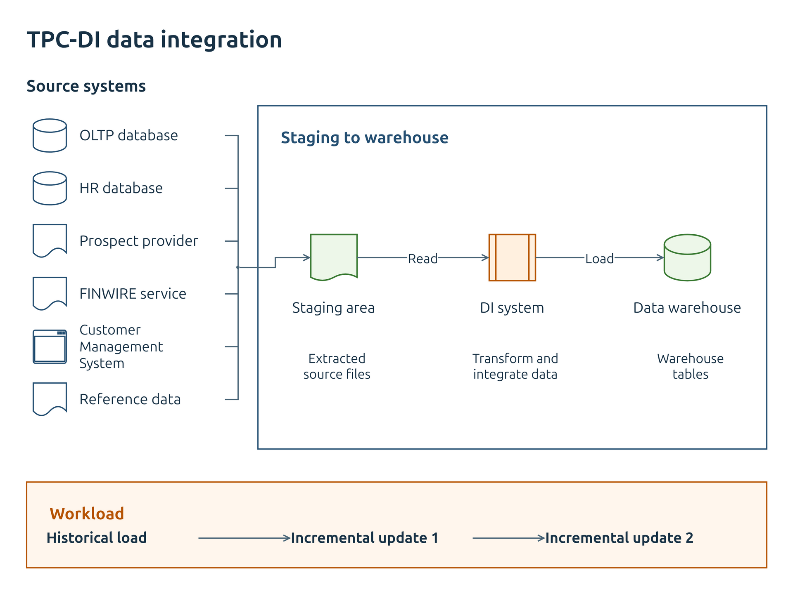
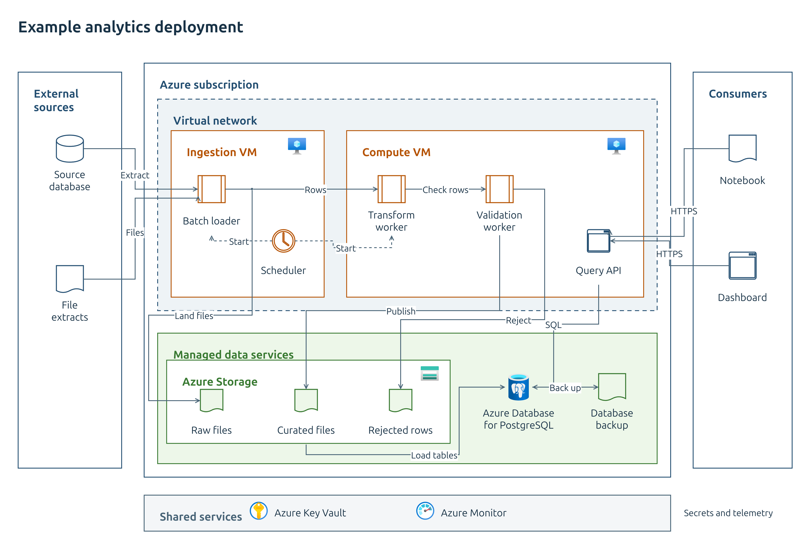
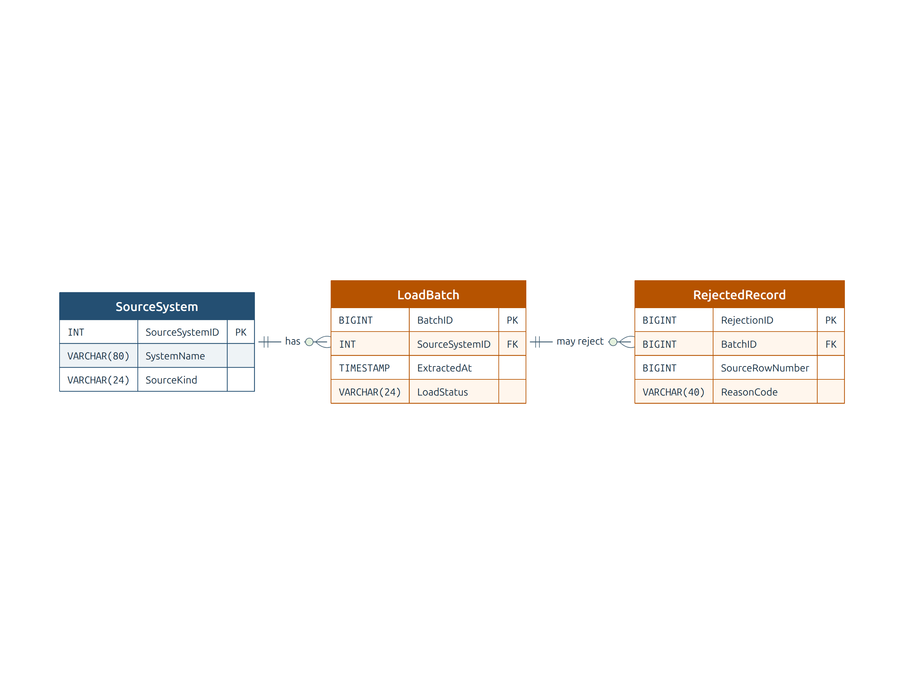

# Diagram Examples

These examples apply the [diagram guide](Diagram-Guide.md) to source flows, deployment scopes, and data relationships. The data-integration view is a `small` draw.io page. The deployment is a `large` 1440 x 960 draw.io page, exported as a 2880 x 1920 PNG. The record relationships are a `medium` Mermaid ERD; the [gold layer ERD](../docs/Data-Specification.md#gold-layer-entity-relationships) is a `large` one. Each PNG has its source beside it, with the same file name.

## Data Integration

This view separates TPC-DI source origins from extracted files, integration work, and warehouse output. The lower band shows the historical load followed by two incremental updates. It summarizes the conceptual environment in Clause 1 of the [TPC-DI specification](../docs/TPC-DI/TPC-DI_v1.1.0.pdf); individual source files and warehouse tables are outside this view.

## Deployment

This illustrative deployment places ingestion and processing on two virtual machines. Solid boundaries show the subscription, machines, and service groups. The dashed boundary names the virtual network. Solid arrows show data or requests; dashed arrows show scheduling. Shared services appear below the main flow. The Azure product icons identify the actual services named in this example.

The diagram illustrates notation and layout. It does not define the coursework architecture, a production deployment recipe, or all required network connections. The batch loader sends rows to the transform worker and keeps raw files. The load from curated files to PostgreSQL summarizes a publishing operation whose implementation is outside this view.

## Data Relationships

This illustrative ERD uses crow's-foot notation. A source system can have zero or more batches. A batch can have zero or more rejected records. Each batch belongs to one source system, and each rejected record belongs to one batch. These example tables do not define the TPC-DI data model.

*Header colors: blue for entities, orange for events.*
